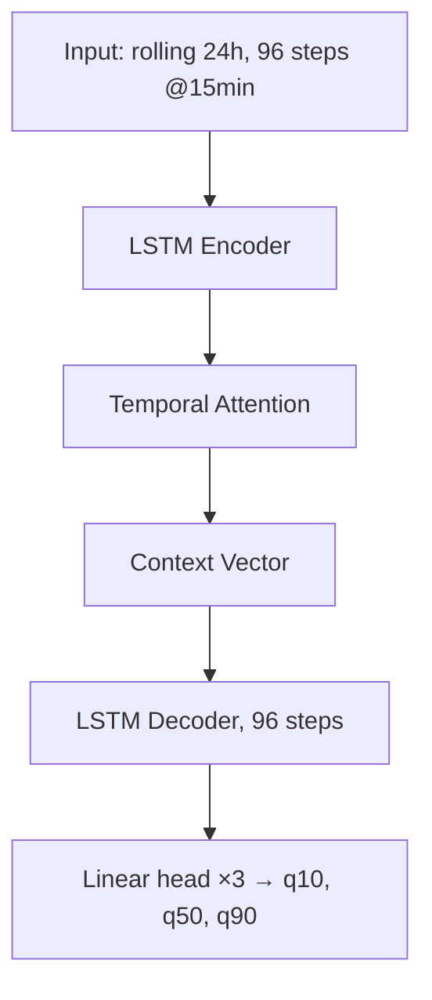

# Layer 3 — AI Inference Module: Detailed Implementation Plan

> **Version:** 3.0 — Closed-loop AI: **2 ML models + 1 DL model**
> **Stack:** Python 3.11 · PyTorch 2.2 (CPU) · XGBoost · Scikit-Learn · FastAPI · Pandas
> **Reference:** [aqss-concept-v2.md](./aqss-concept-v2.md) · [io_contract.md](./io_contract.md)
>
> **V3 changes:** the Autoencoder evaluator is **removed** · `MSE_hour/MSE_day` loss removed (the architecture never had those heads) · `ReLU` on the output layer **removed** (it clipped bounds and faked a CI) · rolling 24h input replaces the 6 AM window · the `reference_window` dead input disappears with the evaluator · evaluation metrics (RMSE/MAE/MAPE vs naive baseline) added.

---

## 1. Executive Summary

Layer 3 hosts the three models that make the closed loop work. None of them is decorative:

| Model | Type | Question it answers | Used by |
| :--- | :--- | :--- | :--- |
| **ML#1 Threshold** | GP Regression | *"What PM2.5 level is unsafe **in this specific space**?"* | `ThresholdService` → cached in `space_thresholds` |
| **ML#2 Dosage** | XGBoost | *"Given this room and this PM2.5 level, what fan level and how long?"* | `ControlDecisionService` on breach |
| **DL Forecast** | Seq2Seq LSTM (quantile) | *"Will this space breach its threshold in the next 24 h?"* | Early warning (q90) + dashboard (q50) |

**Removed from V1:** the Autoencoder evaluator (`/api/v1/evaluate`) and the `assessed_aqi` / `reliability_score` outputs. Sensor-health monitoring is an orthogonal concern, not part of the control thesis — re-adding it later would be a separate module.

---

## 2. Time Windowing (fixed, not variable)

V1 fed `data_since_6am` (up to ~12,960 points at 5 s) **plus** `data_last_hour` (720 points) — a redundant union and an infeasible sequence length. V3 uses a **fixed rolling window**:

$$W_{in} = \{X_\tau \mid \tau \in [T_t - 24h,\; T_t]\} \quad\Rightarrow\quad 96 \text{ steps @ 15-min median resample}$$

- 24 h ÷ 15 min = **96 time steps** — tractable for an LSTM.
- The **backend performs the resampling** (15-minute median, robust to glitches) before calling `/api/v1/forecast` (see `backend-layer.md` §13).
- Output: the **next 24 h** = 96 steps × 3 quantiles.

No variable-length handling, no masking, no 17,280-step sequences.

---

## 3. ML#1 — Threshold Inference (Space → PM2.5 Threshold)

### 3.1 Problem

A supervised regressor that maps space characteristics to the PM2.5 concentration at which intervention should start. **No public dataset labels this** — hence the physics-informed surrogate below.

### 3.2 Physics model that generates labels

$$
V\,\frac{dC}{dt} = P\,C_{out}\,(\lambda_{nat}V) - \big(\lambda_{nat}V + CADR\big)\,C + G
$$

$$
C_{ss} = \frac{P\,C_{out}\,\lambda_{nat}V + G}{\lambda_{nat}V + CADR}
\qquad
t_{clean} = \frac{V}{\lambda_{nat}V + CADR}\,\ln\!\frac{C_0 - C_{ss}}{C_t - C_{ss}}
$$

| Symbol | Meaning | Typical range |
| :--- | :--- | :--- |
| $V$ | Room volume (m³) | 10 – 500 |
| $P$ | Penetration factor | 0.5 – 0.9 |
| $\lambda_{nat}$ | Natural air exchange rate (h⁻¹) | 0.2 – 1.5 |
| $CADR$ | Clean air delivery rate (m³/h) | 30 – 400 |
| $G$ | Indoor generation (µg/h) | 0 – 2,000 |
| $C_{out}$ | Outdoor PM2.5 (µg/m³) | 5 – 200 |

**Standards applied as targets:** WHO 2021 24-h guideline **15 µg/m³**, QCVN 05:2023 24-h **25 µg/m³**, adjusted by exposure duration (sleeping 8 h ⇒ stricter than a 2 h lecture).

### 3.3 Surrogate generation procedure

1. Grid-sample `(volume, purpose, region, ventilation, occupancy)` — ~10,000 combinations.
2. For each, pull the regional outdoor PM2.5 climatology (OpenAQ) and solve the mass-balance for the concentration at which cumulative dose over the occupancy duration exceeds the standard.
3. Emit `(features, threshold)` pairs.
4. Train the surrogate; the model approximates the latent physical parameters ($P$, $\lambda$, $G$) that are expensive to measure, and is **fine-tuned online as real data arrives**.

### 3.4 Model

| Property | Value |
| :--- | :--- |
| Algorithm | **Gaussian Process Regression** (RBF + White kernel) |
| Input features | `volume_m3`, `purpose_encoded`, `region_encoded`, `ventilation_estimate`, `occupancy_typical` |
| Output | `base_threshold_pm25` |
| Uncertainty | GP posterior `±σ` → `uncertainty_lower` / `uncertainty_upper` returned to Layer 2 |

> **Why ML and not the formula?** The formula needs $P$, $\lambda$, $G$ which are unmeasurable per-room. The GP learns the mapping from observable space features, quantifies its own uncertainty, and self-corrects with real data.

```python
from sklearn.gaussian_process import GaussianProcessRegressor
from sklearn.gaussian_process.kernels import RBF, WhiteKernel, ConstantKernel

kernel = ConstantKernel(1.0) * RBF(length_scale=[10.0, 1.0, 1.0, 0.5, 1.0]) + WhiteKernel(0.5)
ml1 = GaussianProcessRegressor(kernel=kernel, normalize_y=True, n_restarts_optimizer=3)
# NOTE: the scaler must be fit on the TRAINING split only (see §6.3).
```

---

## 4. ML#2 — Dosage (Space + Level → Fan Prescription)

| Property | Value |
| :--- | :--- |
| Algorithm | **XGBoost** regressor (multi-output: level + duration) |
| Input features | `volume_m3`, `purpose_encoded`, `current_pm25`, `base_threshold`, `outdoor_pm25_estimate`, `filter_cadr` |
| Output | `filter_level` (0–3), `run_duration_minutes` |
| Labels | Same physics model: the minimum `(level, duration)` pair such that the decay curve reaches $C_t <$ threshold |

`filter_level` maps to fan PWM duty in firmware: **0→0 %, 1→35 %, 2→60 %, 3→90 %**.

```python
import xgboost as xgb

ml2_level = xgb.XGBRegressor(
    n_estimators=400, max_depth=5, learning_rate=0.05,
    objective="reg:squarederror", tree_method="hist",
)
ml2_duration = xgb.XGBRegressor(
    n_estimators=400, max_depth=5, learning_rate=0.05,
    objective="reg:squarederror", tree_method="hist",
)
```

---

## 5. DL — Forecasting Engine (Seq2Seq + Attention, Quantile Output)

### 5.1 Architecture



### 5.2 Attention

$$ u_t = \tanh(W_w h_t + b_w), \qquad \alpha_t = \frac{\exp(u_t^T u_w)}{\sum_t \exp(u_t^T u_w)}, \qquad s = \sum_t \alpha_t h_t $$

### 5.3 PyTorch Implementation

```python
import torch
import torch.nn as nn
import torch.nn.functional as F

class PM25Forecaster(nn.Module):
    """Seq2Seq LSTM + attention with quantile heads.

    V1 BUG FIXED: the old `AQIPredictorWithAttention` applied F.relu() to the
    output of a Linear(hidden, 3) and called it a 95% confidence interval.
    ReLU is not an uncertainty mechanism — it clips valid negative bounds and
    produces a degenerate interval. Quantile heads + quantile loss replace it.
    """

    def __init__(self, input_dim=10, hidden_dim=128, num_layers=2, out_steps=96, dropout=0.3):
        super().__init__()
        self.out_steps = out_steps
        self.encoder = nn.LSTM(input_dim, hidden_dim, num_layers,
                               batch_first=True, dropout=dropout if num_layers > 1 else 0.0)
        self.attn_fc = nn.Linear(hidden_dim, 1)
        self.decoder = nn.LSTM(hidden_dim, hidden_dim, num_layers, batch_first=True)
        self.head = nn.Linear(hidden_dim, 3)          # q10, q50, q90 — RAW, no ReLU

    def forward(self, x):                              # x: (B, 96, input_dim)
        enc_out, _ = self.encoder(x)
        w = F.softmax(self.attn_fc(enc_out), dim=1)    # (B, 96, 1)
        context = torch.sum(w * enc_out, dim=1)        # (B, H)

        dec_in = context.unsqueeze(1).repeat(1, self.out_steps, 1)
        dec_out, _ = self.decoder(dec_in)
        q = self.head(dec_out)                         # (B, 96, 3)

        # Enforce monotonic quantiles at inference: q10 <= q50 <= q90
        q50 = q[..., 1]
        q10 = torch.minimum(q[..., 0], q50)
        q90 = torch.maximum(q[..., 2], q50)
        return torch.stack([q10, q50, q90], dim=-1)
```

### 5.4 Quantile Loss

$$
\mathcal{L}_\tau(y, \hat y) =
\begin{cases}
\tau\,(y - \hat y) & y \ge \hat y\\
(1-\tau)(\hat y - y) & y < \hat y
\end{cases}
\qquad
\mathcal{L} = \mathcal{L}_{0.1} + \mathcal{L}_{0.5} + \mathcal{L}_{0.9}
$$

The decision engine uses **q90** for early warning (safety-critical) and **q50** for display.

> V1's loss referenced `λ₁·MSE_hour + λ₂·MSE_day + λ₃·asym`, but the architecture had a single 24-point output head and no per-hour/per-day heads — the terms were undefined. The quantile sum above is the entire loss; no undefined λ remain.

### 5.5 Planned Multivariate Feature Matrix (versioned contract required)

This is a candidate input matrix for a later forecast contract version. It is **not** the currently implemented Layer 2 → Layer 3 request, which carries only timestamp and PM2.5. Phase A must remain univariate unless a separately versioned request explicitly transmits these aligned features. Do not train with features unavailable at inference time.

| Feature | Type | Notes |
| :--- | :--- | :--- |
| `pm25` | continuous | median-aggregated |
| `hour_sin`, `hour_cos` | cyclical | $\sin/\cos(2\pi h/24)$ |
| `dow_sin`, `dow_cos` | cyclical | day of week |
| `is_weekend` | binary | |
| `pm25_roll_mean_1h` | continuous | 4-step rolling mean |
| `pm25_diff` | continuous | first difference |
| `co2`, `temperature`, `humidity` | continuous | when available |

> `time_since_6am` is **removed** — it belonged to the abandoned 6 AM windowing and wraps incorrectly across midnight.

---

## 6. Training & Validation

### 6.1 Data sources (cold start)

| Dataset | Use | Caveat |
| :--- | :--- | :--- |
| **OpenAQ API v3** (Vietnam / SE Asia) | Candidate ambient PM2.5 context and regional benchmark | Coverage remains unverified because no registered `OPENAQ_API_KEY` was available during the audit. `layer3_ai/data/openaq.py` queries location/sensor metadata; inspect per-provider license, units, cadence and coverage before downloading measurements |
| **UCI Beijing PM2.5 (381)** | PM-only hourly benchmark | Downloaded/audited: 43,824 records (2010–2014), 1 site, 2,067 missing PM2.5 rows (4.72%), 1-hour cadence, CC BY 4.0. Ambient outdoor only; 125 values exceed AQSS sensor-valid 500 µg/m³ range and are retained with quality flags |
| **UCI Beijing Multi-Site (501)** | Multi-site ambient benchmark / site-held-out evaluation | Downloaded/audited: 12 sites, 35,064 hourly records per site (2013–2017), PM2.5 missingness about 1.76–2.72% per site, CC BY 4.0. The UCI archive contains a nested ZIP; the adapter extracts the 12 `PRSA_Data_*` site files and ignores unrelated outer archive CSVs |
| **CAMS global composition** | Potential known-future outdoor context (PM2.5/weather) | Candidate only; ~40 km grid is not indoor ground truth. Convert PM2.5 mass units and preserve forecast origin/valid time; follow Copernicus source/adaptation notice |
| **AQSS telemetry** | Required in-domain validation | No project telemetry export is committed. Use a controlled, anonymized export with sensor/calibration and actuator/intervention metadata when collected |

The initial Layer 3 API contract is **univariate PM2.5** because `ForecastRequest` sends only 96 `{timestamp, pm25}` points at 15-minute cadence. External benchmark sources above are hourly and must be evaluated at their actual hourly cadence; they are **not** upsampled to fabricate 15-minute observations. UCI results test pipeline and ambient forecasting only, not indoor AQSS readiness. No production model or AQSS in-domain validation result exists yet.

`layer3_ai/data/source_registry.json`, `canonical_schema.json`, `uci_inventory.json`, and deterministic adapters record source provenance, license, attribution, native cadence and QC. Raw downloads, Parquet and model weights remain outside Git; scripts/manifests and the small inventory report are tracked. Synthetic threshold/dosage labels are physics-informed surrogates, not measured ground truth.

**Pretrained candidate:** Chronos-2 (`amazon/chronos-2`, 120M) is wired as an optional experimental adapter because its model card supports CPU inference, quantiles and covariates and lists Apache-2.0. It is not loaded by default or considered validated for AQSS. The initial hourly UCI benchmark on Aotizhongxin (168-hour context, 24-hour horizon, 487 rolling origins) gave persistence MAE/RMSE 39.89/47.32 µg/m³ versus seasonal-naive 56.30/66.71; persistence's heuristic q10–q90 interval covered only 50.4%, so it is not calibrated. This is ambient Beijing only and is **not** evidence for indoor AQSS. Compare pretrained models against the same-cadence baselines and temporal/site holdouts. Do not self-host TimesFM 3.0 weights for production under its currently stated non-commercial restriction.

V1 claimed transfer learning from Beijing onto a CO₂-bearing model; that is not possible without feature alignment. V3 states it honestly.

### 6.2 Cross-validation

Rolling origin only — standard K-Fold leaks the future into the past:

```
Fold 1: train [Jan–Mar] test [Apr]
Fold 2: train [Jan–Apr] test [May]
Fold 3: train [Jan–May] test [Jun]
```

### 6.3 Scaling — fit on train only

```python
scaler = RobustScaler().fit(X_train)     # NEVER fit on the full dataset — leakage
X_train_s = scaler.transform(X_train)
X_test_s  = scaler.transform(X_test)     # same scaler object saved with the model
```

V1 shipped "pickled scalers" without constraining the fit split. The scaler artefact is saved **with** the model checkpoint and versioned together.

### 6.4 `config.yaml`

```yaml
experiment_name: "aqss_v3_quantile_seq2seq"
data:
  resample: "15min"          # median aggregation, done by Layer 2 before the call
  seq_length: 96             # 24 h input
  out_steps: 96              # 24 h output
  batch_size: 64
dl_forecast:
  input_dim: 10
  hidden_dim: 128
  num_layers: 2
  dropout: 0.3
  learning_rate: 0.001
  quantiles: [0.1, 0.5, 0.9]
ml1_threshold:
  kernel: "RBF+White"
  n_restarts: 3
ml2_dosage:
  n_estimators: 400
  max_depth: 5
  learning_rate: 0.05
training:
  epochs: 100
  early_stopping_patience: 15
  weight_decay: 1.0e-5
```

### 6.5 Evaluation — the numbers a report needs (NEW)

V1 had no accuracy targets at all. V3 commits to:

| Metric | Target | Baseline |
| :--- | :--- | :--- |
| RMSE (q50) | < 8 µg/m³ | naive persistence (last value repeated) |
| MAE (q50) | < 6 µg/m³ | seasonal-naive (same hour yesterday) |
| MAPE (q50) | < 25 % | naive persistence |
| Interval coverage (q10–q90) | ~80 % of true values inside | — |
| Early-warning precision | > 70 % | — |
| Threshold inference MAE (ML#1) | < 5 µg/m³ vs physics ground truth | rule-based threshold |

Every result is reported **against the naive baselines** — a model is only worth deploying if it beats "repeat the last value".

---

## 7. FastAPI Service

### 7.1 Endpoints

| Endpoint | Model | Input | Output |
| :--- | :--- | :--- | :--- |
| `POST /api/v1/threshold` | ML#1 | Space profile | `{base_threshold_pm25, uncertainty_lower, uncertainty_upper, model_version}` |
| `POST /api/v1/dosage` | ML#2 | Space + current level + threshold | `{filter_level, run_duration_minutes, model_version}` |
| `POST /api/v1/forecast` | DL | 96-step series | 96 steps × `{pm25_q50, pm25_q10, pm25_q90}` |

`/api/v1/evaluate` **removed** (Autoencoder). `/api/v1/predict` **renamed** to `/api/v1/forecast`.

### 7.2 Schemas

```python
from fastapi import FastAPI, HTTPException
from pydantic import BaseModel, Field

app = FastAPI(title="AQSS AI Inference API", version="3.0")

class SpaceProfile(BaseModel):
    space_id: str
    volume_m3: float = Field(..., gt=0)
    purpose: str
    region: str
    ventilation_estimate: str
    occupancy_typical: int = Field(..., ge=0)

class DosageRequest(BaseModel):
    space_id: str
    volume_m3: float = Field(..., gt=0)
    purpose: str
    current_pm25: float = Field(..., ge=0.0, le=750.0)   # GP2Y1023 saturation limit
    base_threshold: float = Field(..., ge=0.0)
    outdoor_pm25_estimate: float = Field(..., ge=0.0)
    filter_cadr: float = Field(..., gt=0)

class SeriesPoint(BaseModel):
    timestamp: str
    pm25: float = Field(..., ge=0.0, le=750.0)           # V1 allowed 2000 — beyond the sensor

class ForecastRequest(BaseModel):
    space_id: str
    series: list[SeriesPoint]                            # exactly 96 entries, validated

@app.post("/api/v1/forecast")
async def forecast(req: ForecastRequest):
    if len(req.series) != 96:
        raise HTTPException(400, "series must contain exactly 96 points (24h @ 15min)")
    return {"space_id": req.space_id, "status": "success",
            "forecast_sequence": infer_forecast(req.series)}
```

> Pydantic ranges now match `io_contract.md` §12 exactly (V1 had three conflicting sets, e.g. temperature `[-20, 80]` here vs `[-10, 60]` on the device).

---

## 8. Project Structure

```text
layer3_dl/
├── data/
│   ├── raw/                  # OpenAQ / UCI dumps
│   └── processed/            # resampled, windowed, scaled
├── models/
│   ├── forecaster_v3.pt      # DL weights + quantile head
│   ├── ml1_threshold.pkl     # GP + scaler artefacts (versioned together)
│   ├── ml2_dosage.json       # XGBoost models (level, duration)
│   └── scalers.pkl           # fit on TRAIN ONLY
├── src/
│   ├── data_pipeline.py      # fetch, resample, label generation (physics surrogate)
│   ├── physics_labels.py     # mass-balance label generator for ML#1/ML#2 (NEW)
│   ├── model_forecaster.py   # Seq2Seq LSTM definition
│   ├── model_tabular.py      # GP + XGBoost definitions (NEW)
│   └── train.py              # rolling-origin CV, early stopping, artefact export
├── api/
│   ├── main.py               # FastAPI entry point
│   ├── schemas.py            # Pydantic models
│   └── inference.py          # model loading + forward passes
├── notebooks/EDA.ipynb
├── Dockerfile
├── requirements.txt
└── config.yaml
```

---

## 9. Deployment (CPU-only)

| Resource | Requirement | Rationale |
| :--- | :--- | :--- |
| Compute | CPU (AVX2+) | One forecast per space per hour — GPU is unnecessary |
| RAM | 2 GB min | PyTorch + weights ≈ 800 MB |
| Storage | 10 GB | Datasets, checkpoints, image layers |

```dockerfile
FROM python:3.11-slim
WORKDIR /app

RUN apt-get update && apt-get install -y --no-install-recommends build-essential \
    && rm -rf /var/lib/apt/lists/*

# V1 BUG FIXED: install torch from the CPU index FIRST and pin it in
# requirements.txt (torch==2.2.*), otherwise `pip install -r requirements.txt`
# silently re-installs the CUDA build (+2 GB image bloat).
COPY requirements.txt .
RUN pip install --no-cache-dir torch==2.2.* --index-url https://download.pytorch.org/whl/cpu
RUN pip install --no-cache-dir -r requirements.txt

COPY . .
EXPOSE 8000
CMD ["uvicorn", "api.main:app", "--host", "0.0.0.0", "--port", "8000", "--workers", "1"]
```

`requirements.txt` (excerpt — note the pinned torch):

```
fastapi==0.111.*
uvicorn==0.30.*
pandas==2.2.*
scikit-learn==1.5.*
xgboost==2.1.*
torch==2.2.*          # installed from the CPU index in the Dockerfile
pydantic==2.*
```

---

## 10. Integration with Layer 2

1. **Trigger:** Layer 2 cron fires hourly (`aqss.control.forecast-cron`).
2. **Fetch:** Layer 2 runs the 15-min median SQL (§13 of `backend-layer.md`) → exactly 96 points.
3. **Call:** `POST /api/v1/forecast` (30 s timeout). Threshold/dosage are called on space-create and on breach respectively.
4. **Persist:** Layer 2 stores the 96×3 JSON in `predictions.forecast_data`.
5. **Broadcast:** STOMP `/topic/spaces/{id}/decision` + dashboard chart.
6. **Fallback:** if Layer 3 times out, Layer 2 serves "Prediction Unavailable" and the loop degrades to rule-based thresholds — never a 500 to the user.

---

## 11. Pre-Deployment Verification Checklist

- [ ] Rolling-origin CV only — no temporal leakage.
- [ ] `RobustScaler` fitted on the training split; scaler versioned with the checkpoint.
- [ ] Quantile monotonicity holds at inference (q10 ≤ q50 ≤ q90) — no `ReLU` on outputs.
- [ ] q90 early-warning precision > 70 % on the validation fold.
- [ ] RMSE(q50) beats naive persistence and seasonal-naive baselines.
- [ ] ML#1 MAE < 5 µg/m³ against the physics ground truth; GP uncertainty band is non-degenerate.
- [ ] `/api/v1/forecast` rejects a series of any length other than 96.
- [ ] Pydantic bounds match `io_contract.md` §12 exactly.
- [ ] Docker image < 1.5 GB (CUDA build excluded — check `pip list` inside the image).
- [ ] Layer 2 handles an AI timeout gracefully (rule-based fallback).
