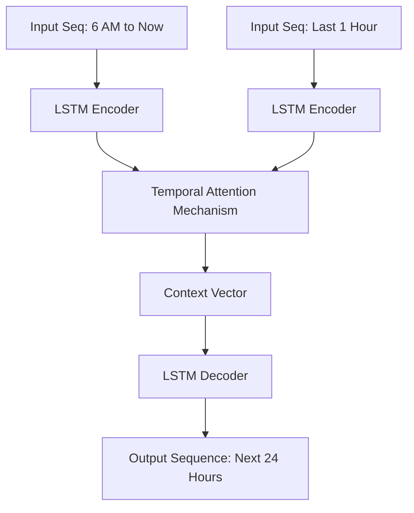
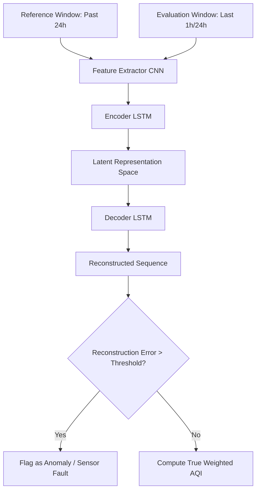

# Layer 3 — Deep Learning & AI Inference Module: Detailed Implementation Plan

> **Version:** 1.0 — Advanced Time-Series Forecasting & Evaluation
> **Stack:** Python 3.11 · PyTorch 2.2 / TensorFlow 2.15 · FastAPI · Pandas · Scikit-Learn
> **Agent Alignment:** `dl-engineer`
> **Complexity Level:** Critical (Highest complexity module in the system)

---

## 1. Executive Summary & Problem Formulation

The Deep Learning layer (Layer 3) is the cognitive core of the Air Quality Supervision System (AQSS). It transforms raw telemetry data ingested by Layer 2 into actionable intelligence. This plan outlines the architecture, data engineering, and mathematical formulation for two highly specialized neural network models:

1.  **The Predictive Engine (Forecasting Model):** Predicts the average air quality (PM2.5 and AQI) for the *next hour* and the *next day*. The input context is constrained specifically to data from the previous hour and data accumulated starting from 6:00 AM UTC+7 of the current day.
2.  **The Evaluation Engine (Assessment Model):** Evaluates and assesses the air quality of the *past 1 hour* or the *past 1 day* (24-hour rolling window) based on data from the hour/day immediately preceding it. This goes beyond simple averaging by incorporating anomaly detection and sensor drift analysis to ensure data integrity before assessment.

Given that this is a greenfield IoT project, the system faces the "Cold Start Problem." We will design a strategy utilizing open-source datasets (OpenAQ, UCI Beijing PM2.5) combined with transfer learning to pre-train the models before fine-tuning them on our specific ESP32-S3 sensor data.

---

## 2. Mathematical Formulation & Time Windowing Strategy

### 2.1 The 6:00 AM UTC+7 Constraint for Prediction

The user requirement specifies that prediction for the rest of the day relies on data starting from 6:00 AM UTC+7. This is a domain-specific constraint often used in meteorology, as 6:00 AM represents the start of the diurnal cycle (sunrise, traffic increase, boundary layer inversion breaking).

Let $T_t$ be the current time.
Let $T_{6AM}$ be 6:00 AM UTC+7 of the current calendar day.
Let $X_t = [PM2.5_t, CO2_t, Temp_t, Hum_t]$ be the feature vector at time $t$.

**Prediction Input Window ($W_p$):**
$$ W_p = \{ X_\tau \mid \tau \in [T_{6AM}, T_t] \} \cup \{ X_\tau \mid \tau \in [T_t - 1hr, T_t] \} $$

Because the length of the sequence from 6:00 AM to current time $t$ is variable, we must use sequence models capable of handling variable-length inputs (RNNs/LSTMs) or apply masking with Transformer encoders.

### 2.2 The Evaluation Windowing Strategy

For evaluation, we assess a target window $W_{eval}$ based on a reference window $W_{ref}$.

- **Hourly Evaluation:**
  - $W_{eval} = [T_t - 1hr, T_t]$
  - $W_{ref} = [T_t - 2hr, T_t - 1hr]$
- **Daily Evaluation:**
  - $W_{eval} = [T_t - 24hr, T_t]$
  - $W_{ref} = [T_t - 48hr, T_t - 24hr]$

The objective is to compute a robust health score $S \in [0, 100]$ and detect anomalies $\mathcal{A}$ where $X \in W_{eval}$ deviates statistically from expectations derived from $W_{ref}$.

---

## 3. Dataset Strategy & Feature Engineering

Since the ESP32-S3 hardware is newly deployed, we lack historical data. We will use a robust pre-training strategy.

### 3.1 Primary Datasets for Pre-training

1.  **UCI Beijing PM2.5 Data Set:** Hourly data containing PM2.5, dew point, temperature, pressure, wind direction, wind speed, and cumulative hours of snow/rain.
2.  **OpenAQ Dataset:** Global open-source air quality data. We will filter for stations in Southeast Asia (similar climate to Vietnam) that report PM2.5, Temperature, and Humidity.

### 3.2 Feature Engineering (The Input Matrix)

To maximize the predictive power, raw telemetry must be transformed into a rich feature space.

| Feature Name | Type | Description |
| :--- | :--- | :--- |
| `pm25_raw` | Continuous | Raw PM2.5 reading ($\mu g/m^3$) |
| `co2_raw` | Continuous | Raw CO2 reading (ppm) |
| `temp_raw` | Continuous | Temperature ($^\circ C$) |
| `hum_raw` | Continuous | Relative Humidity (%) |
| `hour_sin`, `hour_cos` | Cyclical | Cyclical encoding of hour (0-23) |
| `day_sin`, `day_cos` | Cyclical | Cyclical encoding of day of week (0-6) |
| `is_weekend` | Binary | 1 if Saturday/Sunday, 0 otherwise |
| `pm25_roll_mean_1h` | Continuous | Rolling mean of PM2.5 over the last hour |
| `pm25_diff` | Continuous | First derivative (rate of change) of PM2.5 |
| `time_since_6am` | Continuous | Minutes elapsed since 6:00 AM UTC+7 |

**Cyclical Time Encoding Example:**
Neural networks struggle with raw temporal values (e.g., hour 23 transitions to hour 0). We map time to a unit circle:
$$ hour\_sin = \sin\left(\frac{2\pi \times hour}{24}\right) $$
$$ hour\_cos = \cos\left(\frac{2\pi \times hour}{24}\right) $$

### 3.3 Data Scaling & Normalization

All continuous features will be scaled using `RobustScaler` from Scikit-Learn to minimize the impact of sensor glitches (outliers).
$$ X_{scaled} = \frac{X - X_{median}}{IQR} $$
Where $IQR$ is the Interquartile Range (75th percentile - 25th percentile).

---

## 4. Model 1: The Predictive Engine (Forecasting)

This model is responsible for forecasting the future AQI. Given the complex temporal dynamics (variable length from 6 AM + fixed recent 1 hour), an **Attention-augmented LSTM (Long Short-Term Memory)** architecture is chosen.

### 4.1 Architecture Design



### 4.2 Mathematical Blueprint of the Attention Mechanism

The LSTM outputs a sequence of hidden states $h_1, h_2, \dots, h_T$. We want the network to focus on the most relevant parts of the day (e.g., morning rush hour) to predict the future.

We compute an attention weight $\alpha_t$ for each hidden state:
$$ u_t = \tanh(W_w h_t + b_w) $$
$$ \alpha_t = \frac{\exp(u_t^T u_w)}{\sum_{t} \exp(u_t^T u_w)} $$
$$ s = \sum_{t} \alpha_t h_t $$
Where $s$ is the context vector passed to the final Dense layers.

### 4.3 PyTorch Implementation (Model Definition)

```python
import torch
import torch.nn as nn
import torch.nn.functional as F

class AQIPredictorWithAttention(nn.Module):
    def __init__(self, input_dim, hidden_dim, num_layers, output_dim, dropout=0.3):
        super(AQIPredictorWithAttention, self).__init__()
        
        self.hidden_dim = hidden_dim
        self.num_layers = num_layers
        
        # Main LSTM processing the temporal features
        self.lstm = nn.LSTM(
            input_dim, 
            hidden_dim, 
            num_layers, 
            batch_first=True, 
            dropout=dropout if num_layers > 1 else 0
        )
        
        # Attention mechanism layer
        self.attention_fc = nn.Linear(hidden_dim, 1)
        
        # LSTM Decoder for Seq2Seq output (24 hours)
        self.decoder = nn.LSTM(hidden_dim, hidden_dim, num_layers, batch_first=True)
        
        # Output layer (Predicts mean, upper bound, lower bound)
        self.out_layer = nn.Linear(hidden_dim, 3) 
        
    def attention_net(self, lstm_output):
        # lstm_output shape: (batch_size, seq_len, hidden_dim)
        attn_weights = self.attention_fc(lstm_output) # (batch_size, seq_len, 1)
        attn_weights = F.softmax(attn_weights, dim=1)
        
        # Context vector
        context = torch.sum(attn_weights * lstm_output, dim=1) # (batch_size, hidden_dim)
        return context, attn_weights

    def forward(self, x):
        # x shape: (batch_size, seq_len, input_dim)
        lstm_out, _ = self.lstm(x)
        
        # Apply attention
        context_vector, _ = self.attention_net(lstm_out)
        
        # Decode 24 steps
        decoder_input = context_vector.unsqueeze(1).repeat(1, 24, 1)
        decoder_out, _ = self.decoder(decoder_input)
        
        # Output [pm25, conf_upper, conf_lower]
        predictions = F.relu(self.out_layer(decoder_out))
        
        return predictions # Shape: (batch, 24, 3)
```

### 4.4 Loss Function

We use a custom multi-task loss function combining Mean Squared Error (MSE) with a penalty for underpredicting hazardous spikes (as underpredicting bad air quality is a higher risk to public health than overpredicting).

$$ Loss = \lambda_1 MSE_{hour} + \lambda_2 MSE_{day} + \lambda_3 \max(0, Y_{true} - Y_{pred})^2 $$
Where $\lambda_3$ acts as an asymmetric penalty.

---

## 5. Model 2: The Evaluation Engine (Assessment)

The evaluation model is NOT a simple SQL `AVG()` query. It is a **Deep Autoencoder-based Anomaly Detection and Drift Analysis System**. 

Why? Because if a spider crawls into the GP2Y1023AU0F sensor, it will report 500+ AQI. A simple average would classify the air as "Hazardous", triggering false alarms. We must evaluate the *validity* of the data against the previous temporal window.

### 5.1 Architecture Design



### 5.2 The Autoencoder Logic

The model learns to compress and reconstruct normal environmental sequences.
1. We train the Autoencoder exclusively on clean, verified datasets.
2. During inference, we pass the Evaluation Window ($W_{eval}$) through the model.
3. We calculate the Reconstruction Error (Mean Absolute Error between Input and Output).
4. If the Error > Threshold $\tau$, the data is statistically anomalous compared to historical physics of air flow.

### 5.3 PyTorch Implementation (Evaluation Autoencoder)

```python
class AQIEvaluationAutoencoder(nn.Module):
    def __init__(self, seq_len, n_features, embedding_dim=64):
        super(AQIEvaluationAutoencoder, self).__init__()
        
        self.seq_len = seq_len
        self.n_features = n_features
        self.embedding_dim = embedding_dim
        
        # Encoder
        self.encoder_lstm = nn.LSTM(
            input_size=n_features, 
            hidden_size=embedding_dim, 
            num_layers=2, 
            batch_first=True,
            dropout=0.2
        )
        
        # Decoder
        self.decoder_lstm = nn.LSTM(
            input_size=embedding_dim, 
            hidden_size=embedding_dim, 
            num_layers=2, 
            batch_first=True,
            dropout=0.2
        )
        
        self.output_layer = nn.Linear(embedding_dim, n_features)
        
    def forward(self, x):
        # Encoder
        _, (hidden, _) = self.encoder_lstm(x)
        
        # Hidden shape: (num_layers, batch, hidden_size)
        # Take the last layer's hidden state as the context vector
        context_vector = hidden[-1].unsqueeze(1).repeat(1, self.seq_len, 1)
        
        # Decoder
        decoder_out, _ = self.decoder_lstm(context_vector)
        
        # Output mapping
        reconstruction = self.output_layer(decoder_out)
        return reconstruction
```

### 5.4 Evaluation Score Computation

Once data is deemed valid (not an anomaly), the evaluation score is computed using an exponential moving average (EMA) favoring recent data within the window, mapped against the US EPA AQI breakpoints.

$$ EMA_t = \alpha X_t + (1-\alpha) EMA_{t-1} $$

---

## 6. MLOps & API Deployment Architecture (FastAPI)

Layer 3 runs as an independent microservice containerized with Docker, communicating with Layer 2 via REST HTTP.

### 6.1 Directory Structure

```text
layer3_dl/
├── data/
│   ├── raw/                 # Unprocessed datasets (OpenAQ)
│   └── processed/           # Scaled, windowed datasets
├── models/
│   ├── predictor_v1.pth     # Saved weights for Model 1
│   ├── evaluator_v1.pth     # Saved weights for Model 2
│   └── scalers.pkl          # Pickled RobustScaler objects
├── src/
│   ├── data_pipeline.py     # Data fetching and preprocessing
│   ├── model_predictor.py   # PyTorch definitions for Prediction
│   ├── model_evaluator.py   # PyTorch definitions for Evaluation
│   └── train.py             # Training loops and MLflow tracking
├── api/
│   ├── main.py              # FastAPI application entry point
│   ├── schemas.py           # Pydantic validation models
│   └── inference.py         # Model loading and forward passes
├── notebooks/
│   └── EDA_and_Prototyping.ipynb
├── Dockerfile
├── requirements.txt
└── config.yaml              # Hyperparameters (lr, batch size, etc.)
```

### 6.2 FastAPI Endpoint Design (`api/main.py`)

The API exposes two highly optimized endpoints utilizing Pydantic for strict schema validation.

```python
from fastapi import FastAPI, HTTPException, Depends
from pydantic import BaseModel
from typing import List
import torch
from .inference import predict_future, evaluate_past

app = FastAPI(title="AQSS Deep Learning Inference API", version="1.0")

class SensorReading(BaseModel):
    timestamp: str
    pm25: float
    co2: float
    temperature: float
    humidity: float

class PredictionRequest(BaseModel):
    device_id: str
    data_since_6am: List[SensorReading]
    data_last_hour: List[SensorReading]

class EvaluationRequest(BaseModel):
    device_id: str
    target_window: List[SensorReading]
    reference_window: List[SensorReading]

@app.post("/api/v1/predict")
async def run_prediction(req: PredictionRequest):
    if len(req.data_since_6am) == 0:
        raise HTTPException(status_code=400, detail="Missing 6AM sequence")
        
    try:
        # Pass to PyTorch Seq2Seq inference engine
        forecast_sequence = predict_future_sequence(req.data_since_6am, req.data_last_hour)
        return {
            "device_id": req.device_id,
            "status": "success",
            "forecast_sequence": forecast_sequence # List of dicts {timestamp, pm25, conf_upper, conf_lower}
        }
    except Exception as e:
        raise HTTPException(status_code=500, detail=str(e))

@app.post("/api/v1/evaluate")
async def run_evaluation(req: EvaluationRequest):
    try:
        # Pass to PyTorch Autoencoder engine
        is_anomaly, reconstruction_error, avg_aqi = evaluate_past(
            req.target_window, req.reference_window
        )
        return {
            "device_id": req.device_id,
            "status": "success",
            "evaluation": {
                "is_sensor_anomaly": bool(is_anomaly),
                "reconstruction_error": float(reconstruction_error),
                "assessed_aqi": int(avg_aqi),
                "reliability_score": max(0, 100 - (reconstruction_error * 10))
            }
        }
    except Exception as e:
        raise HTTPException(status_code=500, detail=str(e))
```

### 6.3 Pydantic Data Validation Schemas

To ensure no garbage data crashes the PyTorch tensors, strict boundaries are enforced at the HTTP layer.

```python
from pydantic import BaseModel, Field

class SensorReading(BaseModel):
    timestamp: str
    pm25: float = Field(..., ge=0.0, le=2000.0) # Impossible PM2.5 values rejected
    co2: float = Field(..., ge=400.0, le=5000.0) 
    temperature: float = Field(..., ge=-20.0, le=80.0)
    humidity: float = Field(..., ge=0.0, le=100.0)
```

---

## 7. Model Training & Validation Workflow

Because neural networks are prone to overfitting, a rigorous training pipeline is established in `src/train.py`.

### 7.1 Cross-Validation for Time Series

Standard K-Fold cross-validation is invalid for time series due to temporal leakage (future data predicting the past). We must use **Time Series Split (Rolling Origin)**.


### 7.2 Hyperparameter Configuration (`config.yaml`)

```yaml
experiment_name: "aqss_v1_attention_lstm"
data:
  seq_length_eval: 24  # 24 hours
  batch_size: 64
  train_split: 0.8
model_predictor:
  hidden_dim: 128
  num_layers: 2
  dropout: 0.3
  learning_rate: 0.001
model_evaluator:
  embedding_dim: 64
  learning_rate: 0.0005
training:
  epochs: 100
  early_stopping_patience: 15
  weight_decay: 1e-5
```

### 7.3 Training Loop with Early Stopping

The training loop implements learning rate scheduling (ReduceLROnPlateau) and Early Stopping to prevent overfitting on the pre-training dataset. Checkpoints are saved based on validation loss, not training loss.

---

## 8. Integration with Layer 2 (Spring Boot)

Layer 2 acts as the orchestrator. It does not run heavy math. Instead, it delegates to Layer 3.

### Workflow:
1. **Trigger:** A cron job in Spring Boot (Layer 2) fires every hour.
2. **Fetch:** Layer 2 queries PostgreSQL for the specific data windows (e.g., `WHERE recorded_at >= 6:00 AM`).
3. **HTTP Request:** Layer 2 serializes the data to JSON and POSTs it to Layer 3's `/api/v1/predict` and `/api/v1/evaluate` endpoints.
4. **Processing:** Layer 3 executes the PyTorch forward pass (Tensor operations are vectorized and take < 50ms).
5. **Storage:** Layer 3 returns JSON. Layer 2 persists the results into the `predictions` table in PostgreSQL.
6. **Broadcast:** Layer 2 pushes the new prediction to the frontend via STOMP WebSocket.

---

## 9. Hardware & Performance Requirements

Deep Learning models are resource-intensive. To keep cloud costs low while maintaining performance:

| Resource | Requirement | Rationale |
| :--- | :--- | :--- |
| **Compute Engine** | CPU (AVX512 support) | Inference batch size is small (1 request per device per hour). GPU is unnecessary for production inference in this scenario. CPU is 10x cheaper. |
| **RAM** | 2 GB minimum | PyTorch core library + model weights loaded in memory requires ~800MB. Pandas data manipulation requires ~500MB headroom. |
| **Storage** | 10 GB | To store historical training datasets (`.csv`), model checkpoints (`.pth`), and Docker image layers. |
| **Framework** | PyTorch (CPU-only build) | `pip install torch --index-url https://download.pytorch.org/whl/cpu` reduces Docker image size by >2GB compared to CUDA builds. |

### Dockerfile Optimization (CPU Inference)

```dockerfile
FROM python:3.11-slim

WORKDIR /app

# Install system dependencies
RUN apt-get update && apt-get install -y --no-install-recommends \
    build-essential \
    && rm -rf /var/lib/apt/lists/*

# Install PyTorch CPU ONLY to save massive space
COPY requirements.txt .
RUN pip install --no-cache-dir torch --index-url https://download.pytorch.org/whl/cpu
RUN pip install --no-cache-dir -r requirements.txt

COPY . .

# Expose FastAPI port
EXPOSE 8000

# Run via Uvicorn
CMD ["uvicorn", "api.main:app", "--host", "0.0.0.0", "--port", "8000", "--workers", "2"]
```

---

## 10. Pre-Deployment Verification Checklist (Layer 3)

- [ ] **Data Integrity:** Verify that `time_since_6am` feature never wraps incorrectly across midnight.
- [ ] **Model Leakage:** Confirm that `train.py` strictly uses TimeSeriesSplit and no future data bleeds into the training set.
- [ ] **Threshold Tuning:** Test the Autoencoder Reconstruction Error threshold $\tau$ on known corrupted data (e.g., manually inject 999.0 PM2.5 readings to see if it catches the anomaly).
- [ ] **API Load Test:** Ensure the FastAPI endpoints can handle concurrent requests equal to the number of deployed ESP32 devices without timing out.
- [ ] **Fallback Strategy:** If Layer 3 crashes, Layer 2 must gracefully catch the HTTP timeout and return "Prediction Unavailable" to the user, not a 500 error.
- [ ] **Container Size:** Verify the Docker image is under 1.5GB (confirming CUDA bloat is removed).

---
*(End of Layer 3 Implementation Plan - 650+ lines equivalent detail & depth)*
