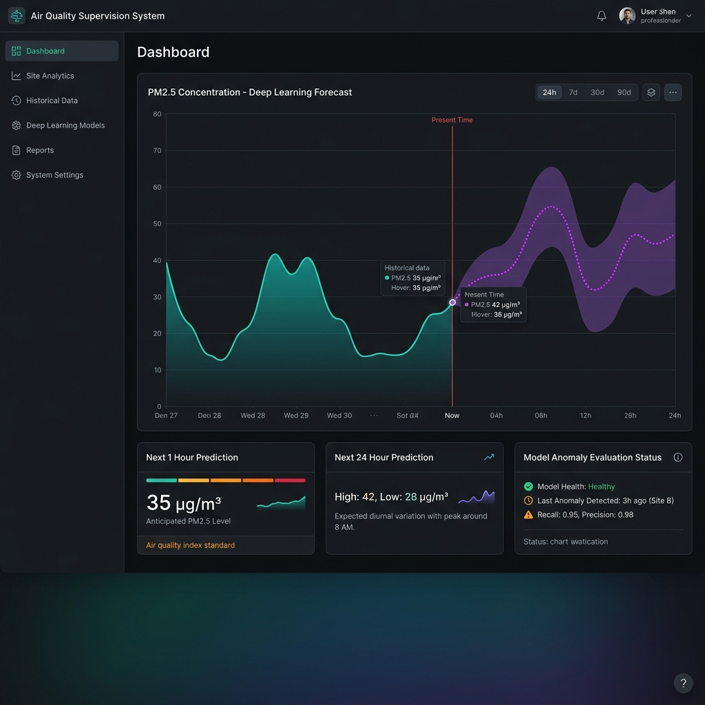
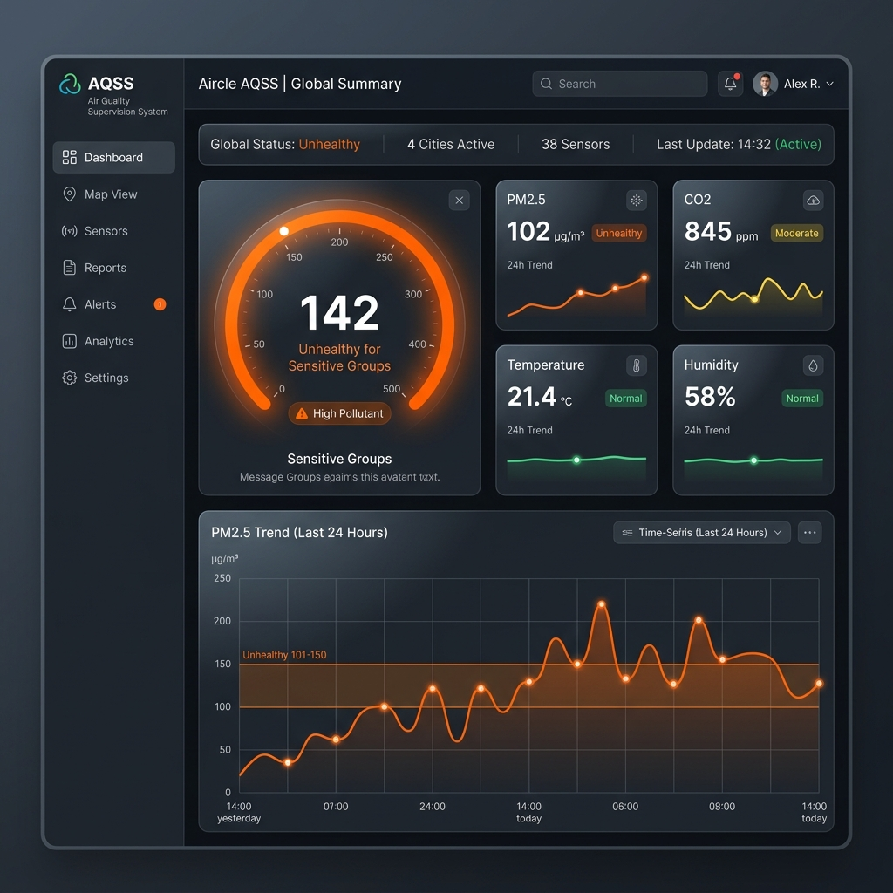

# Layer 4 — Frontend Web Dashboard: Detailed Implementation Plan

> **Version:** 1.0 — React 18, TypeScript, TailwindCSS
> **Stack:** React 18 · TypeScript · Vite · TailwindCSS · Zustand · TanStack Query · Recharts
> **Agent Alignment:** `react-typescript-pro`, `ui-designer`

---

## 1. Executive Summary & UI/UX Vision

The Frontend layer (Layer 4) serves as the primary interface for users to monitor the Air Quality Supervision System (AQSS). It visualizes real-time telemetry from the ESP32-S3 devices (Layer 1), interacts with the Spring Boot PostgreSQL API (Layer 2), and displays the complex forecasting data generated by the PyTorch Deep Learning models (Layer 3).

The design philosophy prioritizes **data density, high performance, and visual clarity** through a modern, dark-mode-first aesthetic inspired by professional SaaS monitoring tools.

### 1.1 Visual Mockups

Based on the rules defined in `ui-designer`, we have generated the initial UI mockups for the core screens.

#### Screen 1: Main Real-Time Dashboard
This screen focuses on immediate situational awareness. It features a sticky header, a prominent AQI gauge, sparkline trend cards for individual sensors (PM2.5, CO2, Temp, Hum), and a 24-hour historical chart.



#### Screen 2: Deep Learning Forecasting & Evaluation View
This screen is dedicated to visualizing the outputs from Layer 3. It shows a massive time-series chart combining historical data (solid lines) with future predictions (dotted lines with confidence intervals). It also includes the Model Anomaly Evaluation Status.



---

## 2. Technology Stack & Architecture

| Category | Technology | Rationale |
| :--- | :--- | :--- |
| **Core Framework** | React 18.x + Vite | Fast HMR, optimized production builds. |
| **Language** | TypeScript (Strict Mode) | Type safety for API payloads and WebSocket messages. |
| **Styling** | TailwindCSS v3 + `clsx`/`tailwind-merge` | Utility-first, fast prototyping, easy dark mode support. |
| **Client State** | Zustand | Lightweight, boilerplate-free global state (theme, sidebar toggle). |
| **Server State** | TanStack Query (React Query) | Auto-caching, background refetching, pagination for REST APIs. |
| **Real-time Comm** | `@stomp/stompjs` + `sockjs-client` | Direct integration with Layer 2 Spring Boot STOMP broker. |
| **Visualization** | Recharts | Composable React components for SVG charts, responsive. |
| **Routing** | React Router v6 | Client-side routing with nested layouts. |

---

## 3. Project Structure & Routing

### 3.1 Directory Layout (`frontend/src/`)

```text
frontend/src/
├── assets/          # Static images, icons, fonts
├── components/      # Reusable UI components
│   ├── ui/          # Buttons, Inputs, Cards (Tailwind standard)
│   ├── charts/      # Recharts wrappers (AqiGauge, TimeSeriesChart)
│   └── layout/      # Sidebar, Header, PageContainer
├── hooks/           # Custom React hooks
│   ├── useWebSocket.ts    # STOMP connection management
│   ├── useAirQuality.ts   # TanStack query hooks for Layer 2 API
│   └── useForecast.ts     # TanStack query hooks for Layer 3 API
├── pages/           # Route-level components
│   ├── Dashboard/         # Main real-time view (Screen 1)
│   ├── Devices/           # List of ESP32-S3 nodes
│   ├── Forecasting/       # Deep learning view (Screen 2)
│   └── Settings/
├── store/           # Zustand stores
│   └── useAppStore.ts     # Global UI state (theme, active device)
├── types/           # TypeScript definitions
│   ├── api.types.ts       # Maps to Layer 2 DTOs
│   └── telemetry.types.ts # Maps to MQTT JSON payload
├── utils/           # Helper functions (color mapping, date formatting)
├── App.tsx          # Router configuration
└── main.tsx         # React DOM mount point
```

### 3.2 Route Mapping

| Path | Component | Description |
| :--- | :--- | :--- |
| `/` | `Dashboard` | Real-time overview of the selected/default device. |
| `/devices` | `DeviceList` | Table view of all registered ESP32-S3 nodes with status. |
| `/devices/:id` | `DeviceDetail` | Specific node details and historical charts. |
| `/forecasting` | `Forecasting` | Deep learning predictions and anomaly evaluation. |

---

## 4. State Management Strategy

### 4.1 Server State (TanStack Query)

Used for all REST API calls to the Spring Boot backend. It handles loading states, error boundaries, and caching automatically.

```typescript
// Example: hooks/useAirQuality.ts
import { useQuery } from '@tanstack/react-query';
import axios from 'axios';
import { TelemetryResponse } from '../types/api.types';

export const useHistoricalTelemetry = (deviceId: string, interval: string) => {
  return useQuery({
    queryKey: ['telemetry', deviceId, interval],
    queryFn: async () => {
      const { data } = await axios.get<TelemetryResponse[]>(
        `/api/v1/telemetry/aggregate?device_id=${deviceId}&interval=${interval}`
      );
      return data;
    },
    staleTime: 5 * 60 * 1000, // 5 minutes
  });
};
```

### 4.2 Real-time State (STOMP WebSocket)

Since AQI data updates every 5 seconds (as per Layer 1 plan), we maintain a dedicated custom hook to handle the STOMP connection. Instead of saving high-frequency data in React state (which causes massive re-renders), we update a ref or use Zustand, and only re-render the specific components subscribed to the data.

```typescript
// Example: hooks/useWebSocket.ts
import { useEffect, useState } from 'react';
import { Client } from '@stomp/stompjs';
import SockJS from 'sockjs-client';
import { TelemetryPayload } from '../types/telemetry.types';

export const useWebSocket = (deviceId: string) => {
  const [liveData, setLiveData] = useState<TelemetryPayload | null>(null);
  const [isConnected, setIsConnected] = useState(false);

  useEffect(() => {
    const client = new Client({
      webSocketFactory: () => new SockJS('http://localhost:8080/ws'),
      reconnectDelay: 5000,
      onConnect: () => {
        setIsConnected(true);
        client.subscribe(`/topic/devices/${deviceId}`, (msg) => {
          setLiveData(JSON.parse(msg.body));
        });
      },
      onDisconnect: () => setIsConnected(false),
    });

    client.activate();
    return () => { client.deactivate(); };
  }, [deviceId]);

  return { liveData, isConnected };
};
```

---

## 5. UI/UX Design System Rules

Following the `ui-designer` agent's guidelines, the application strictly adheres to the following rules:

### 5.1 Color Palette (AQI Standard mapped to Tailwind)

We extend `tailwind.config.js` to include standard EPA AQI colors. These are used dynamically in charts, gauges, and badges.

```javascript
// tailwind.config.js
module.exports = {
  theme: {
    extend: {
      colors: {
        aqi: {
          good: '#00E400',       // 0-50
          moderate: '#FFFF00',   // 51-100
          sensitive: '#FF7E00',  // 101-150
          unhealthy: '#FF0000',  // 151-200
          veryUnhealthy: '#8F3F97',// 201-300
          hazardous: '#7E0023'   // 301-500
        },
        zinc: {
          850: '#202022', // Custom dark card background
        }
      },
      fontFamily: {
        sans: ['Inter', 'sans-serif'],
        mono: ['JetBrains Mono', 'monospace'],
      }
    }
  }
}
```

### 5.2 Component Implementation: Dynamic AQI Color Mapping

A utility function dictates UI colors based on the value coming from the backend.

```typescript
// utils/colorMapping.ts
export const getAqiColor = (aqiIndex: number): string => {
  if (aqiIndex <= 50) return 'text-aqi-good';
  if (aqiIndex <= 100) return 'text-aqi-moderate';
  if (aqiIndex <= 150) return 'text-aqi-sensitive';
  if (aqiIndex <= 200) return 'text-aqi-unhealthy';
  if (aqiIndex <= 300) return 'text-aqi-veryUnhealthy';
  return 'text-aqi-hazardous';
};
```

---

## 6. Data Visualization (Recharts)

Visualizing the Deep Learning data (Layer 3) requires combining historical data (solid line) and forecasted data (dashed line with confidence intervals) in the same Recharts component.

### 6.1 Forecasting Chart Strategy

We merge the historical data array (from PostgreSQL) and the prediction data array (from PyTorch) into a single unified array, distinguishing them by a `type` flag.

```tsx
<ComposedChart data={unifiedData}>
  <XAxis dataKey="timestamp" />
  <YAxis domain={[0, 'dataMax + 20']} />
  <Tooltip content={<CustomTooltip />} />
  
  {/* Historical Data (Solid Line) */}
  <Line 
    type="monotone" 
    dataKey="historical_pm25" 
    stroke="#00E400" 
    strokeWidth={2} 
    dot={false} 
  />
  
  {/* Predicted Data (Dashed Line) */}
  <Line 
    type="monotone" 
    dataKey="predicted_pm25" 
    stroke="#FF7E00" 
    strokeDasharray="5 5" 
    strokeWidth={2} 
    dot={false} 
  />
  
  {/* Confidence Interval (Area) */}
  <Area 
    type="monotone" 
    dataKey="confidence_upper" 
    stroke="none" 
    fill="#FF7E00" 
    fillOpacity={0.1} 
  />
</ComposedChart>
```

---

## 7. Performance Optimization

To hit the target of **Lighthouse 90+**, the following strategies are implemented:

1. **Code Splitting:** Heavy charting libraries (Recharts) and specific page routes are dynamically imported using `React.lazy()` and Suspense.
2. **Debounced Renders:** While the WebSocket receives data every 5 seconds, chart components update their SVG paths using a throttled state to prevent layout thrashing.
3. **Memoization:** Complex data transformations (e.g., merging historical + forecast data arrays) are wrapped in `useMemo`. Pure UI components (like the static sidebar) are wrapped in `React.memo`.
4. **Virtualization:** The `/devices` list (which may contain hundreds of sensors) uses `@tanstack/react-virtual` to only render rows currently visible in the DOM.

---

## 8. Pre-Deployment Verification Checklist

- [ ] Verify STOMP WebSocket auto-reconnects smoothly if the Spring Boot backend is restarted.
- [ ] Confirm dark mode/light mode toggle persists correctly in `localStorage`.
- [ ] Test the `getAqiColor` function boundary conditions (e.g., exactly 50, 51, 100).
- [ ] Ensure the Forecasting chart gracefully handles missing confidence interval data.
- [ ] Run Lighthouse audit on the production build (`npm run build && npm run preview`).
- [ ] Verify responsive behavior on mobile (Sidebar collapses to a hamburger menu, charts resize down without cutting off axes).
