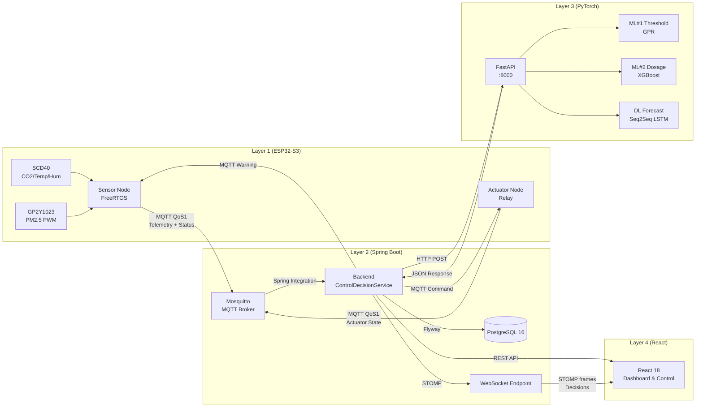

# AQSS — Input / Output Contract Declaration

> **Purpose:** Single source of truth for all data contracts between the 4 layers of the Air Quality Supervision System. Use this document to validate integration tests, mock data generators, and API conformance checks.
>
> **Last Validated:** 2026-09-16 (V2 closed-loop update)

---

## Table of Contents

1. [Layer 1 → Layer 2: MQTT Telemetry](#1-layer-1--layer-2-mqtt-telemetry)
2. [Layer 1 → Layer 2: MQTT Status (LWT)](#2-layer-1--layer-2-mqtt-status-lwt)
3. [Layer 1 → Layer 2: Actuator State MQTT](#3-layer-1--layer-2-actuator-state-mqtt)
4. [Layer 2 → Layer 1: MQTT Commands](#4-layer-2--layer-1-mqtt-commands)
5. [Layer 2 → Database: PostgreSQL Schema](#5-layer-2--database-postgresql-schema)
6. [Layer 2 → Layer 4: REST API Responses](#6-layer-2--layer-4-rest-api-responses)
7. [Layer 2 → Layer 4: STOMP WebSocket Messages](#7-layer-2--layer-4-stomp-websocket-messages)
8. [Layer 2 → Layer 3: ML#1 Threshold Request/Response](#8-layer-2--layer-3-ml1-threshold-requestresponse)
9. [Layer 2 → Layer 3: ML#2 Dosage Request/Response](#9-layer-2--layer-3-ml2-dosage-requestresponse)
10. [Layer 2 → Layer 3: DL Forecast Request](#10-layer-2--layer-3-dl-forecast-request)
11. [Layer 3 → Layer 2: DL Forecast Response](#11-layer-3--layer-2-dl-forecast-response)
12. [Layer 4 → Layer 2: REST API Requests](#12-layer-4--layer-2-rest-api-requests)
13. [Sensor Value Ranges & Validation Rules](#13-sensor-value-ranges--validation-rules)
14. [AQI Breakpoint Table (EPA Standard)](#14-aqi-breakpoint-table-epa-standard)

---

## 1. Layer 1 → Layer 2: MQTT Telemetry

| Property | Value |
| :--- | :--- |
| **Protocol** | MQTT v3.1.1 |
| **Broker** | Eclipse Mosquitto (port 1883) |
| **Topic** | `aqss/devices/{device_id}/telemetry` |
| **QoS** | 1 (At Least Once) |
| **Publish Interval** | Every **5 seconds** |
| **Auth** | Username/Password (defined in `mosquitto.conf`) |
| **Payload Format** | JSON (UTF-8) |
| **Max Payload Size** | 384 bytes |

### Payload Schema

```json
{
  "device_id": "AQSS_ESP32S3_01",
  "space_id": "SPACE_201",
  "timestamp": 1724217600,
  "sensors": {
    "pm25": 35.4,
    "co2": 620,
    "temperature": 29.5,
    "humidity": 68.2
  },
  "computed": {
    "aqi_index": 101,
    "aqi_level": "Unhealthy for Sensitive Groups"
  },
  "system": {
    "wifi_rssi": -65,
    "uptime_sec": 3600,
    "free_heap": 245760
  }
}
```

### Field Definitions

| JSON Path | Type | Unit | Range | Nullable | Source |
| :--- | :---: | :---: | :--- | :---: | :--- |
| `device_id` | `string` | — | Max 32 chars, pattern `AQSS_ESP32S3_XX` | No | Hardcoded in firmware `config.h` |
| `space_id` | `string` | — | Target space ID | Yes | Optional, for V2 |
| `timestamp` | `uint32` | Unix epoch (s) | > 1700000000 | No | NTP sync (`pool.ntp.org`, UTC+7) |
| `sensors.pm25` | `float` | µg/m³ | 0.0 – 1000.0 | No | GP2Y1023AU0F PWM → formula `(W - W₀) / 14.0` |
| `sensors.co2` | `float` | ppm | 400 – 5000 | No | SCD40 I2C `readMeasurement()` (5s cycle) |
| `sensors.temperature` | `float` | °C | -10.0 – 60.0 | No | SCD40 co-read with CO2 |
| `sensors.humidity` | `float` | % | 0.0 – 100.0 | No | SCD40 co-read with CO2 |
| `computed.aqi_index` | `int` | — | 0 – 500 | No | Calculated from `pm25` via EPA breakpoints |
| `computed.aqi_level` | `string` | — | One of: `"Good"`, `"Moderate"`, `"Unhealthy for Sensitive Groups"`, `"Unhealthy"`, `"Very Unhealthy"`, `"Hazardous"` | No | Derived from `aqi_index`, Max 40 chars |
| `system.wifi_rssi` | `int` | dBm | -100 – 0 | No | `WiFi.RSSI()` |
| `system.uptime_sec` | `uint32` | seconds | 0 – 2³² | No | `millis() / 1000` |
| `system.free_heap` | `uint32` | bytes | 0 – 524288 | No | `ESP.getFreeHeap()` |

---

## 2. Layer 1 → Layer 2: MQTT Status (LWT)

| Property | Value |
| :--- | :--- |
| **Topic** | `aqss/devices/{device_id}/status` |
| **QoS** | 1 |
| **Retain** | true |

### Payload Schema

```json
{
  "device_id": "AQSS_ESP32S3_01",
  "status": "ONLINE"
}
```
*(Or "OFFLINE" via Last Will and Testament)*

---

## 3. Layer 1 → Layer 2: Actuator State MQTT

| Property | Value |
| :--- | :--- |
| **Topic** | `aqss/devices/{id}/actuator/state` |
| **QoS** | 1 |

### Payload Schema

```json
{
  "device_id": "AQSS_ESP32S3_ACT_01",
  "state": "ON",
  "level": 2,
  "mode": "AUTO",
  "timestamp": 1724217600
}
```

---

## 4. Layer 2 → Layer 1: MQTT Commands

| Property | Value |
| :--- | :--- |
| **Topic** | `aqss/devices/{device_id}/command` |
| **QoS** | 1 |
| **Direction** | Server → Device |
| **Trigger** | Admin action via REST `POST /api/v1/devices/{id}/command` |

### Payload Schema

```json
{
  "command": "reboot",
  "params": {}
}
```

### Supported Commands

| Command | Params | Description |
| :--- | :--- | :--- |
| `reboot` | `{}` | Triggers `ESP.restart()` on the device |
| `set_interval` | `{"interval_ms": 10000}` | Change telemetry publish interval (default 5000) |
| `recalibrate_dust` | `{"baseline_w0": 1350}` | Update GP2Y1023 baseline in EEPROM |
| `force_ntp_sync` | `{}` | Force immediate NTP resync |
| `set_actuator` | `{"state": "ON", "level": 2}` | Control relay on actuator node |
| `display_warning`| `{"message": "Air quality declining...", "severity": "WARN"}` | Show early warning on OLED |

---

## 5. Layer 2 → Database: PostgreSQL Schema

### 5.1 `telemetry_data` (Partitioned by month)

| Column | PG Type | Java Type | Source JSON Path | Notes |
| :--- | :--- | :--- | :--- | :--- |
| `id` | `BIGSERIAL` | `Long` | Auto-generated | PK (with `recorded_at`) |
| `recorded_at` | `TIMESTAMPTZ` | `Instant` | `timestamp` (converted) | Partition key |
| `device_id` | `VARCHAR(32)` | `String` | `device_id` | FK → `devices` |
| `pm25` | `REAL` | `Float` | `sensors.pm25` | |
| `co2` | `REAL` | `Float` | `sensors.co2` | |
| `temperature` | `REAL` | `Float` | `sensors.temperature` | |
| `humidity` | `REAL` | `Float` | `sensors.humidity` | |
| `aqi_index` | `SMALLINT` | `Short` | `computed.aqi_index` | |
| `aqi_level` | `VARCHAR(40)` | `String` | `computed.aqi_level` | Truncated to 40 chars |
| `wifi_rssi` | `SMALLINT` | `Short` | `system.wifi_rssi` | Nullable |
| `uptime_sec` | `INT` | `Integer` | `system.uptime_sec` | Nullable |
| `free_heap` | `INT` | `Integer` | `system.free_heap` | Nullable |

### 5.2 `predictions`

| Column | PG Type | Description |
| :--- | :--- | :--- |
| `id` | `BIGSERIAL` | PK |
| `device_id` | `VARCHAR(32)` | FK → `devices` |
| `predicted_at` | `TIMESTAMPTZ` | When the model ran |
| `forecast_data` | `JSONB` | Array of 96 steps × 3 quantiles (q10, q50, q90) |
| `model_version` | `VARCHAR(20)` | e.g. `"v2.0"` |

### 5.3 Space & Actuation Tables

| Table | Purpose |
| :--- | :--- |
| `spaces` | Space registry (`id`, `name`, `volume_m3`, `purpose`, `region`, `created_at`) |
| `space_devices` | Many-to-many mapping of sensor/actuator nodes to spaces |
| `space_thresholds` | Cached ML#1 output per space |
| `actuators` | Actuator registry (`device_id`, `space_id`, `current_state`, `last_command_at`) |
| `control_decisions` | Audit log of decisions (`space_id`, `timestamp`, `trigger`, `action`, `mode`, `threshold_used`, `dosage_used`) |

---

## 6. Layer 2 → Layer 4: REST API Responses

### 6.1 Spaces and Actuation (New in V2)

#### `GET /api/v1/spaces`
```json
[
  {
    "id": "SPACE_201",
    "name": "Phòng 201",
    "volume_m3": 15,
    "purpose": "bedroom",
    "region": "hanoi"
  }
]
```

#### `GET /api/v1/spaces/{id}`
```json
{
  "id": "SPACE_201",
  "name": "Phòng 201",
  "volume_m3": 15,
  "purpose": "bedroom",
  "region": "hanoi",
  "threshold": {
    "base_threshold_pm25": 18,
    "uncertainty_lower": 15,
    "uncertainty_upper": 22
  },
  "devices": ["AQSS_ESP32S3_01"],
  "actuators": ["AQSS_ESP32S3_ACT_01"]
}
```

#### `POST /api/v1/spaces`
*Create space payload & response omitted for brevity (standard CRUD).*

#### `GET /api/v1/spaces/{id}/decisions`
```json
[
  {
    "timestamp": "2026-09-16T10:00:00Z",
    "action": "ACTIVATE",
    "mode": "AUTO",
    "threshold_used": 18,
    "dosage_used": {"level": 2, "duration": 25}
  }
]
```

#### `GET /api/v1/actuators`
```json
[
  {
    "device_id": "AQSS_ESP32S3_ACT_01",
    "space_id": "SPACE_201",
    "current_state": "ON",
    "level": 2
  }
]
```

#### `POST /api/v1/actuators/{id}/command`
```json
{
  "status": "sent"
}
```

### 6.2 Telemetry and Others

*Telemetry, History, Aggregate, Alerts, Auth responses follow the same format as V1.*

---

## 7. Layer 2 → Layer 4: STOMP WebSocket Messages

### 7.1 `/topic/devices/{device_id}`
Live telemetry (same as MQTT payload).

### 7.2 `/topic/device-status`
Online/Offline events.

### 7.3 `/topic/alerts`
Alert Notifications.

### 7.4 `/topic/spaces/{id}/decision` (New)
```json
{
  "action": "ALERT",
  "mode": "AUTO",
  "trigger": "forecast_breach_q90",
  "threshold": 18,
  "dosage": null,
  "timestamp": "2026-09-16T10:00:00Z"
}
```

### 7.5 `/topic/actuators/{id}` (New)
```json
{
  "state": "ON",
  "level": 2,
  "since": "2026-09-16T10:00:00Z",
  "mode": "AUTO"
}
```

---

## 8. Layer 2 → Layer 3: ML#1 Threshold Request/Response

| Property | Value |
| :--- | :--- |
| **Protocol** | HTTP POST |
| **URL** | `http://layer3-dl:8000/api/v1/threshold` |

### Request
```json
{
  "volume_m3": 15,
  "purpose_encoded": 1,
  "region_encoded": 2,
  "ventilation_estimate": 0.5,
  "occupancy_typical": 1
}
```

### Response
```json
{
  "base_threshold_pm25": 18.0,
  "uncertainty_lower": 15.0,
  "uncertainty_upper": 22.0
}
```

---

## 9. Layer 2 → Layer 3: ML#2 Dosage Request/Response

| Property | Value |
| :--- | :--- |
| **Protocol** | HTTP POST |
| **URL** | `http://layer3-dl:8000/api/v1/dosage` |

### Request
```json
{
  "volume_m3": 15,
  "purpose_encoded": 1,
  "current_pm25": 19.5,
  "base_threshold": 18.0,
  "outdoor_pm25_estimate": 35.0,
  "filter_cadr": 150
}
```

### Response
```json
{
  "filter_level": 2,
  "run_duration_minutes": 25
}
```

---

## 10. Layer 2 → Layer 3: DL Forecast Request

| Property | Value |
| :--- | :--- |
| **Protocol** | HTTP POST |
| **URL** | `http://layer3-dl:8000/api/v1/forecast` |
| **Content-Type** | `application/json` |

### Request Body
```json
{
  "device_id": "AQSS_ESP32S3_01",
  "data_24h": [
    {
      "timestamp": "2026-09-16T10:00:00Z",
      "pm25": 12.0,
      "co2": 520,
      "temperature": 28,
      "humidity": 72
    }
  ]
}
```
*(96 time steps @ 15min resampled median aggregation)*

---

## 11. Layer 3 → Layer 2: DL Forecast Response

```json
{
  "device_id": "AQSS_ESP32S3_01",
  "status": "success",
  "forecast_sequence": [
    {
      "target_time": "2026-09-16T10:15:00Z",
      "pm25_q10": 11,
      "pm25_q50": 13,
      "pm25_q90": 16
    }
  ]
}
```
*(96 steps × 3 quantiles)*

---

## 12. Layer 4 → Layer 2: REST API Requests

*Reference V1 endpoints, plus new Space/Actuator endpoints described in Section 6.*

---

## 13. Sensor Value Ranges & Validation Rules

| Sensor | Min | Max | Unit | Reject If | Alert If |
| :--- | :---: | :---: | :---: | :--- | :--- |
| PM2.5 | 0.0 | 1000.0 | µg/m³ | `< 0` or `> 2000` | (Depends on Space threshold) |
| CO2 | 400 | 5000 | ppm | `< 300` or `> 10000` | `> 2000` |
| Temperature | -10.0 | 60.0 | °C | `< -40` or `> 85` | `> 50` (likely sensor error) |
| Humidity | 0.0 | 100.0 | % | `< 0` or `> 100` | — |
| AQI Index | 0 | 500 | — | `< 0` or `> 500` | `> 150` |
| Wi-Fi RSSI | -100 | 0 | dBm | `> 0` | `< -80` (weak signal) |

---

## 14. AQI Breakpoint Table (EPA Standard)

> **Note on AQI in V2:** AQI is now computed via the **NowCast algorithm** and is used for **display only**. All core control logic relies on raw PM2.5 and space-derived thresholds.

| AQI Range | Category | PM2.5 (µg/m³, 24h avg) | Color Hex | Text Color |
| :---: | :--- | :---: | :---: | :---: |
| 0 – 50 | Good | 0.0 – 12.0 | `#00E400` | Dark |
| 51 – 100 | Moderate | 12.1 – 35.4 | `#FFFF00` | Dark |
| 101 – 150 | Unhealthy for Sensitive Groups | 35.5 – 55.4 | `#FF7E00` | Dark |
| 151 – 200 | Unhealthy | 55.5 – 150.4 | `#FF0000` | White |
| 201 – 300 | Very Unhealthy | 150.5 – 250.4 | `#8F3F97` | White |
| 301 – 500 | Hazardous | 250.5 – 500.4 | `#7E0023` | White |

---

## Data Flow Diagram (End-to-End)


