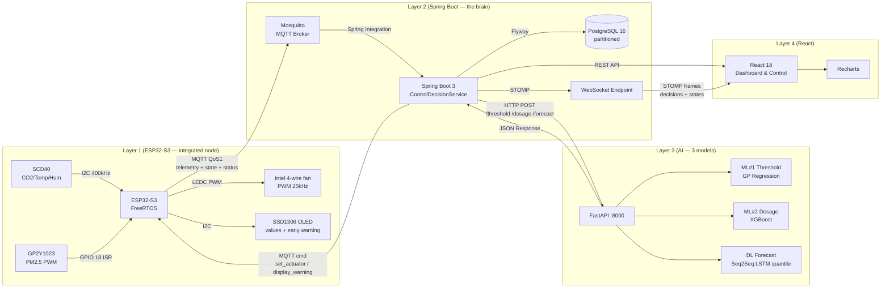

# AQSS V2 — Input / Output Contract Declaration

> **Purpose:** Single source of truth for all data contracts between the 4 layers of the Air Quality Supervision System. Use this document to validate integration tests, mock data generators, and API conformance checks.
>
> **Version:** 2.1 · **Last Validated:** 2026-09-16 (post V2 architecture review)
>
> **V2 headline changes:** Space is a first-class entity · **one integrated node** (no separate actuator node, no relay — the filter fan is PWM-driven) · `status` + LWT defined · AQI demoted to a display-only NowCast metric (no longer computed on the device) · DL output switched to quantiles (q10/q50/q90) · Autoencoder evaluator removed · CO2 is alert-only.

---

## Table of Contents

1. [Layer 1 → Layer 2: MQTT Telemetry](#1-layer-1--layer-2-mqtt-telemetry)
2. [Layer 1 → Layer 2: Actuator State Telemetry](#2-layer-1--layer-2-actuator-state-telemetry)
3. [Layer 1 → Layer 2: Device Status & LWT](#3-layer-1--layer-2-device-status--lwt)
4. [Layer 2 → Layer 1: MQTT Commands](#4-layer-2--layer-1-mqtt-commands)
5. [Layer 2 → Database: PostgreSQL Schema](#5-layer-2--database-postgresql-schema)
6. [Layer 2 → Layer 4: REST API Responses](#6-layer-2--layer-4-rest-api-responses)
7. [Layer 2 → Layer 4: STOMP WebSocket Messages](#7-layer-2--layer-4-stomp-websocket-messages)
8. [Layer 2 → Layer 3: ML Threshold Request](#8-layer-2--layer-3-ml-threshold-request)
9. [Layer 2 → Layer 3: ML Dosage Request](#9-layer-2--layer-3-ml-dosage-request)
10. [Layer 2 ↔ Layer 3: DL Forecast](#10-layer-2--layer-3-dl-forecast)
11. [Layer 4 → Layer 2: REST API Requests](#11-layer-4--layer-2-rest-api-requests)
12. [Sensor Value Ranges & Validation Rules](#12-sensor-value-ranges--validation-rules)
13. [AQI (NowCast) — Display Only](#13-aqi-nowcast--display-only)

---

## 1. Layer 1 → Layer 2: MQTT Telemetry

| Property | Value |
| :--- | :--- |
| **Protocol** | MQTT v3.1.1 |
| **Broker** | Eclipse Mosquitto (port 1883, username/password — `mosquitto.conf`) |
| **Topic** | `aqss/devices/{device_id}/telemetry` |
| **QoS** | 1 (At Least Once) |
| **Publish Interval** | Every **5 seconds** (configurable via `set_interval`) |
| **Payload Format** | JSON (UTF-8) |
| **Max Payload Size** | **512 bytes** (V1's 384 overflowed once `space_id` + `min_free_heap` were added) |

### Payload Schema

```json
{
  "device_id": "AQSS_ESP32S3_01",
  "space_id": "SP_201",
  "timestamp": 1724217600,
  "sensors": {
    "pm25": 35.4,
    "co2": 620.0,
    "temperature": 29.5,
    "humidity": 68.2
  },
  "system": {
    "wifi_rssi": -65,
    "uptime_sec": 3600,
    "free_heap": 245760,
    "min_free_heap": 185000
  }
}
```

> **V2 change:** the `computed` object (`aqi_index`, `aqi_level`) is **removed**. AQI is a derived, display-only metric computed server-side via NowCast (§13). The firmware no longer computes AQI — this fixes the V1 error of applying 24h-average EPA breakpoints to instantaneous readings.

### Field Definitions

| JSON Path | Type | Unit | Range | Nullable | Source |
| :--- | :---: | :---: | :--- | :---: | :--- |
| `device_id` | `string` | — | Max 32 chars, pattern `AQSS_ESP32S3_XX` | No | Firmware `config.h` |
| `space_id` | `string` | — | Max 20 chars, pattern `SP_XX` | No | NVS, set via `set_space` |
| `timestamp` | `uint32` | Unix epoch (s) | > 1700000000 | No | NTP (`pool.ntp.org`, UTC+7) |
| `sensors.pm25` | `float` | µg/m³ | 0.0 – 500.0 | No | GP2Y1023 PWM → `(W − W₀) / 14.0` |
| `sensors.co2` | `float` | ppm | 400 – 5000 | No | SCD40 `readMeasurement()` (5 s cycle) |
| `sensors.temperature` | `float` | °C | −10.0 – 60.0 | No | SCD40 co-read |
| `sensors.humidity` | `float` | % | 0.0 – 100.0 | No | SCD40 co-read |
| `system.wifi_rssi` | `int` | dBm | −100 – 0 | No | `WiFi.RSSI()` |
| `system.uptime_sec` | `uint32` | seconds | 0 – 2³² | No | `millis() / 1000` |
| `system.free_heap` | `uint32` | bytes | 0 – ~320000 | No | `ESP.getFreeHeap()` |
| `system.min_free_heap` | `uint32` | bytes | 0 – ~320000 | No | `ESP.getMinFreeHeap()` |

---

## 2. Layer 1 → Layer 2: Actuator State Telemetry

| Property | Value |
| :--- | :--- |
| **Topic** | `aqss/devices/{device_id}/actuator/state` |
| **QoS** | 1 |
| **Publish** | On state change, and every 5 s while the fan is ON |

```json
{
  "device_id": "AQSS_ESP32S3_01",
  "timestamp": 1724217600,
  "state": "ON",
  "level": 2,
  "duty_pct": 60,
  "mode": "AUTO",
  "filter_runtime_h": 123.4
}
```

| Field | Type | Range | Description |
| :--- | :---: | :--- | :--- |
| `state` | `string` | `ON` / `OFF` | Fan power state |
| `level` | `int` | 0 – 3 | Discrete commanded level (0 = off) |
| `duty_pct` | `int` | 0 – 100 | Actual PWM duty applied (0/35/60/90 % per level) |
| `mode` | `string` | `AUTO` / `MANUAL` | Who is in control |
| `filter_runtime_h` | `float` | ≥ 0 | Cumulative fan runtime (filter-life tracking) |

> There is **no separate actuator device** — the integrated node owns both sensing and actuation, so `device_id` here is the same node id (`AQSS_ESP32S3_XX`).

---

## 3. Layer 1 → Layer 2: Device Status & LWT

| Property | Value |
| :--- | :--- |
| **Topic** | `aqss/devices/{device_id}/status` |
| **QoS** | 1 |
| **Retain** | **Yes** |
| **Publish** | `{"status":"ONLINE"}` on connect; the broker publishes `{"status":"OFFLINE"}` via **Last Will and Testament** on ungraceful disconnect |

```json
{
  "device_id": "AQSS_ESP32S3_01",
  "status": "ONLINE",
  "timestamp": 1724217600
}
```

```cpp
// Firmware must register the LWT (V1 subscribed to this topic but never published it):
mqttClient.connect(clientId, user, pass,
    "aqss/devices/AQSS_ESP32S3_01/status", 1, true, "{\"status\":\"OFFLINE\"}");
// then on success: mqttClient.publish(topic_status, "{\"status\":\"ONLINE\"}", true);
```

---

## 4. Layer 2 → Layer 1: MQTT Commands

| Property | Value |
| :--- | :--- |
| **Topic** | `aqss/devices/{device_id}/command` |
| **QoS** | 1 |
| **Direction** | Server → Device |
| **Trigger** | Backend `ActuatorService` / admin REST action |

```json
{ "command": "set_actuator", "params": {} }
```

### Supported Commands

| Command | Params | Description | Introduced |
| :--- | :--- | :--- | :---: |
| `reboot` | `{}` | `ESP.restart()` | V1 |
| `set_interval` | `{"interval_ms": 10000}` | Telemetry publish interval (default 5000) | V1 |
| `recalibrate_dust` | `{"baseline_w0": 1350}` | Update GP2Y1023 baseline W₀ — persisted to **NVS** (the ESP32-S3 has no EEPROM) | V1 (fixed) |
| `force_ntp_sync` | `{}` | Immediate NTP resync | V1 |
| `set_space` | `{"space_id": "SP_201"}` | Bind the node to a space; persisted to NVS | **V2** |
| `set_actuator` | `{"state": "ON\|OFF", "level": 0–3}` | Drive the filter fan (PWM duty 0/35/60/90 % per level) | **V2** |
| `display_warning` | `{"message": "...", "severity": "INFO\|WARNING\|CRITICAL"}` | Render a forecast-based early warning on the OLED | **V2** |

> Firmware must **null-check** `doc["command"]` before `strcmp` — a malformed payload must not crash the node (V1 panicked on `strcmp(nullptr, …)`).

---

## 5. Layer 2 → Database: PostgreSQL Schema

Full migrations in `docs/backend-layer.md` §2. Summary:

### 5.1 `telemetry_data` (partitioned monthly)

| Column | PG Type | Source JSON Path | Notes |
| :--- | :--- | :--- | :--- |
| `id` | `BIGSERIAL` | — | PK (with `recorded_at`) |
| `recorded_at` | `TIMESTAMPTZ` | `timestamp` | Partition key |
| `device_id` | `VARCHAR(32)` | `device_id` | FK → `devices` |
| `space_id` | `VARCHAR(20)` | `space_id` | Space **code** (`spaces.code`), e.g. `SP_201` — denormalized, **not** an FK (partition-insert cost) |
| `pm25` | `REAL` | `sensors.pm25` | |
| `co2` | `REAL` | `sensors.co2` | |
| `temperature` | `REAL` | `sensors.temperature` | |
| `humidity` | `REAL` | `sensors.humidity` | |
| `wifi_rssi` | `SMALLINT` | `system.wifi_rssi` | Nullable |
| `uptime_sec` | `INT` | `system.uptime_sec` | Nullable |
| `free_heap` | `INT` | `system.free_heap` | Nullable |
| `min_free_heap` | `INT` | `system.min_free_heap` | Nullable |

> **No AQI columns** — AQI is derived at read time (NowCast) and exposed via REST/STOMP only.
> The JPA entity must map the composite PK `(id, recorded_at)` with `@EmbeddedId` — `@Id id` + `@GeneratedValue(IDENTITY)` fails `ddl-auto: validate`.

### 5.2 `spaces` (V4)

| Column | PG Type | Notes |
| :--- | :--- | :--- |
| `id` | `BIGSERIAL` | PK — internal FK target for `space_thresholds`, `actuators`, `control_decisions`, `predictions` |
| `code` | `VARCHAR(20)` | **UNIQUE, NOT NULL** — device-facing identifier carried by telemetry `space_id` and MQTT `set_space`, e.g. `SP_201` |
| `name` | `VARCHAR(100)` | e.g. "Phòng 201" |
| `area_m2` / `ceiling_m` | `REAL` | |
| `volume_m3` | `REAL NOT NULL` | |
| `purpose` | `VARCHAR(30)` | `bedroom` / `dorm` / `classroom` / `office` |
| `region` | `VARCHAR(50)` | e.g. `hanoi_caugiay` |
| `ventilation_estimate` | `VARCHAR(20)` | `low` / `medium` / `high` |
| `created_at` | `TIMESTAMPTZ` | |

### 5.3 `space_devices`, `space_thresholds`, `actuators`, `control_decisions` (V4)

| Table | Purpose |
| :--- | :--- |
| `space_devices` | `(space_id, device_id, role)` — node ↔ space mapping (`SENSOR` / `ACTUATOR` / `COMBINED`) |
| `space_thresholds` | Cached ML#1 output: `base_threshold_pm25`, `uncertainty_lower/upper`, `dosage_level`, `dosage_duration_min`, `model_version`, `computed_at` — recomputed on space config change |
| `actuators` | Per-node actuator state: `current_state`, `current_level`, `mode`, `last_command_at`, plus the live `duty_pct`, `filter_runtime_h`, `state_since` used by the min-ON/OFF safety timers |
| `control_decisions` | Audit log: `action` (ACTIVATE/DEACTIVATE/ALERT/IDLE), `mode` (AUTO/MANUAL/ALERT), `trigger_reason`, `pm25_at_decision`, `threshold_used`, `dosage_level`, `dosage_duration_min` |

### 5.4 `predictions` (V2 — quantile forecast)

| Column | PG Type | Notes |
| :--- | :--- | :--- |
| `id` | `BIGSERIAL` | PK |
| `space_id` | `BIGINT` | FK → `spaces` (V2 scopes forecasts to a space, not a device) |
| `predicted_at` | `TIMESTAMPTZ` | |
| `forecast_data` | `JSONB` | `[{target_time, pm25_q50, pm25_q10, pm25_q90}]` × 96 |
| `model_version` | `VARCHAR(20)` | |

> `model_evaluations` **removed** together with the Autoencoder evaluator.

---

## 6. Layer 2 → Layer 4: REST API Responses

### 6.1 `GET /api/v1/telemetry/latest?device_id={id}`

```json
{
  "device_id": "AQSS_ESP32S3_01",
  "space_id": "SP_201",
  "recorded_at": "2026-09-16T10:35:00Z",
  "pm25": 35.4,
  "co2": 620.0,
  "temperature": 29.5,
  "humidity": 68.2,
  "aqi_index": 101,
  "aqi_level": "Unhealthy for Sensitive Groups",
  "co2_alert": false,
  "wifi_rssi": -65
}
```

`aqi_index` / `aqi_level` are derived at read time (NowCast, §13). `co2_alert` is `true` when co2 > 1000 ppm (**alert only**, §12).

### 6.2 `GET /api/v1/spaces/{id}`

```json
{
  "id": 1,
  "name": "Phòng 201",
  "area_m2": 5.0,
  "ceiling_m": 3.0,
  "volume_m3": 15.0,
  "purpose": "bedroom",
  "region": "hanoi_caugiay",
  "ventilation_estimate": "low",
  "devices": ["AQSS_ESP32S3_01"],
  "actuators": ["AQSS_ESP32S3_01"],
  "threshold": {
    "base_threshold_pm25": 18.0,
    "uncertainty_lower": 15.0,
    "uncertainty_upper": 22.0,
    "model_version": "v2.0"
  },
  "dosage": { "level": 2, "duration_min": 25 }
}
```

### 6.3 `GET /api/v1/spaces/{id}/decisions`

```json
[
  {
    "id": 42,
    "decided_at": "2026-09-16T23:00:00Z",
    "action": "ALERT",
    "mode": "ALERT",
    "trigger_reason": "forecast_breach_q90",
    "pm25_at_decision": 12.0,
    "threshold_used": 18.0,
    "dosage_level": null,
    "dosage_duration_min": null
  }
]
```

### 6.4 `GET /api/v1/forecast/{space_id}`

```json
{
  "space_id": "SP_201",
  "predicted_at": "2026-09-16T10:00:00Z",
  "model_version": "v2.0",
  "forecast_sequence": [
    { "target_time": "2026-09-16T10:15:00Z", "pm25_q50": 13.0, "pm25_q10": 11.0, "pm25_q90": 16.0 }
  ]
}
```

`forecast_sequence` contains **96 objects** (24 h @ 15 min).

### 6.5 Actuator control — `POST /api/v1/spaces/{id}/actuator`

```json
{ "mode": "MANUAL", "state": "ON", "level": 2 }
```
Response: `{ "status": "sent" }`

### 6.6 `GET /api/v1/alerts`

```json
[
  {
    "id": 42,
    "space_id": "SP_201",
    "device_id": "AQSS_ESP32S3_01",
    "alert_type": "PM25_THRESHOLD",
    "severity": "WARNING",
    "message": "PM2.5 exceeded the space threshold 18 µg/m³",
    "triggered_at": "2026-09-16T09:15:00Z",
    "resolved_at": null
  }
]
```

`alert_type` ∈ `PM25_THRESHOLD` | `CO2_ALERT` | `SENSOR_OFFLINE` | `SENSOR_SATURATED`.

### 6.7 Auth — unchanged

`POST /api/v1/auth/token` → `{access_token, refresh_token, token_type, expires_in}` (HS256, 30-min access / 7-day refresh, BCrypt passwords, SHA-256 device API keys).

---

## 7. Layer 2 → Layer 4: STOMP WebSocket Messages

| Property | Value |
| :--- | :--- |
| **Endpoint** | `ws://localhost:8080/ws` (native) or SockJS fallback |
| **Protocol** | STOMP 1.2 over WebSocket |
| **Auth** | JWT in STOMP `CONNECT` header: `Authorization: Bearer <jwt>` |

| Destination | Payload | Purpose |
| :--- | :--- | :--- |
| `/topic/devices/{device_id}` | Telemetry JSON (§1) | Live readings |
| `/topic/spaces/{space_id}/decision` | `{action, mode, trigger, threshold, dosage, timestamp}` | Decision stream (NEW) |
| `/topic/actuators/{device_id}` | Actuator state JSON (§2) | Fan state updates (NEW) |
| `/topic/alerts` | Alert JSON (§6.6) | Alerts |
| `/topic/device-status` | Status JSON (§3) | Online/offline (LWT) |

---

## 8. Layer 2 → Layer 3: ML Threshold Request

| Property | Value |
| :--- | :--- |
| **URL** | `POST http://layer3-ai:8000/api/v1/threshold` |
| **Trigger** | On space create/update; result cached in `space_thresholds` |
| **Model** | ML#1 — Gaussian Process Regression |

```json
// Request
{
  "space_id": "SP_201",
  "volume_m3": 15.0,
  "purpose": "bedroom",
  "region": "hanoi_caugiay",
  "ventilation_estimate": "low",
  "occupancy_typical": 1
}

// Response
{
  "space_id": "SP_201",
  "base_threshold_pm25": 18.0,
  "uncertainty_lower": 15.0,
  "uncertainty_upper": 22.0,
  "model_version": "v2.0"
}
```

---

## 9. Layer 2 → Layer 3: ML Dosage Request

| Property | Value |
| :--- | :--- |
| **URL** | `POST http://layer3-ai:8000/api/v1/dosage` |
| **Trigger** | On threshold breach; consumed by `ControlDecisionService` |
| **Model** | ML#2 — Gradient Boosting (XGBoost) |

```json
// Request
{
  "space_id": "SP_201",
  "volume_m3": 15.0,
  "purpose": "bedroom",
  "current_pm25": 19.0,
  "base_threshold": 18.0,
  "outdoor_pm25_estimate": 35.0,
  "filter_cadr": 40.0
}

// Response
{
  "space_id": "SP_201",
  "filter_level": 2,
  "run_duration_minutes": 25,
  "model_version": "v2.0"
}
```

> `filter_cadr` is the **measured** effective CADR of the fan + HEPA assembly (for one Intel fan ≈ 30–50 m³/h — to be measured in Phase 11; V1's example of 150 m³/h exceeded the hardware). `filter_level` maps to PWM duty 0/35/60/90 %.

---

## 10. Layer 2 ↔ Layer 3: DL Forecast

| Property | Value |
| :--- | :--- |
| **URL** | `POST http://layer3-ai:8000/api/v1/forecast` |
| **Trigger** | `@Scheduled` cron — hourly |
| **Model** | Seq2Seq LSTM + Attention, quantile heads (τ = 0.1, 0.5, 0.9) |
| **Timeout** | 30 seconds |

```json
// Request — the BACKEND performs the 15-min median resample
{
  "space_id": "SP_201",
  "series": [
    { "timestamp": "2026-09-16T22:00:00+07:00", "pm25": 12.0 },
    { "timestamp": "2026-09-16T22:15:00+07:00", "pm25": 12.4 }
  ]
}
// series: exactly 96 chronological entries (24 h); PM2.5 in [0, 500]
// The backend skips inference unless all 96 15-minute buckets exist and the latest bucket is fresh.

// Response
{
  "space_id": "SP_201",
  "status": "ok",
  "model_version": "forecast-v1",
  "forecast_sequence": [
    { "target_time": "2026-09-16T22:15:00+07:00", "pm25_q10": 11.0, "pm25_q50": 13.0, "pm25_q90": 16.0 }
  ]
}
```

**Removed from V1:**

| Item | Reason |
| :--- | :--- |
| `/api/v1/evaluate` | Autoencoder evaluator removed from the closed-loop thesis |
| `/api/v1/predict` | Renamed to `/api/v1/forecast` |
| `data_since_6am` + `data_last_hour` | Redundant union, infeasible length → rolling 24 h, 96 steps |
| `conf_upper` / `conf_lower` from `ReLU(Linear(hidden,3))` | Not a valid uncertainty mechanism → quantile outputs |
| `co2`/`temperature`/`humidity` forecast features | Not sent by the current Layer 2 DTO; initial forecast contract is univariate PM2.5 and any feature expansion needs a versioned contract update |

---

## 11. Layer 4 → Layer 2: REST API Requests

| Endpoint | Method | Auth | Request Body | Response |
| :--- | :---: | :---: | :--- | :--- |
| `/api/v1/auth/register` | POST | None | `{email, password, full_name}` | `{id, email, role}` |
| `/api/v1/auth/token` | POST | None | `{email, password}` | `{access_token, refresh_token, ...}` |
| `/api/v1/auth/refresh` | POST | Refresh | `{refresh_token}` | `{access_token, ...}` |
| `/api/v1/spaces` | GET/POST | JWT / ADMIN | — / `{name, area_m2, ceiling_m, purpose, region, ventilation_estimate}` | `[Space]` / `{id,...}` |
| `/api/v1/spaces/{id}` | GET/PUT/DELETE | JWT / ADMIN | Space profile | `Space` (§6.2) |
| `/api/v1/spaces/{id}/devices` | POST | ADMIN | `{device_id, role}` | `{status: "assigned"}` |
| `/api/v1/spaces/{id}/decisions` | GET | JWT | `?limit=` | `[ControlDecision]` (§6.3) |
| `/api/v1/spaces/{id}/actuator` | POST | JWT | `{mode, state, level}` | `{status: "sent"}` |
| `/api/v1/spaces/{id}/threshold` | POST | ADMIN | `{}` | Triggers ML#1 recompute |
| `/api/v1/telemetry/latest` | GET | JWT | `?device_id=` | `TelemetryLatest` (§6.1) |
| `/api/v1/telemetry/history` | GET | JWT | `?device_id=&start=&end=` | `[TelemetryData]` |
| `/api/v1/telemetry/aggregate` | GET | JWT | `?space_id=&interval=&start=&end=` | `[AggregateRow]` |
| `/api/v1/forecast/{space_id}` | GET | JWT | — | `ForecastResult` (§6.4) |
| `/api/v1/forecast/run` | POST | ADMIN | `{space_id}` | `{status: "triggered"}` |
| `/api/v1/alerts` | GET | JWT | — | `[Alert]` |
| `/api/v1/alerts/{id}/resolve` | PUT | JWT | — | `{status: "resolved"}` |
| `/api/v1/devices` | GET/POST | JWT / ADMIN | — / `{device_id, name, ...}` | `[Device]` / `{device_id, api_key}` |
| `/actuator/health` | GET | None | — | Liveness |

---

## 12. Sensor Value Ranges & Validation Rules

**One table, enforced identically at every layer** (firmware pre-filter, backend ingest filter, AI-service Pydantic). V1 had three conflicting sets.

| Sensor | Min | Max | Unit | Reject If | Alert If |
| :--- | :---: | :---: | :---: | :--- | :--- |
| PM2.5 | 0.0 | 500.0 | µg/m³ | `< 0` or `> 750` (sensor saturation) | Space-derived threshold |
| CO2 | 400 | 5000 | ppm | `< 300` or `> 10000` | `> 1000` (indoor guideline — **alert only**) |
| Temperature | −10.0 | 60.0 | °C | `< −40` or `> 85` | `> 50` (likely sensor error) |
| Humidity | 0.0 | 100.0 | % | `< 0` or `> 100` | — |
| Wi-Fi RSSI | −100 | 0 | dBm | `> 0` | `< −80` (weak signal) |

> **PM2.5:** the GP2Y1023AU0F detects 0–500 µg/m³ and saturates near ~750. Values above 500 are physically unreliable and must be flagged (`SENSOR_SATURATED`). The V1 range of 0–1000 / reject > 2000 exceeded the sensor's capability.
>
> **CO2:** V1 alerted at 2,000 ppm. The common indoor guideline is **1,000 ppm** (outdoor ≈ 420 ppm). CO2 alerts are advisory — HEPA media cannot remove CO2, so CO2 never actuates.
>
> **AQI row removed** — AQI is derived (§13), not a sensor reading.

---

## 13. AQI (NowCast) — Display Only

**V1 error:** `aqi_index` was computed on the ESP32 from *instantaneous* PM2.5 against EPA breakpoints defined for the **24-hour average** — methodologically wrong, producing a wildly fluctuating index.

**V2 rule:**

- The firmware sends **raw PM2.5 only**.
- The backend computes AQI with the **EPA NowCast algorithm** (weighted average over the last 12 hours) and exposes it via REST/STOMP as a **display-only** metric.
- **All control logic uses raw PM2.5 against the space-derived threshold — never AQI.**

### AQI Breakpoint Table (EPA)

| AQI Range | Category | PM2.5 (µg/m³, 24h avg) | Color Hex | Text Color |
| :---: | :--- | :---: | :---: | :---: |
| 0 – 50 | Good | 0.0 – 12.0 | `#00E400` | Dark |
| 51 – 100 | Moderate | 12.1 – 35.4 | `#FFFF00` | Dark |
| 101 – 150 | Unhealthy for Sensitive Groups | 35.5 – 55.4 | `#FF7E00` | Dark |
| 151 – 200 | Unhealthy | 55.5 – 150.4 | `#FF0000` | White |
| 201 – 300 | Very Unhealthy | 150.5 – 250.4 | `#8F3F97` | White |
| 301 – 500 | Hazardous | 250.5 – 500.4 | `#7E0023` | White |

$$
AQI = \frac{I_{Hi} - I_{Lo}}{BP_{Hi} - BP_{Lo}} \times (C_p - BP_{Lo}) + I_{Lo}
$$

> Persist as `aqi_level VARCHAR(40)` if ever stored — "Unhealthy for Sensitive Groups" is exactly 30 characters, no headroom at `VARCHAR(30)`.

---

## Data Flow Diagram (End-to-End, V2)


