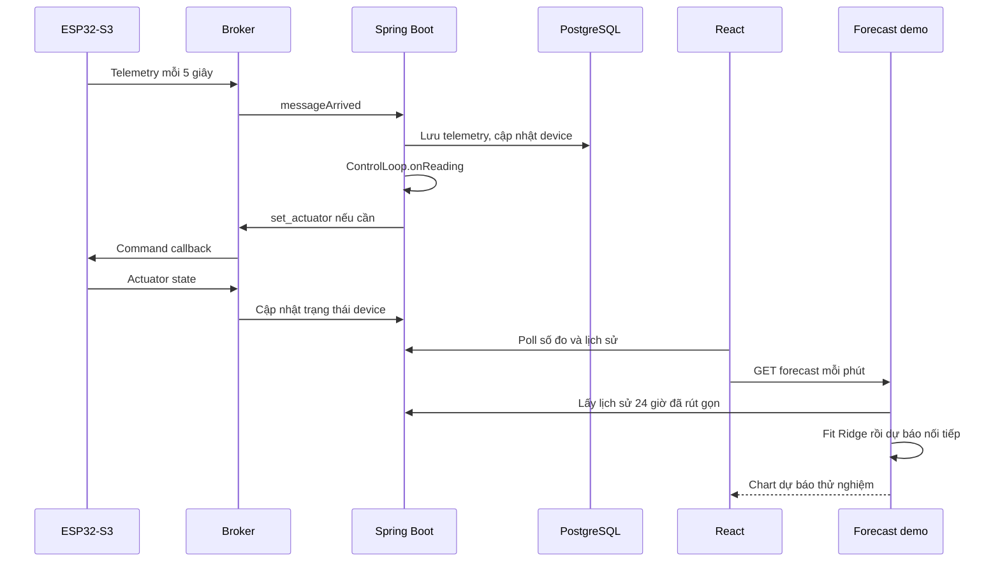

# 01 — Đánh giá hệ thống hiện tại và phần cần giữ

Trạng thái: audit code ngày 14/11/2026, chưa sửa implementation. Các nhận xét dưới đây dựa trên source, chưa phải kết quả chạy thử phần cứng hoặc benchmark trên database đang triển khai.

## 1. Luồng đang có



Trong luồng hiện tại, backend quyết định bằng ngưỡng. Forecast demo chưa tham gia quyết định và chưa lưu bằng chứng forecast phát hành trước tương lai.

## 2. Ma trận giữ, sửa, bổ sung

| Thành phần | Hiện trạng | Quyết định |
|---|---|---|
| Phần cứng, chân tín hiệu, nguồn quạt | Đã có cấu hình và firmware vận hành | Giữ |
| FreeRTOS, watchdog, NVS, provisioning | Đã có | Giữ, kiểm thử hồi quy khi tích hợp |
| MQTT telemetry/status/command/state | Có payload và callback rõ | Giữ topic/payload firmware |
| Công thức ngưỡng | Backend tính trong process | Giữ, trình bày là chính sách công thức |
| Hysteresis và giới hạn runtime | Có control loop | Giữ ý nghĩa, sửa lỗi state/publish và thứ tự kiểm tra |
| Pair/unpair, cấu hình, lõi lọc | Có trên backend/frontend | Giữ, nâng cách hiển thị kết quả thật |
| Telemetry history | Dữ liệu DB đầy hơn response chart | Tách API raw export với chart aggregation |
| Actuator state | Chủ yếu ghi đè bản ghi device | Thêm lịch sử để train/đánh giá |
| Forecast demo | Ridge fit mỗi request | Giữ làm tham khảo/baseline, thay luồng production |
| Frontend | Layout hẹp, ưu tiên một cột | Nâng desktop shell, bảng và phân tích |
| Model lifecycle và đánh giá | Chưa có đầy đủ | Bổ sung |

## 3. Embedded: đủ khả năng cho phiên bản AI đầu tiên

Nguồn: [setup và task](../../embedded/src/main.cpp), [MQTT](../../embedded/src/mqtt_network.cpp), [quạt](../../embedded/src/fan_control.cpp), [SCD40](../../embedded/src/scd40_sensor.cpp).

Những khả năng đã có để tận dụng:

- Telemetry PM2.5, CO₂, nhiệt độ, độ ẩm, RSSI; các trường hệ thống và cờ lỗi.
- Mức quạt, chế độ, duty và runtime trong actuator report.
- Các lệnh cấu hình/điều khiển hiện có; không cần thêm lệnh riêng cho AI cảnh báo trên web.
- AUTO/MANUAL, nút vật lý, fail-safe khi backend không gia hạn, watchdog và cấu hình NVS.

### Giới hạn cần ghi đúng, chưa mở đợt viết lại firmware

| Quan sát từ code | Ảnh hưởng | Xử lý trong phiên bản kế hoạch |
|---|---|---|
| Nhánh mất Wi-Fi `continue` trước nhánh buffer MQTT | Không thể nói mọi mất mạng đều có dữ liệu bù | Dashboard và tập học giữ khoảng trống; không bịa mẫu |
| Biến theo dõi state cập nhật trước khi publish thành công; OFF không có heartbeat như ON | Có khả năng mất report thay đổi cuối | Backend có trạng thái chưa xác nhận; kiểm tra bằng demo thật |
| Không có sample timestamp/freshness riêng cho từng cảm biến | Timestamp telemetry mới chưa chứng minh từng cảm biến vừa đo | Hiển thị packet age và freshness chưa xác định; không khẳng định sensor age chính xác |
| `runtimeS` là biến local trong task quạt, trong khi reset xử lý ở nơi khác | Cần kiểm tra reset bị ghi đè; runtime có sai số theo vòng lặp | Không dùng runtime firmware làm phép đo điện năng/tuổi thọ; ghi issue riêng |
| Firmware và backend có cửa sổ validation chưa hoàn toàn đồng nhất | Một số bản tin có thể bị backend loại | Backend thống kê reject theo lý do; thống nhất lại chỉ trong đợt firmware được duyệt |
| Không có tachometer/power sensor | Không biết RPM hoặc điện năng thực tế | Report chỉ xác nhận phần mềm thiết bị đã báo state |

Không sửa các điểm này trong đợt viết tài liệu. Nếu triển khai phát hiện một điểm làm demo sai, tách thành bugfix nhỏ, giải thích cụ thể và review riêng; không mở rộng thành rewrite embedded.

## 4. Backend: nền tảng tốt nhưng thiếu dữ liệu cho AI

Nguồn: [TelemetryService](../../backend/src/main/java/com/aqss/backend/service/TelemetryService.java), [DeviceService](../../backend/src/main/java/com/aqss/backend/service/DeviceService.java), [ControlLoop](../../backend/src/main/java/com/aqss/backend/service/ControlLoop.java), [MqttLink](../../backend/src/main/java/com/aqss/backend/mqtt/MqttLink.java).

### 4.1. Lịch sử đang dành cho chart

Code hiện tại:

```java
int step = Math.max(1, rows.size() / 800);
for (int i = 0; i < rows.size(); i += step) {
    thinned.add(rows.get(i));
}
```

Đây là lấy mẫu theo bước sau khi đọc toàn bộ lịch sử, không phải dữ liệu gốc và cũng không phải giới hạn cứng 800 điểm. Forecast demo lấy chính endpoint này nên số bản tin node gửi không bằng số điểm model nhìn thấy.

### 4.2. Lệnh yêu cầu đang bị trộn với state thiết bị

Trong `applyActuator`:

```java
boolean published = mqtt.publishCommand(deviceId, "set_actuator", params);
device.setFanState(on ? "ON" : "OFF");
device.setFanLevel((short) (on ? clamped : 0));
```

Device được cập nhật dù publish trả false. `renewLease` cũng cập nhật `lastCommandAt` mà chưa dùng kết quả publish. Trong khi đó actuator report về sau lại ghi đè state. Bảng device vì vậy chưa phải nguồn đủ chính xác để chứng minh thời điểm hành động thực sự được thiết bị báo nhận.

Sửa ưu tiên: lưu command intent riêng; state hiển thị chính đến từ report. Không gọi broker publish success là application ACK.

### 4.3. Những khoảng trống khác

- `SystemInfo` đã nhận uptime/heap/dust fault, nhưng entity telemetry chưa lưu đầy đủ.
- `ActuatorStateEvent` hiện chưa có timestamp dù firmware có gửi; bổ sung DTO phía backend mà không đổi firmware.
- `lastSeenAt` khi nhận telemetry dùng thời gian sự kiện; gói offline cũ có thể làm sai cách hiểu liveness.
- Chưa có `received_at`, snapshot dataset hoặc join cấu hình theo thời điểm.
- Chưa có dedup đủ rõ cho QoS 1 và dữ liệu gửi bù.
- Không lưu lịch sử ngưỡng/cấu hình nên chưa thể phục dựng toàn bộ bối cảnh dự báo cũ.
- Guard dữ liệu cũ nằm trước kiểm tra `max_on`; cần tách giới hạn runtime khỏi việc có mẫu PM mới.
- Có trường/comment `minOffMinutes` nhưng hàm quyết định hiện không áp dụng thời gian nghỉ này. Không đưa lên slide như chức năng đang chạy.
- CO₂ trong tính ngưỡng cần có kiểm tra độ mới và nguồn thiết bị rõ; một node/phòng là cấu hình thực nghiệm đầu tiên.

### 4.4. Ngưỡng hiện tại không phải mô hình ML

Nguồn: [ThresholdService](../../backend/src/main/java/com/aqss/backend/service/ThresholdService.java), [SpaceService](../../backend/src/main/java/com/aqss/backend/service/SpaceService.java).

`ThresholdService.compute()` là công thức từ purpose, volume, ventilation và CO₂. Giờ sử dụng được suy ra từ purpose; request có `occupancyHours` nhưng chưa có đầy đủ đường lưu/áp dụng như một cấu hình thực. Preview không lưu; POST mới áp dụng, không phải tự cập nhật ngưỡng theo mỗi telemetry.

Cần giữ công thức như chính sách vận hành, hiển thị input/factor và sửa chỗ UI hứa một trường nhưng backend chưa thực sự dùng. Không lấy kết quả công thức làm nhãn rồi gọi việc học lại công thức là AI hiểu chất lượng không khí.

## 5. Forecast demo hiện tại

Nguồn: [forecast-demo/app.py](../../forecast-demo/app.py).

```python
make_pipeline(StandardScaler(), Ridge(alpha=10, solver="svd"))
```

`StandardScaler` là bước chuẩn hóa; **Ridge mới là estimator học dự báo**. Demo bucket 5 phút, 6 lag, train lại trong request và dự báo recursive 6 bước. Dữ liệu liên tục ít làm mô hình có ít training rows; đường gần thẳng không tự nó chứng minh model lỗi hoặc đúng.

Validation hiện chỉ là holdout rất ngắn cho dự báo một bước, không đủ để khẳng định chất lượng forecast 30 phút. Chưa có artifact, registry, model version, issued forecast ledger hoặc tập test đóng băng. Giữ demo để so sánh và tham khảo, không nâng tên hiển thị thành một hệ thống AI hoàn thiện.

## 6. Frontend và tài liệu

Nguồn: [routes](../../frontend/src/App.tsx), [query hooks](../../frontend/src/hooks/useAqss.ts), [HistoryChart](../../frontend/src/components/HistoryChart.tsx), [ForecastPanel](../../frontend/src/components/ForecastPanel.tsx).

- Các trang chính dùng `max-w-md/max-w-lg`, chưa tận dụng desktop.
- Poll dữ liệu 5 giây và history/forecast mỗi phút đã phù hợp để giữ trong phiên bản đầu.
- HistoryChart có median bucket và xử lý spike riêng; đây là lựa chọn hiển thị, không được âm thầm dùng làm ground truth đánh giá.
- ForecastPanel đã giữ chart khi tính lại; giữ hành vi này khi thay service.
- Chưa có trang dữ liệu học, training jobs, metrics, thí nghiệm và export bằng chứng.
- Một số comment/model/doc còn nói về kiến trúc AI cũ. Khi triển khai phải đồng bộ tài liệu theo code mới, không tái sử dụng nguyên mô tả cũ.

## 7. Thứ tự ưu tiên

**P0:** dữ liệu gốc và provenance; actuator history; requested/reported state; train/evaluate đúng; forecast ledger; giao diện desktop đủ báo cáo.

**P1:** cảnh báo, phản hồi đề xuất, thí nghiệm, feature ablation, export và trình bày kết quả.

**P2:** uncertainty đã kiểm định, mô hình đáp ứng theo mức quạt, anomaly detection có đánh giá, tối ưu điều khiển. Chỉ mở khi P0/P1 đã chạy đúng và còn đủ thời gian/dữ liệu.
