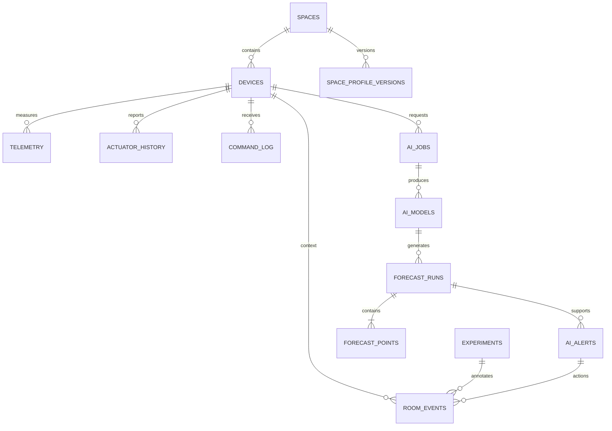
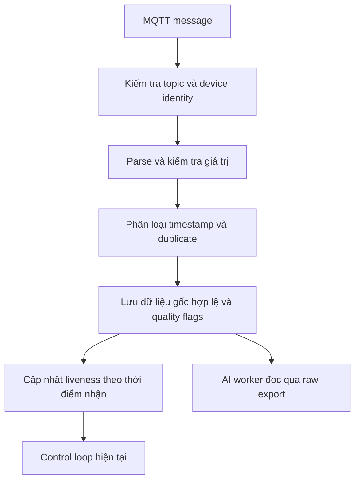
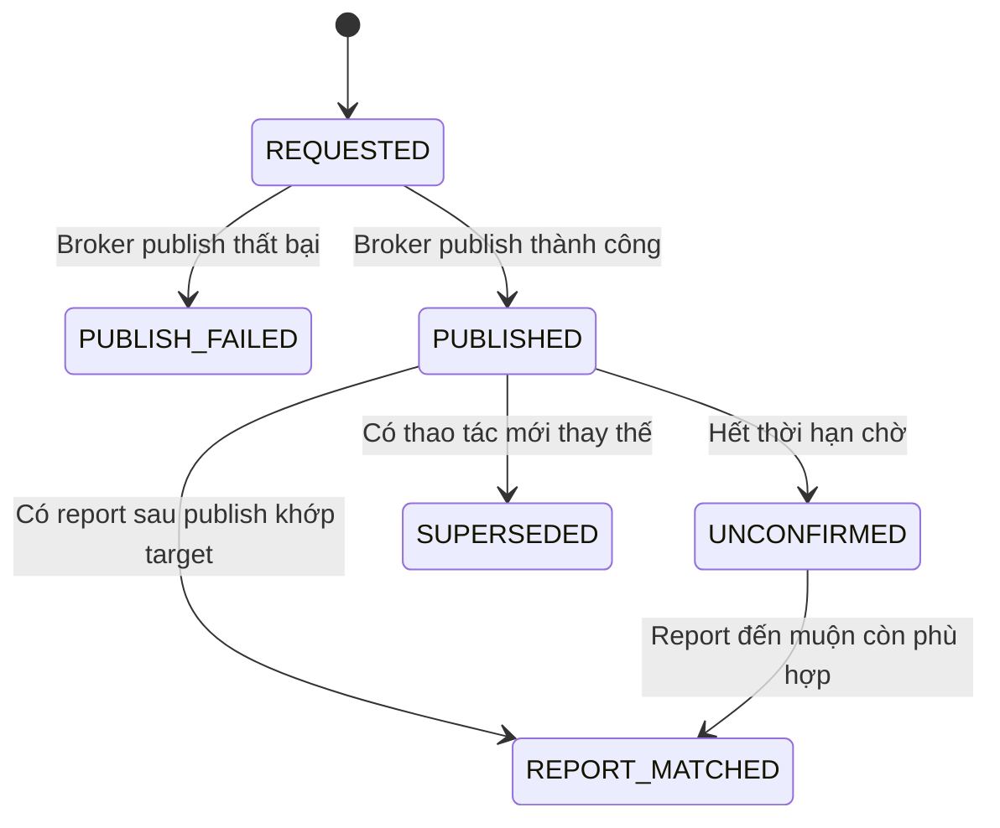

# 02 — Backend và nền dữ liệu

Trạng thái: thiết kế đề xuất; chưa có migration/API mới được triển khai. Đọc cùng [audit](01-current-system-audit.md) và [thiết kế AI](03-ai-service.md).

## 1. Mục tiêu và nguyên tắc

Backend phải phục vụ ba loại dữ liệu khác nhau: số đo gốc để học/kiểm chứng, dữ liệu gộp để xem chart, và kết quả AI đã phát hành. Không dùng response đã xử lý để hiển thị làm dữ liệu gốc huấn luyện.

Giữ Spring Boot, PostgreSQL, Flyway, MQTT và các REST endpoint đang dùng. Thay đổi theo hướng bổ sung, không bắt firmware đổi topic/payload. AI không thực hiện truy vấn trực tiếp vào Neon và không giữ credential database.

## 2. Sơ đồ dữ liệu đích



Các quan hệ trong sơ đồ thể hiện liên kết logic; không phải mọi liên kết đều bắt buộc có FK cứng. Metadata và bản export cần giữ được khi thiết bị được unpair. Không mở rộng chính sách xóa cascade hiện tại sang bằng chứng báo cáo; thao tác xóa hẳn cần phân biệt với unpair.

### 2.1. Bổ sung bảng hiện có

| Bảng | Trường/ý nghĩa đề xuất |
|---|---|
| `telemetry` | `received_at`, `device_timestamp`, `time_quality`, `quality_flags` JSONB, `dust_fault`, `uptime_sec`, `free_heap`, `min_free_heap`, `payload_hash` |
| `devices` | Thời gian nhận telemetry cuối riêng với thời gian đo; thời điểm actuator report cuối; liên kết command đang chờ |
| `spaces` | `occupancy_hours` nullable, `profile_version`; giữ purpose và công thức mặc định nếu không nhập giờ |

Không đổi nghĩa âm thầm của `fan_state/fan_level/fan_mode`: trong giai đoạn chuyển đổi giữ response cũ, thêm khối `reported_actuator` và `pending_command`. Khi frontend chuyển xong, các trường legacy chỉ là mirror của reported state, không cập nhật optimistic từ lệnh.

### 2.2. Bảng mới, phiên bản đầu

| Bảng | Trường chính và mục đích |
|---|---|
| `actuator_history` | ID, device, device timestamp nếu hợp lệ, `received_at`, state, level, duty, mode, runtime gốc, quality; lưu report append-only |
| `command_log` | UUID, device, command/params JSONB, actor, requested/published/matched timestamps, publish attempts, status, lỗi, thời hạn chờ |
| `space_profile_versions` | Space, version, effective timestamp, profile JSONB, threshold/source và các factors đã dùng |
| `room_events` | UUID, device/space, occurred/received timestamps, loại sự kiện, nội dung, experiment/alert nếu có |
| `experiments` | UUID, device, thời gian, protocol version, nhóm quan sát, điều kiện đầu, trạng thái và ghi chú |
| `ai_jobs` | UUID, type, device, params, status, worker/lease, progress, data cutoff, result/error; nhận cả train/evaluate/export |
| `ai_dataset_snapshots` | UUID, mốc snapshot, ordered ID manifests và context manifests bất biến, counts/hash, thời hạn tải |
| `ai_models` | UUID/version, device, algorithm, feature version, dataset manifest/hash, tham số, train cutoff, metrics JSONB, artifact hash, status |
| `forecast_runs` | UUID, device, model hoặc baseline ID, issued/input cutoff/accepted timestamps, profile version, threshold, data quality, worker |
| `forecast_points` | Run, horizon phút, target time, PM2.5, giá trị thật matched, lỗi, trạng thái chấm điểm |
| `ai_alerts` | UUID, device, forecast run, loại, thời gian, threshold snapshot, horizon, reason, lifecycle và phản hồi |

Worker heartbeat lưu trong một bảng nhỏ `ai_workers`; không lấy thời điểm forecast cuối để giả định worker còn online.

Indexes bắt buộc: telemetry `(device_id, recorded_at, id)` và `(received_at, id)`; actuator `(device_id, received_at)`; forecasts `(device_id, issued_at)`; points `(target_at, evaluation_status)`; jobs `(status, created_at)`; alerts `(device_id, created_at)`.

Giữ migrations V1–V4. Dự kiến V5 cho telemetry/actuator/command/profile và V6 cho AI/experiments. Không tạo lại bảng `predictions` V1 đã bị V4 xóa để rồi tái dùng ý nghĩa cũ.

## 3. Ingestion và chất lượng dữ liệu

Luồng đề xuất:



- So khớp device ID trên topic với payload; mismatch bị loại và ghi counter, không để payload đổi danh tính thiết bị.
- Giữ validation cảm biến trong contract. `null` được lưu; giá trị ngoài dải hoặc không hữu hạn bị reject theo chính sách hiện tại, đồng thời ghi lý do thống kê.
- Timestamp device thiếu/không hợp lệ: lưu thời gian nhận làm `recorded_at`, kèm `time_quality=server_assigned`; không đưa vào bộ kiểm định chính.
- Timestamp lớn hơn server quá 120 giây: quarantine metadata, không đưa vào control/train. Gói cũ hợp lệ được lưu như dữ liệu đến muộn, không làm lùi liveness.
- `received_at` là thời điểm backend nhận, không backfill bằng timestamp thiết bị. Dữ liệu cũ trước migration có `received_at=null`, provenance là legacy.
- Dedup v1 dựa device ID, timestamp device hợp lệ và hash payload canonical giống hệt. Cùng timestamp nhưng payload khác không bị xóa chung; đưa vào bucket với cờ conflict. Không tuyên bố exactly-once khi firmware chưa có sequence ID.
- Các counter reject/duplicate/quarantine lưu theo device/phút; không cần giữ toàn bộ payload lỗi vô hạn.

Telemetry hợp lệ để lưu chưa chắc hợp lệ để học: ví dụ PM bão hòa hoặc dust fault vẫn có giá trị chẩn đoán nhưng bị loại khỏi target/features PM. Không biến những mẫu này thành không khí sạch.

## 4. Raw export, snapshot và chart API

### Raw export dành cho worker

`GET /internal/v1/ai/devices/{id}/telemetry?from&to&limit&cursor&snapshot_id`

Trước khi tải, worker gọi `POST /internal/v1/ai/dataset-snapshots` với device/from/to. Backend tạo ordered manifest các ID nhìn thấy trong một transaction read-only `REPEATABLE READ`, sort theo `(recorded_at,id)`, kèm context manifests cùng snapshot, rồi lưu manifest bất biến vào `ai_dataset_snapshots`. Các GET phân trang chỉ đọc đúng slice ID theo ordinal trong manifest. Dữ liệu mới hoặc gửi bù sau snapshot không được chèn giữa các trang. Rows gốc đã lưu không sửa trong lúc export.

Không dùng riêng `max(id)` hoặc `received_at` làm bằng chứng snapshot cố định: transaction nhận ID sớm nhưng commit muộn có thể xuất hiện sau trang đầu. Membership bất biến mới là cơ sở bảo đảm phân trang. Bản đầu một node cho phép lưu ordered ID manifests dạng JSONB trong database; tải xong worker ghi snapshot local có hash. Giữ manifest tải trong bảy ngày rồi hết hạn bằng trạng thái rõ, giữ metadata/hash phục vụ audit; không giữ transaction database mở suốt lúc worker tải.

Response gồm `items`, `next_cursor`, snapshot metadata và counts. Giới hạn mặc định 2.000, tối đa 5.000 bản ghi/trang. Cùng snapshot và cursor phải trả cùng tập bản ghi; hết trang trả cursor null. Timestamp truyền bằng ISO-8601 UTC, JSON snake_case.

Worker lấy thêm actuator history, profile versions, room events trong cùng cửa sổ nhận snapshot. Đối với backtest point-in-time, chỉ join các record có thời gian nhận không sau forecast origin.

### Chart và thống kê

Thêm `GET /api/v1/devices/{id}/series?from&to&bucket=1m|5m|15m`, `GET /api/v1/devices/{id}/summary?from&to` và `GET /api/v1/devices/{id}/samples?from&to&limit&cursor` cho bảng số đo gốc có phân trang. Samples phục vụ xem, không thay contract snapshot dùng train/export kiểm định.

Series trả median/min/max/count/expected_count/quality theo bucket, không bỏ spike âm thầm. Summary trả trung bình, median, cực đại, tỷ lệ coverage, thời gian vượt ngưỡng và phần thời gian không xác định. Giới hạn tối đa 2.000 bucket/request; khoảng dài yêu cầu bucket lớn hơn. Endpoint history cũ tiếp tục phục vụ client cũ trong giai đoạn chuyển.

## 5. Command lifecycle và control



`REPORT_MATCHED` nghĩa là một report phần mềm thiết bị phù hợp với yêu cầu, **không phải ACK mang command ID và không phải xác nhận RPM**. Lưu `match_method=state_observation`.

Quy tắc phiên bản đầu:

- Tạo command record trước khi publish. Dùng ranh giới transaction riêng để lỗi HTTP hoặc rollback nghiệp vụ không xóa lịch sử publish đã xảy ra.
- Chờ report tối đa 15 giây. Lệnh mới thay thế lệnh pending trước đó của cùng device; không replay manual command cũ sau mất mạng.
- Nếu publish false: lưu thất bại, trả lỗi điều khiển có command ID để UI tra cứu; không cập nhật reported state hoặc `lastCommandAt`.
- Khi có actuator report: lưu append-only, cập nhật reported state theo bản tin nhận được và thử match command phù hợp; report lỗi giá trị không được mặc định hóa thành OFF.
- AUTO không phát lệnh ON mới mỗi telemetry khi còn command ON pending. Sau timeout, vòng đánh giá tiếp theo có thể tạo yêu cầu mới nếu điều kiện vẫn đúng; manual không tự retry.
- Gia hạn lease chỉ ghi thành công khi publish true. Không dùng AI để thay đổi lịch gia hạn.
- `max_on` xét trước guard dữ liệu PM cũ. Khi dữ liệu cũ, không kích hoạt theo PM và không gia hạn vô hạn; giữ fail-safe hiện có.
- Nút vật lý/manual override được tôn trọng. Nếu reported mode đổi, cập nhật UI và dừng tác vụ AUTO tương ứng.

Không thêm trường ACK vào firmware trong phiên bản này. Không có report thì hiển thị chưa xác nhận, kể cả trạng thái vật lý có thể đã đổi.

## 6. API đề xuất cho desktop và worker

| API | Vai trò |
|---|---|
| `GET /api/v1/ai/status` | Worker online/offline, model hiện hành, dữ liệu mới nhất |
| `POST /api/v1/ai/jobs` | Tạo train/evaluate/export job, trả 202 và job ID |
| `GET /api/v1/ai/jobs` và `GET /api/v1/ai/jobs/{id}` | Danh sách, tiến độ, lỗi và kết quả |
| `GET /api/v1/ai/models?device_id=...` | Phiên bản, tham số, dữ liệu học, metrics và trạng thái |
| `GET /api/v1/devices/{id}/forecast` | Forecast mới nhất, tuổi dữ liệu, model và baseline |
| `GET /api/v1/devices/{id}/ai-evaluation?from&to` | MAE/RMSE theo horizon, baseline, event metrics |
| `GET /api/v1/devices/{id}/alerts` | Cảnh báo và đề xuất |
| `POST /api/v1/alerts/{id}/feedback` | Chấp nhận/bỏ qua/đã làm, tạo liên kết sự kiện |
| `POST/GET /api/v1/devices/{id}/events` | Ghi và xem mốc hoạt động trong phòng |
| `POST/GET /api/v1/experiments` | Tạo phiên và xem kết quả quan sát |
| `GET /api/v1/devices/{id}/commands` | Lịch sử command và trạng thái xác nhận |
| `GET /internal/v1/ai/...` | Snapshot/raw data/config/events dành cho worker |
| `POST /internal/v1/ai/dataset-snapshots` | Chốt membership của dataset trước khi phân trang |
| `POST /internal/v1/ai/workers/{id}/heartbeat` | Worker capabilities, model artifact sẵn có |
| `POST /internal/v1/ai/jobs/claim` | Nhận một job đủ điều kiện một cách nguyên tử |
| `POST /internal/v1/ai/jobs/{id}/progress` | Heartbeat, gia hạn lease, tiến độ |
| `POST /internal/v1/ai/jobs/{id}/complete` | Hoàn tất job idempotent và đăng ký metadata |
| `POST /internal/v1/ai/forecast-runs` | Upload một run và points trong một transaction |

UI không cần biết địa chỉ service AI local. Local FastAPI chỉ expose `/health` trên loopback để chẩn đoán.

Job claim dùng transaction/row locking, không claim job train khác khi worker đang train. Heartbeat 15 giây, lease 90 giây; quá lease trả job về queue tối đa hai lần rồi đánh dấu lỗi. Job completion phải có lease token hiện hành, tránh worker cũ ghi đè job đã nhận lại.

Internal endpoints dùng `Authorization: Bearer ...` qua HTTPS; secret chỉ ở backend và worker env, không đưa vào Vite. Các API user giữ chính sách hiện tại; không tự mở thêm dự án authentication trong đợt này.

## 7. Payload tối thiểu và tính nhất quán

Ví dụ forecast response minh họa cấu trúc; các con số là **ví dụ contract**, không phải kết quả đo:

```json
{
  "status": "ready",
  "run_id": "uuid",
  "device_id": "device-id",
  "issued_at": "2026-11-14T03:00:10Z",
  "input_cutoff": "2026-11-14T03:00:00Z",
  "model_version": "pm25-feature-v1-model-001",
  "model_status": "experimental",
  "threshold_pm25": 25.0,
  "profile_version": 3,
  "points": [
    {"horizon_minutes": 5, "target_at": "2026-11-14T03:05:00Z", "pm25": 23.0},
    {"horizon_minutes": 15, "target_at": "2026-11-14T03:15:00Z", "pm25": 27.0},
    {"horizon_minutes": 30, "target_at": "2026-11-14T03:30:00Z", "pm25": 29.0}
  ]
}
```

Backend tự ghi `accepted_at`. Run chỉ đủ điều kiện chấm prospective nếu được backend nhận trước target, không tin riêng timestamp worker. UUID và unique `(device_id, model_version, input_cutoff)` ngăn gửi lặp. Không có kết quả mới thì trả run cũ cùng freshness, không tạo một issued timestamp mới cho cùng dự báo.

## 8. Nghiệm thu và migration

- Migration thêm nullable fields cho dữ liệu cũ; không gán thời gian nhận giả hoặc actuator history giả cho quá khứ.
- Snapshot export được tái đọc, không thiếu/trùng khi insert dữ liệu mới/gói gửi bù trong lúc phân trang.
- Series và summary tính từ cùng tập dữ liệu, công bố bucket và coverage.
- Publish thất bại, report đến muộn, manual override và worker offline có kiểm thử tích hợp.
- Metrics/export không nằm trong transaction ingestion MQTT; query có giới hạn cửa sổ và index.
- Có feature flag AI; tắt cờ không làm hỏng API đo/điều khiển cũ. Backup database trước migration, rollback ứng dụng bằng cờ; không drop bảng mới để rollback demo.
