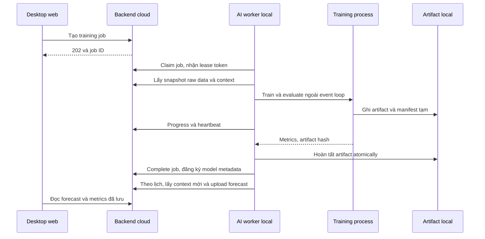

# 03 — Service AI tự huấn luyện trên dữ liệu thiết bị

Trạng thái: thiết kế đề xuất. Đây là phần học máy chính của phiên bản nâng cấp, không phải mô tả tính năng đã có.

## 1. AI giúp gì và không được kết luận quá mức

| Năng lực | Phần học máy | Giá trị sử dụng | Cách chứng minh |
|---|---|---|---|
| Dự báo PM2.5 | Học quan hệ giữa quá khứ và PM tương lai | Biết xu hướng trước mốc 5/15/30 phút | MAE/RMSE và so baseline |
| Cảnh báo trước vượt ngưỡng | Sử dụng forecast đã học | Có thời gian kiểm tra nguồn bụi, chuẩn bị xử lý | Event precision/recall và lead time |
| Đề xuất có bối cảnh | Quy tắc dùng forecast, PM hiện tại, CO₂, trạng thái quạt | Nói rõ nên kiểm tra gì và vì sao | Nhật ký phản hồi và phiên quan sát |
| Tự cập nhật model | Pipeline train/evaluate/promote | Học thêm dữ liệu mới thay vì cố định model demo | Training history, learning curve, model version |

Phần AI được train là mô hình dự báo. Chuyển dự báo thành lời đề xuất là logic sản phẩm có thể giải thích. Công thức tính ngưỡng hiện có không được gọi là một model học máy.

Không học một nhãn “không khí tốt cho sức khỏe” từ dữ liệu không có nhãn đó. Không khẳng định dự báo chắc chắn xảy ra nếu người dùng thay đổi quạt/cửa sau khi forecast phát hành.

## 2. Stack và cấu trúc service

Service mới dự kiến ở `ai-service/`, chạy Python, FastAPI, httpx, pandas hoặc numpy cho dữ liệu, scikit-learn cho model và joblib cho artifact local. Khóa phiên bản dependencies sau khi kiểm tra môi trường triển khai. CPU là cấu hình chuẩn; GPU không giải quyết được vấn đề thiếu dữ liệu của một node.

```text
ai-service/
  app/                 health, cấu hình và vòng đời service
  worker/              backend client, job claim, scheduler, heartbeat
  data/                raw export, snapshot, validation, bucket
  features/            feature-v1 dùng chung train và inference
  models/              persistence, Ridge, gradient boosting
  training/            split, search, evaluate, promotion
  inference/           load artifact, dự báo, upload run
  reports/             metrics, ablation, biểu đồ export
  tests/               temporal correctness, model IO, job lifecycle
  artifacts/           model/snapshot local, không commit dữ liệu lớn
```

Đây là cấu trúc dự kiến, chưa tạo code. Giữ `forecast-demo/` như bản thử tham khảo đến khi service mới đạt nghiệm thu; frontend chỉ chuyển sang API mới sau đó.

## 3. Luồng local worker



- Một service local, một worker; một training process tại một thời điểm. Train chạy trong process riêng, tránh chặn heartbeat và inference.
- Poll job 10 giây; heartbeat 15 giây; inference sau mỗi phút hoàn tất. Có timeout HTTP và retry có giới hạn cho thao tác idempotent.
- Kết quả upload lỗi được giữ trong outbox file local theo run ID, retry sau; backend vẫn kiểm tra thời điểm nhận trước target khi chấm prospective.
- Job train có timeout 10 phút và lưu lỗi rõ; không tự tạo hàng loạt job sau một lỗi.
- Restart phải đọc model pointer/artifact đã lưu. Đang train thì giao diện tiếp tục dùng model trước.
- Chỉ load artifact do chính pipeline local tạo, có hash/manifest; backend không gửi executable/pickle để worker thực thi.

## 4. Dataset: từ bản tin đến mẫu học

### 4.1. Mốc thời gian chuẩn

Bucket một phút, kết thúc tại `t`, chứa mẫu trong `(t−60 giây, t]`. Forecast origin là phút hoàn tất gần nhất. Input chỉ gồm bản tin đã được nhận trước `issued_at`; không nhìn vào phút chưa hoàn tất.

Với chu kỳ 5 giây, một bucket kỳ vọng 12 mẫu. Nếu thiết bị đã đổi interval, tính expected_count từ lịch sử interval có hiệu lực, không hardcode 12 cho mọi dữ liệu. Dữ liệu legacy không biết lịch sử interval phải gắn provenance giới hạn.

Bucket hợp lệ cho PM cần ít nhất 50% mẫu kỳ vọng, giá trị trong dải, không dust fault/bão hòa. Giá trị đại diện là median. Lưu thêm min/max/std/count và tỷ lệ coverage; không xóa spike chỉ vì nó lớn hơn hàng xóm.

### 4.2. Bảng features phiên bản `feature-v1`

| Nhóm | Features | Quy tắc thời gian |
|---|---|---|
| PM hiện tại và lag | PM tại t; lag 1, 2, 3, 5, 10, 15, 30, 60 phút | Chỉ bucket kết thúc không sau t |
| Rolling PM | Mean, median, std, min, max trong 5/15/30/60 phút; coverage mỗi cửa sổ | Cửa sổ kết thúc tại t |
| Xu hướng | Chênh lệch 1/5/15 phút; slope cửa sổ 5/15 phút | Không centered rolling |
| CO₂/T/RH | Giá trị gần nhất hợp lệ, mean và thay đổi 5/15 phút; missing flags | Chỉ dữ liệu đã nhận tại origin |
| Quạt | Reported state/level/mode, tuổi report; tỷ lệ ON và mean level 5/15/30 phút | Join report bằng thời gian nhận, không dùng command intent làm actual |
| Thời gian | Sin/cos giờ trong ngày theo Asia/Ho_Chi_Minh | Metadata đã biết trước |

Một phòng có volume/purpose gần như không đổi trong vài ngày. Giữ chúng trong metadata và tính ngưỡng; không tuyên bố model đã học được khác biệt giữa nhiều loại phòng từ một node.

Sự kiện ghi tay dùng để phân tích và phân nhóm trong phiên bản đầu, không là feature bắt buộc để model hoạt động. Tránh train bằng những ghi chú chỉ được bổ sung sau khi đã quan sát kết quả.

### 4.3. Missing data

- Feature PM chỉ forward-fill tối đa hai phút; lưu missing flag. Không backward-fill và không nội suy bằng mẫu tương lai.
- Nếu PM tại origin không có mẫu thật, hoặc một lag bắt buộc vẫn thiếu sau giới hạn fill: chưa tạo learned forecast mới.
- Rolling chỉ hợp lệ khi đạt ít nhất 80% bucket trong cửa sổ; thiếu thì pipeline abstain nếu thuộc PM bắt buộc.
- Features phụ CO₂/T/RH có thể thiếu: Ridge dùng imputer fit trên train và missing indicators; boosting nhận NaN cùng indicators. Không bỏ toàn bộ mẫu học chỉ vì sensor phụ chưa có số đo.
- Lịch sử quạt có khoảng offline dài hơn 30 giây đánh dấu unknown, không tích phân thành ON/OFF chắc chắn. OFF report cũ nhưng telemetry còn liên tục có thể carry như “trạng thái báo gần nhất”, kèm tuổi report; không biến tuổi report thành lỗi thiết bị chắc chắn.
- Latest input quá 5 phút là stale. Chưa có đủ lịch sử 60 phút hợp lệ là insufficient_data.
- Thiếu timestamp/provenance hoặc sensor freshness không xác định phải được công bố trong dataset quality, không tự bổ sung chứng cứ không có.

### 4.4. Labels và số lượng mẫu

Với mỗi origin t:

```text
X(t)   = features đã biết ở t
y5(t)  = median PM của bucket kết thúc ở t + 5 phút
y15(t) = median PM của bucket kết thúc ở t + 15 phút
y30(t) = median PM của bucket kết thúc ở t + 30 phút
```

Label cần mẫu thật hợp lệ, không fill. Mỗi horizon có số mẫu hợp lệ riêng; khi so các model dùng đúng cùng origins của horizon đó.

Một ngày đủ mẫu: khoảng 17.280 telemetry → 1.440 bucket phút → tối đa khoảng 1.350 origins có đủ lịch sử 60 phút và tương lai 30 phút. Đây không phải 1.350 quan sát độc lập vì các cửa sổ chồng lấn.

## 5. Thuật toán và quá trình lựa chọn

### 5.1. Baselines

**Persistence:** `y_hat(t+h)=PM(t)` cho cả ba horizon. Không cần train nhưng thường là đối chứng mạnh trong chuỗi thay đổi chậm.

**Ridge:** một estimator cho mỗi horizon, pipeline imputer → StandardScaler → Ridge. Grid alpha `{0.1, 1, 10, 100}`; fit preprocessing riêng trong từng fold. StandardScaler không phải mô hình dự báo.

### 5.2. Gradient boosting ứng viên

`HistGradientBoostingRegressor` học quan hệ phi tuyến giữa features và target, một estimator trực tiếp cho mỗi horizon. Không lấy forecast +5 làm input cho +15/+30.

Grid nhỏ, cố định trước khi xem test:

| Tham số | Giá trị |
|---|---|
| loss | squared_error |
| learning_rate | 0.05 hoặc 0.1 |
| max_leaf_nodes | 7 hoặc 15 |
| max_iter | 200 |
| min_samples_leaf | 20 |
| l2_regularization | 1.0 |
| early_stopping | false, tránh split validation ngẫu nhiên bên trong estimator |
| random_state | 42 |

Model chỉ là ứng viên. Chọn hyperparameters theo MAE validation; không ép boosting lên production nếu Ridge/persistence tốt hơn. Thiết kế lag features, temporal split và boosting có thể đối chiếu với [ví dụ chính thức scikit-learn](https://scikit-learn.org/stable/auto_examples/applications/plot_time_series_lagged_features.html).

### 5.3. Khi nào train

- Sau 24 giờ dữ liệu đạt coverage ≥80% có thể train bản experimental.
- Đánh giá chính cần tối thiểu 48 giờ thời gian quan sát, đủ mẫu để có train/validation/test; ưu tiên 3–7 ngày.
- Dùng tối đa 14 ngày gần nhất cho bản đầu. Những ngày chưa tồn tại không được thay bằng dữ liệu giả.
- Người dùng có thể tạo job thủ công. Scheduler kiểm tra mỗi giờ và chỉ tạo retrain khi cách lần train trước ít nhất 6 giờ, có ít nhất 6 giờ bucket mới hợp lệ và không có job train đang chờ/chạy.
- “Tự train” là batch retraining có phiên bản và kiểm định, không phải cập nhật trọng số sau từng gói telemetry.

## 6. Split, chọn model và promotion

Chi tiết phép đo ở [04 — Đánh giá](04-evaluation-and-experiments.md). Quy tắc bắt buộc: thời gian tăng dần, preprocessing fit trên train, purge label 30 phút qua ranh giới; test dùng một lần cho model báo cáo đóng băng.

Trong tập development, dùng ba fold walk-forward nếu đủ dữ liệu: mỗi fold bắt đầu với ít nhất 12 giờ train, validation ít nhất 4 giờ; origin được chia theo timestamp thực thay vì ép chuỗi thiếu dữ liệu thành index đều. Nếu không đủ ba fold, dùng một chronological holdout và ghi rõ đánh giá sơ bộ.

Promotion gate trên cùng validation window:

1. So ứng viên với baseline tốt nhất trong persistence/Ridge.
2. `mean(MAE15, MAE30)` phải giảm ít nhất 10% so baseline; MAE5 không xấu hơn 5%.
3. Nếu baseline MAE bằng 0, không tính phần trăm; không promote model sai số lớn hơn 0. Nếu cùng 0 giữ model đơn giản hơn.
4. Không có lỗi pipeline, timestamp, dữ liệu hoặc artifact; so trên cùng origins có đủ target.
5. Thay model pointer atomically sau khi artifact hoàn tất, giữ bản trước để rollback.

Nếu chưa đạt: model vẫn được lưu là experimental/rejected với metrics và lý do. Ridge có thể trở thành learned model phục vụ nếu nó vượt persistence theo cùng tiêu chí; nếu không, UI giữ persistence ở vai trò baseline và hiển thị model học được riêng ở chế độ thử nghiệm.

Trong đợt báo cáo cuối, đóng băng model và lịch train cho cohort test. Dữ liệu test không dùng lại để điều chỉnh model báo cáo; fail test thì công bố fail và bắt đầu một kỳ đánh giá tương lai mới nếu còn thời gian.

## 7. Artifacts, registry và reproducibility

Mỗi model version có:

- File model, feature schema, preprocessing và algorithm/hyperparameters.
- Manifest dataset: snapshot ID/hash, thời gian quan sát/nhận, device, số rows/buckets/origins hợp lệ, exclusions.
- Thời gian train, cutoff nhãn train/validation, split boundaries, git revision và dependency versions.
- Metrics từng horizon, metrics từng fold, baseline values, model status/promotion reason.
- Artifact SHA-256 và worker ID có artifact local.

Backend lưu metadata và metrics; artifact/snapshot ở thư mục local được backup trước demo. Backend còn metadata nhưng laptop mất artifact thì status là artifact_missing, không giả định có thể tiếp tục inference bằng model đó.

## 8. Inference và cảnh báo

Mỗi phút: lấy context ít nhất 65 phút qua raw API → bucket/features chung → kiểm tra readiness → load model đang dùng → dự báo ba mốc → clip về dải sensor [0,500] → upload một forecast run. Ghi tỷ lệ bị clip và chấm metrics trên output đã clip cho tất cả model; không giấu việc model ra ngoài dải.

Output gồm forecast, model version, issued/input cutoff/accepted timestamps, threshold và profile version, data quality, baseline đi kèm. Chart chỉ có điểm dự báo thật ở +5/+15/+30; đoạn nối là hỗ trợ nhìn xu hướng, không mô tả như đã dự báo độc lập từng phút.

### Logic cảnh báo/đề xuất phiên bản đầu

| Điều kiện | Hiển thị | Hành động |
|---|---|---|
| PM hiện tại dưới ngưỡng, một horizon dự báo đạt/vượt ngưỡng | Nguy cơ vượt ngưỡng tại mốc dự báo sớm nhất | Đề nghị kiểm tra nguồn bụi, xem điều khiển quạt |
| PM hiện tại đã vượt ngưỡng | Đang vượt ngưỡng | Trình bày quyết định backend và reported/pending state, không gọi là cảnh báo sớm |
| Có cảnh báo, fan OFF/level thấp | Forecast và trạng thái hiện tại | Nút mở điều khiển; người dùng chọn/xác nhận mức và mode như chức năng hiện tại |
| CO₂ vượt mốc advisory cấu hình | Kiểm tra thông gió | Rule-based, tách khỏi chất lượng PM forecast; không tự tăng quạt HEPA vì CO₂ |
| Data/model chưa sẵn sàng | Chưa đủ cơ sở dự báo | Hiển thị số đo thật, coverage và việc cần chờ |

Mốc advisory CO₂ mặc định 1.000 ppm là thông số vận hành có thể đổi và được ghi là policy của dự án, không phải model học được hoặc chứng nhận an toàn. Không bật quạt sớm tự động trong phiên bản này.

Cảnh báo forecast cần xuất hiện ở hai run liên tiếp trước khi thông báo; cùng đợt không spam mỗi phút. Giữ alert active tới khi không còn forecast breach trong ba run liên tiếp, hoặc PM đã vượt ngưỡng và chuyển trạng thái observed_breach. Cooldown thông báo 15 phút; lưu các forecast hỗ trợ alert để audit. Các chi tiết chấm event ở tài liệu 04.

## 9. Giải thích model và uncertainty

- Có ablation: PM-lags-only so với full features, dùng cùng estimator/split/origins.
- Permutation importance theo nhóm PM, môi trường, actuator và thời gian trên validation; không dùng test để chọn features.
- Giải thích importance là mức ảnh hưởng tới dự báo trên dữ liệu kiểm định, không phải quan hệ nhân quả.
- Không tạo “độ tin cậy 95%” bằng công thức tùy ý từ RMSE. Bản đầu dùng data quality và lịch sử error làm bối cảnh, không là xác suất đúng của một điểm.
- Quantile models và coverage là P2; chỉ hiển thị prediction band sau khi đo coverage/width trên dữ liệu ngoài train. Tham khảo [prediction intervals của scikit-learn](https://scikit-learn.org/stable/auto_examples/ensemble/plot_gradient_boosting_quantile.html).

## 10. Tiêu chí nghiệm thu AI

- [ ] Train thực trên snapshot node, không dùng tập giả làm bằng chứng chính.
- [ ] Cùng input tạo cùng features ở train và inference; không leakage qua preprocessing hoặc future join.
- [ ] Có cả persistence và Ridge trong bảng đánh giá.
- [ ] Restart load lại artifact; background train không làm gián đoạn dự báo.
- [ ] Mỗi forecast có model/cutoff/threshold/version; upload sau target không được tính prospective.
- [ ] Underperforming, insufficient_data, stale_data, worker_offline và artifact_missing có hành vi rõ.
- [ ] Có model card đủ trả lời “học từ gì, học bao nhiêu, đánh giá ra sao, đang tốt/xấu ở đâu”.
