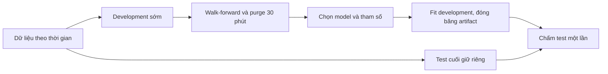
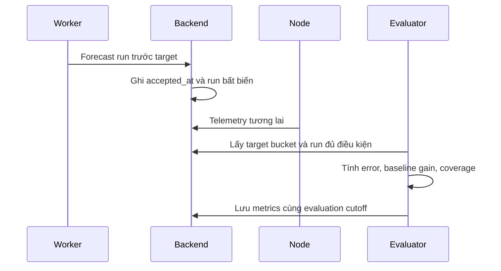

# 04 — Đánh giá AI và thí nghiệm chứng minh giá trị

Trạng thái: protocol đề xuất, **chưa có kết quả đo**. Các tỷ lệ mục tiêu trong tài liệu không được đưa lên slide như thành tích đã đạt.

## 1. Ba loại kết luận phải tách riêng

| Câu hỏi | Dữ liệu cần có | Có thể kết luận |
|---|---|---|
| Model dự báo có tốt hơn baseline? | Origins, dự báo và ground truth cùng horizon/split | Sai số cải thiện trên khoảng đã kiểm định |
| Cảnh báo có sớm và hữu ích? | Alert đã phát hành, event vượt ngưỡng, thời gian theo dõi | Lead time, precision, recall, false alarms |
| Đề xuất có cải thiện vận hành? | Hành động thật và các phiên có điều kiện được ghi lại | Kết quả quan sát; chỉ kết luận nhân quả nếu thiết kế đối chứng đủ chặt |

Forecast chart đẹp không chứng minh quạt tiết kiệm điện hoặc người dùng giảm phơi nhiễm. Sai số thấp trên không khí gần như đứng yên cũng chưa chứng minh cảnh báo được một đợt tăng bụi.

## 2. Thu thập dữ liệu thật

Một node/phòng, mục tiêu liên tục 3–7 ngày. Bắt đầu ngay sau khi lưu được raw telemetry và actuator history, không chờ hoàn thiện UI.

Mỗi ngày ghi: thời gian node hoạt động, PM/CO₂/T/RH, reported fan state, ngưỡng/cấu hình, các mốc mở/đóng cửa hoặc hoạt động đã quan sát. Thao tác quạt trên web tự tạo event; thay đổi bằng nút vật lý dựa trên report và có thể bổ sung ghi chú.

Không đòi người dùng gắn nhãn mọi phút. Có nút sự kiện nhanh và ghi chú tự do; phân biệt `occurred_at` do người dùng nhập với `received_at` để biết sự kiện nào được ghi bổ sung về sau.

Không tạo dữ liệu giả để làm biểu đồ “kết quả thật”. Dữ liệu mô phỏng chỉ phục vụ kiểm thử hoặc replay giao diện, có nhãn và không đi vào bảng metrics chính.

### Data card cho mỗi lần đánh giá

| Mục | Nội dung |
|---|---|
| Phạm vi | Device, phòng, from/to UTC và múi giờ hiển thị |
| Khối lượng | Raw packets, valid buckets, số origins mỗi horizon |
| Chất lượng | Coverage, null, lỗi/bão hòa, gap, late packets, clock quality |
| Bối cảnh | Ngưỡng/profile version, chế độ quạt, các thay đổi cấu hình |
| Giới hạn | Một node, không có PM reference/RPM/power, freshness cảm biến chưa đầy đủ |

MAE ở đây đo khả năng dự báo **số đo sensor của hệ thống**, không xác nhận độ chính xác tuyệt đối của sensor so với thiết bị tham chiếu.

## 3. Chia train/validation/test

### 3.1. Quy tắc chính

- Không shuffle chuỗi thời gian. Không fit scaler/imputer trên toàn dataset trước khi split.
- Nếu tổng khoảng quan sát từ 48 đến dưới 72 giờ: test là 12 giờ cuối. Từ 72 giờ trở lên: test là 24 giờ cuối.
- Development là phần đứng trước test. Tuning dùng walk-forward như tài liệu 03; fallback holdout giữ 25% cuối development nếu chưa đủ folds.
- Purge origins có label +30 phút vượt ranh giới train/validation/test. Gap được tính bằng thời gian thực, không chỉ số dòng sau khi drop missing.
- Feature history của test được đọc từ quá khứ trước test; điều này hợp lệ. Không đưa target test vào fit hoặc chọn model.
- So sánh trên giao của origins hợp lệ cho các model. Công bố số bị loại và lý do; không chọn bỏ điểm model dự báo sai.



### 3.2. Hai loại bằng chứng khác nhau

**Retrospective test:** train trên phần quá khứ và evaluate phần sau theo split đã khóa. Khi replay, features phải point-in-time theo thời gian nhận, không dùng dữ liệu đến muộn như thể nó đã có ở origin. Dữ liệu legacy chưa có `received_at` chỉ được ghi là backtest hạn chế provenance.

**Prospective test:** model đóng băng, forecast được backend chấp nhận trước target thật, chờ telemetry tương lai để chấm. Không upload backtest cũ rồi gọi là forecast thực tế.

Đợt báo cáo ưu tiên có tối thiểu 12 giờ prospective sau khi model đóng băng. Nếu chưa đủ thì báo đúng thời lượng hiện có; không kéo dài đường forecast trên chart để tạo cảm giác có thêm bằng chứng.

## 4. Forecast ledger và ground truth

Mỗi run lưu: issued_at, accepted_at, input_cutoff, model version/train cutoff, snapshot/feature version, threshold/profile và ba target times. Lưu persistence, Ridge và model ứng viên theo cùng origins, kể cả model không được chọn làm mặc định.



Ground truth là median bucket target theo cùng quy tắc valid/count. Chờ tối đa 10 phút sau target để nhận gói trễ. Sau mốc này kết quả đánh giá của snapshot được đóng băng; dữ liệu đến muộn hơn được thống kê riêng, không âm thầm đổi biểu đồ đã export.

Không đủ target thì `unscored_missing_target`; upload sau target là `late_submission`, không chấm prospective. Giữ cả số điểm có thể chấm và tổng điểm phát hành để model không có vẻ tốt chỉ vì bỏ qua những đoạn khó.

## 5. Chỉ số và biểu đồ bắt buộc

### 5.1. Sai số dự báo

```text
MAE(h)  = mean(abs(predicted(t,h) - observed(t+h)))
RMSE(h) = sqrt(mean((predicted(t,h) - observed(t+h))²))
Gain(h) = 100 × (MAE_baseline(h) - MAE_model(h)) / MAE_baseline(h)
```

Nếu baseline MAE=0, gain là không áp dụng. Không dùng MAPE làm chỉ số chính vì PM gần 0 làm mẫu số không ổn định.

| Biểu đồ | Mục đích |
|---|---|
| Actual và ba model ở horizon cố định | So các dự báo đã phát hành cho cùng target; không chắp forecast mới thành đường rồi gọi là forecast cũ |
| Cột MAE/RMSE cho 5/15/30 phút | Đánh giá theo độ xa tương lai |
| Error theo thời gian và nhóm PM/quạt | Biết model sai ở đoạn tăng bụi, bật quạt hay dữ liệu yếu |
| Predicted vs actual, đường y=x | Nhìn bias, các điểm bão hòa hoặc dự báo lệch |
| Learning curve theo thời lượng dữ liệu | So các model train prefix khác nhau trên cùng validation tương lai cố định |
| Ablation và feature importance | Kiểm tra features phụ có đóng góp thay vì chỉ kể tên cảm biến |

Mục tiêu promotion là giảm 10% MAE 15/30 phút, không phải cam kết có sẵn. Báo cả gain âm. Nếu thêm khoảng bất định của metric, dùng resampling theo block thời gian tối thiểu 60 phút, không bootstrap từng điểm chồng lấn như quan sát độc lập.

### 5.2. Sự kiện cảnh báo

Trong cửa sổ đánh giá chính, cố định threshold/profile để kết quả không bị lẫn với việc đổi chính sách.

- Event bắt đầu từ bucket đầu của ba phút hợp lệ liên tiếp PM ≥ threshold; xác nhận ở phút thứ ba nhưng onset là phút đầu.
- Kết thúc khi có ba phút hợp lệ liên tiếp dưới threshold.
- Khoảng missing làm event bị gián đoạn/không xác định; không nối qua gap như chắc chắn PM vẫn cao.
- Alert onset là thời điểm alert thực sự được tạo sau điều kiện hai forecast liên tiếp, không lùi về run đầu tiên.
- Match alert trong 30 phút trước một event onset; mỗi event và alert episode chỉ match một lần, ưu tiên alert hợp lệ sớm nhất.
- PM đã vượt ngưỡng ở thời điểm cảnh báo không được tính là early warning.
- Alert chưa hết 30 phút theo dõi hoặc thiếu target window là pending/unscored.

Chỉ số:

```text
Precision = matched alert episodes / adjudicated alert episodes
Recall = event episodes có early warning / event episodes đủ dữ liệu
Lead time = event onset - alert onset, chỉ tính giá trị dương
False alarms/day = unmatched adjudicated alerts / valid observation hours × 24
```

Trình bày TP/FP/FN, valid hours, số event và median lead time. So cùng logic alert với forecast Ridge/persistence; thêm đối chiếu với rule chỉ báo sau khi PM hiện tại vượt ngưỡng.

Nếu có hành động sớm có thể ngăn event, không tự gọi cảnh báo đó là false positive hoặc true positive. Đưa vào nhóm `intervention_affected`, công bố số lượng và phân tích riêng. Bảng warning quality chính dùng giai đoạn shadow, chưa hiển thị đề xuất cho người vận hành; core control theo ngưỡng vẫn chạy bình thường.

Đổi threshold trong cửa sổ theo dõi thì loại run đó khỏi event benchmark cố định, giữ trong operational log. Không viết lại threshold cũ để tăng tỷ lệ đúng.

Nếu chưa có đủ 10 event độc lập, metrics vẫn được tính khi mẫu số hợp lệ nhưng phải gắn nhãn sơ bộ. Không có event thì precision/recall có thể là N/A; đó không phải lỗi biểu đồ.

## 6. Thí nghiệm đề xuất và hành động thật

### 6.1. Hai giai đoạn

**Giai đoạn A — shadow:** AI dự báo và lưu cảnh báo, chưa hiển thị khuyến nghị hành động. Đo forecast/warning quality trên luồng vận hành hiện có.

**Giai đoạn B — hỗ trợ người dùng:** hiển thị đề xuất; người dùng quyết định và thao tác qua điều khiển hiện có. Lưu `suggested_at`, `accepted_at`, command, reported state và các sự kiện liên quan.

Không tắt control loop nền để tạo một đối chứng yếu. Không coi một lần bật quạt làm PM giảm là bằng chứng đã học được chính sách tối ưu.

### 6.2. Phiên quan sát ghép cặp

Mục tiêu ít nhất ba cặp phiên, xem là mô tả sơ bộ. Mỗi phiên có 30 phút theo dõi sau mốc bắt đầu, cộng lịch sử trước đó để biết xu hướng. Không cần cố tạo thêm nguồn bụi cho đủ số phiên; dùng diễn biến thực tế và công bố số phiên thu được.

Ghép các phiên cùng phòng, threshold, điều kiện cửa tương đương, PM đầu chênh không quá 20%, CO₂ cùng nhóm dưới/trên mốc advisory. Ghi hoạt động phòng, trạng thái quạt ban đầu và can thiệp khác. Chốt thứ tự shadow/assisted trước phiên nếu có thể, không chỉ chọn các lần AI thành công để đưa vào bảng.

Các chỉ số mô tả:

- Số phút PM vượt threshold trong 30 phút, tính trên thời gian có dữ liệu.
- Diện tích vượt ngưỡng: `sum(max(PM-T,0) × valid_minutes)`, đơn vị µg·min/m³.
- Thời gian quay về dưới ngưỡng và giữ ba phút; chưa hồi phục cuối phiên ghi là censored, không gán 30 phút như đã hồi phục.
- Phút quạt được thiết bị báo ON; khoảng không xác định tính riêng.
- Độ trễ từ đề xuất tới thao tác và tới report khớp.

Các phiên khác điều kiện chỉ đặt cạnh nhau để thảo luận, không gộp thành tỷ lệ cải thiện nhân quả. Mở cửa có thể thay đổi cả CO₂ và PM theo môi trường bên ngoài; hệ thống hiện không có cảm biến ngoài trời để khẳng định chiều tác động trước.

## 7. Export để đưa lên slide

Mỗi gói export phải có:

```text
manifest.json        khoảng dữ liệu, model versions, cutoff, protocol version, hashes
forecast-points.csv  origin, target, forecast, actual, baseline, status
event-metrics.csv    từng event/alert match và trạng thái chấm
experiments.csv      điều kiện, hành động, outcome, phần dữ liệu thiếu
metrics.json         metrics từng horizon và mẫu số
figures/             SVG và PNG có title, đơn vị, legend, khoảng thời gian
limitations.md       giới hạn cụ thể của chính lần đánh giá này
```

Charts xuất bằng công cụ plotting chuẩn như matplotlib, không chụp chart rồi sửa số. Chọn một đoạn thời gian đại diện và có thể công bố thêm các đoạn model sai; metric tổng luôn dựa toàn bộ test đã chốt.

## 8. Câu kết luận được phép dùng

Khi đạt: “Trên [N] origins của [khoảng thời gian], model giảm MAE ở horizon 15 phút từ [A] xuống [B] µg/m³ so với [baseline]. Có [E] sự kiện được chấm, median cảnh báo trước [L] phút.”

Khi chưa đạt: “Model đã tự train và hoạt động; trong tập kiểm định này chưa tốt hơn persistence. Hệ thống giữ baseline làm mặc định và tiếp tục thu [phần dữ liệu còn thiếu].”

Chỉ nói “AI giảm thời gian vượt ngưỡng” khi có kết quả thí nghiệm phù hợp; nếu chưa kiểm soát được điều kiện thì dùng “các phiên có hỗ trợ AI ghi nhận…”, kèm số phiên và giới hạn.
