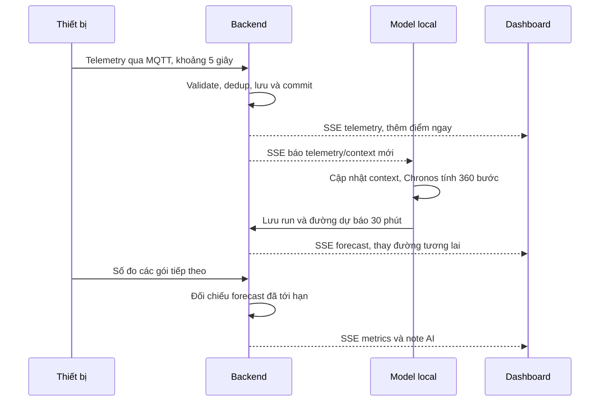

# 07 — AI trên một chart trực tiếp: thực đo, dự báo và độ khớp

Ngày: 14/11/2026. **Kế hoạch mới để review; chưa triển khai.**

Chốt bổ sung: **một chart nối tiếp trên cùng hệ trục; mỗi telemetry khoảng 5 giây kích hoạt cập nhật thực đo và tính lại dự báo**. Các đoạn cũ nói inference mỗi phút đã được thay bằng thiết kế bên dưới. Quy trình nghiên cứu/train và các hình dùng làm slide được ghi riêng tại [08 — Dữ liệu, phân tích và huấn luyện](08-ai-data-analysis-and-training.md).

Tài liệu này thay hướng sản phẩm AI của kế hoạch 03/04/05: bỏ trang Trung tâm AI khỏi luồng sử dụng chính, thay mô hình chính bằng foundation model dự báo chuỗi thời gian, đưa dự báo và kết quả đối chiếu vào ngay màn hình phòng. Không sửa firmware trong đợt này.

## 1. Người xem chỉ cần hiểu ba việc

1. Đường bên trái là không khí thiết bị vừa đo.
2. Đường bên phải là dự báo 30 phút tiếp theo; dòng phía trên cho biết có cần chú ý hoặc hành động gì.
3. Ô bên cạnh cho biết các dự báo đã phát hành trước đó khớp số đo thực tế đến mức nào.

Không bắt người dùng đọc worker, feature version, promotion gate, training jobs, artifact hash hoặc bảng Ridge/boosting. Những thứ phục vụ debug/train vẫn có thể lưu nội bộ và xuất phục vụ phụ lục; không chiếm giao diện chính.

Giao diện dễ hiểu giúp báo cáo mạch lạc. Không có thiết kế hoặc kích thước model nào bảo đảm giảng viên sẽ không hỏi sâu. Cần chuẩn bị được lời giải thích ngắn, đúng với hệ thống thực sự chạy.

## 2. Bố cục chốt

```text
Phòng ngủ · Đang nhận dữ liệu                         [Xem lịch sử] [Cài đặt]
PM2.5 28.4 µg/m³    CO₂ 920 ppm    24.1 °C    74 %

AI: PM2.5 có thể vượt ngưỡng trong khoảng 10 phút; nên kiểm tra nguồn bụi.

┌──────────────────────────────────────────────────────┬──────────────────────┐
│              MỘT CHART, CHUNG TRỤC THỜI GIAN          │ ĐỘ KHỚP DỰ BÁO       │
│                                                      │ [5p] [15p] [30p]    │
│   THỰC ĐO                       DỰ BÁO               │                      │
│   đường xanh liền              đường vàng nét đứt    │ Sai lệch trung bình  │
│               ╱╲                  ╱╲                 │ — µg/m³              │
│  ────────────╱  ╲────────●┆───────╱  ╲──────          │                      │
│  -30p      -15p       HIỆN TẠI        +15p      +30p  │ Trong ±5 µg/m³      │
│                         ┆                            │ — %                  │
│  đường dự báo cũ đã tới hạn có thể bật để đối chiếu   │ — mốc đã đối chiếu  │
├──────────────────────────────────────────────────────┤                      │
│ [Thực đo] [Dự báo] [Dự báo trước 5 phút]               │ 6 giờ gần nhất      │
│ Mất dữ liệu thì để trống; không nối qua khoảng mất   │ [Xem các mốc]        │
└──────────────────────────────────────────────────────┴──────────────────────┘

Quạt: AUTO · máy báo ON mức 3                         [AUTO] [Tắt] [1] [2] [3]
```

Các số trong wireframe chỉ là ví dụ bố cục, không phải kết quả model.

- Ở desktop, chart chiếm khoảng 75%, ô độ khớp 25%. Chart tối thiểu cao 400 px; tooltip và số trục đủ lớn để trình chiếu.
- **Chỉ một chart instance**, một trục X, một trục Y, một tooltip. Hai nửa là hai miền thời gian trong cùng chart, không phải hai biểu đồ đặt cạnh nhau hoặc hai trục tự scale.
- Chế độ Trực tiếp hiển thị 30 phút trước và 30 phút sau timestamp mẫu hợp lệ mới nhất. Mốc Mẫu mới nhất ở giữa; tooltip ghi cả thời gian đo và nhận, nhãn tuổi mẫu cho biết có đang chậm/mất kết nối không.
- Mỗi packet khoảng 5 giây thêm một điểm thực đo, dịch cửa sổ thời gian và kích hoạt tính lại forecast. Không có lịch chờ 5 phút hoặc một phút cho đường dự báo.
- Đường dự báo bắt đầu bằng điểm nối `(timestamp mẫu mới nhất, PM mẫu mới nhất)`, sau đó là **360 giá trị model dự báo**, cách nhau 5 giây đến +30 phút. Điểm nối là số đo, không tính vào sai số model và không ép các giá trị tương lai bằng số đo đó.
- Toàn bộ thời gian chờ suy luận vẫn giữ chart cũ, thêm số đo mới và hiện Đang cập nhật dự báo. Đường tương lai cũ giữ nguyên giá trị/thời gian; nếu nối từ mẫu mới sang điểm tương lai đầu còn hiệu lực thì đó chỉ là đoạn nối hiển thị, không được ghi thành forecast mới. Run cũ và issue time giữ nguyên để đối chiếu.
- Khi kết quả mới về, thay đường tương lai atomically; không vẽ lại đường thực đo và không sửa forecast lịch sử. Kết quả của origin đã bị một kết quả mới hơn thay thế không được kéo chart lùi.
- Nhìn lịch sử 1h/24h là chế độ khác, không ép 24h quá khứ và 30p tương lai thành hai nửa có tỷ lệ gây hiểu nhầm.
- Bỏ panel dự báo riêng bên phải và mục Trung tâm AI trên sidebar. Ô độ khớp thay vị trí panel đó. Giữ điều khiển quạt; chuyển thông tin bảo trì/lõi lọc về Cài đặt.
- `/ai` cũ redirect về phòng tương ứng; không để liên kết cũ chết. Bảng train/model chỉ còn ở công cụ phát triển hoặc bản export, không dựng một trang quản trị khác thay tên.

## 3. SSE: gói mới tới đâu chart vẽ tới đó

Hiện source chưa có `SseEmitter` hoặc `EventSource`; cần triển khai đường streaming thật.



Firmware vẫn phát khoảng 5 giây/gói. SSE giúp server đẩy ngay sau khi nhận, không tự làm cảm biến đo nhanh hơn. Không tạo thêm điểm giả để chart có vẻ đang đo mỗi giây. Có thể animate đường chuyển động, nhưng timestamp/giá trị phải giữ nguyên.

### API và vòng đời kết nối

- `GET /api/v1/devices/{id}/live/snapshot`: initial state, 30 phút raw samples, forecast hiện hành, dữ liệu đối chiếu, metrics, note, server time và cursor.
- `GET /api/v1/devices/{id}/live/events`: `text/event-stream`; sự kiện `telemetry`, `forecast`, `metrics`, `advisory`, `actuator`, `reset`.
- Envelope tối thiểu: `event_id`, `device_id`, `occurred_at`, `received_at`, `payload`; tất cả JSON snake_case. SSE `id` dùng event cursor, không lấy timestamp làm khóa unique.
- Đăng ký subscription và chốt high-water cursor trước snapshot; replay các event sau cursor để không mất gói giữa initial GET và mở stream. Dedup frontend bằng event ID và sample/run ID.
- Publish sự kiện **sau transaction commit**. Không để `SseEmitter.send()` chặn callback MQTT: executor và hàng đợi có giới hạn cho từng client; client chậm được reset/resync.
- Heartbeat dạng comment mỗi 15 giây. EventSource reconnect tự động; server giữ buffer khoảng 1.000 event/device cho phiên bản một instance. Cursor quá cũ hoặc server restart thì gửi `reset`, client lấy snapshot mới.
- CORS cho origin hiện tại; response không cache, flush từng event, kiểm tra proxy cloud có giữ buffer hay cắt stream không. Xác minh trên backend đã deploy, không chỉ localhost.
- Khi stream lỗi, giữ chart và báo Đang kết nối lại. Có thể fallback polling 5 giây nếu kết nối SSE chưa khôi phục; khi SSE lên phải dừng polling, không chạy song song hai đường nhận.
- Cấu hình, pair và lệnh quạt tiếp tục dùng REST. SSE chỉ thay cách đẩy dữ liệu về UI.
- Worker local cũng subscribe SSE outbound tới backend qua `/internal/v1/ai/devices/{id}/events`. Load context một lần lúc khởi động, cập nhật cache từ gói mới, resync raw data khi reconnect; không tải lại 60 phút lịch sử sau mỗi packet.
- Inference một tác vụ/device tại một thời điểm. Trong lúc đang tính, giữ một pending request mới nhất, không xếp hàng mọi gói tới hạn. Xong tác vụ thì nhận context mới nhất; theo dõi số lần bỏ bớt yêu cầu để đo khả năng theo kịp 5 giây.
- Mỗi forecast gắn `anchor_sample_id`, `input_cutoff`, `issued_at`, `accepted_at`; UI không nhận kết quả cũ làm kết quả hiện hành. Gói gửi bù chỉ bổ sung lịch sử, không đổi anchor mới nhất thành mẫu quá khứ.

Spring MVC đã hỗ trợ SSE; không cần đổi toàn bộ backend sang WebFlux. Tham khảo [tài liệu Spring](https://docs.spring.io/spring-framework/reference/web/webmvc/mvc-ann-async.html).

## 4. Model chính: Chronos-2, có fine-tune thực

Chọn `amazon/chronos-2`: foundation model encoder-only **120 triệu tham số** cho dự báo chuỗi thời gian, có khả năng dùng nhiều chuỗi/covariates và xuất nhiều bước tương lai. Đây là thay đổi model chính, không đổi tên Ridge thành AI lớn. Nguồn: [model card của Amazon](https://huggingface.co/amazon/chronos-2).

### Input/output

| Thành phần | Quyết định |
|---|---|
| Target | PM2.5 |
| Nhịp học/dự báo | 5 giây/mẫu, cùng nhịp dữ liệu thiết bị |
| Context tối đa | 720 bước, tương đương 60 phút gần nhất |
| Input phụ | CO₂, nhiệt độ, độ ẩm và mức quạt đã được thiết bị báo trong quá khứ |
| Forecast | 360 bước, +5 giây đến +30 phút; đường chính là median dự báo |
| Nhịp inference | Sau mỗi telemetry mới hợp lệ, thông thường một lần/5 giây |
| Lúc chưa đủ context | Note ngắn Chưa đủ lịch sử để dự báo, giữ chart thực đo |
| Mức readiness khởi đầu | Cửa sổ 60 phút, ít nhất 576/720 bước có mẫu hợp lệ; mẫu mới nhất không quá 15 giây; readiness phải được kiểm tra khi benchmark |

Chỉ dùng quá khứ cho sensor/fan covariates. Không điền trước CO₂, nguồn bụi hoặc mức quạt tương lai như thể model đã biết. Khoảng mất dữ liệu giữ missing mask; không ép một ngày mất mạng thành chuỗi liên tục.

Context chuẩn hóa trên lưới 5 giây kết thúc tại anchor của run; chọn số đo đã có trong từng ô, giữ timestamp/ID gốc. Không kéo mẫu chưa nhận vào context. Các biến đổi dữ liệu, khoảng thiếu và khác biệt giữa dữ liệu sinh/thiết bị phải được kiểm tra theo protocol 08.

Checkpoint chính thức khai báo context tối đa 8.192 bước và 64 output patches × 16 bước = 1.024 bước dự báo; cấu hình 720 → 360 nằm trong giới hạn đó. Đây là kiểm tra giới hạn kiến trúc, chưa chứng minh tốc độ hoặc độ chính xác trên máy này. Nguồn: [config chính thức](https://huggingface.co/amazon/chronos-2/blob/main/config.json).

Giữ pretrained checkpoint làm mốc so sánh. Fine-tune LoRA trên dữ liệu của bài toán để có checkpoint/adapter riêng, có thay đổi weights và có thể load lại. Cách nói khi báo cáo: **dùng foundation model pretrained và tự fine-tune cho dự báo PM2.5**, không nói huấn luyện 120 triệu tham số từ đầu.

### Kế hoạch trên phần cứng hiện có

Máy đã kiểm tra có RTX 3050 Laptop 4 GB VRAM, RAM 16 GB. Chưa benchmark Chronos thực tế; không coi cấu hình dưới đây là cam kết đã fit hoặc chạy nhanh.

1. Tạo môi trường riêng Python 3.12 cho PyTorch/Chronos/PEFT; khóa phiên bản và model revision sau smoke test. Không phá môi trường worker đang chạy.
2. Benchmark load + inference **720 context → 360 future steps**, đo VRAM, RAM, cold/warm latency và chạy lặp ít nhất 10 phút với input mỗi 5 giây.
3. Fine-tune thử 20 optimizer steps trước: LoRA rank 8/alpha 16, context 720, prediction length 360, batch size 8, gradient accumulation 4, FP16. Batch size của Chronos tính cả target/covariates, không được giảm tùy tiện xuống thấp hơn nhóm input.
4. Nếu OOM: thử context 360 bước và ghi rõ biến thể 30 phút context, giữ prediction length 360; nếu vẫn không fit thì kiểm tra fine-tune trên CPU trước khi chốt tài nguyên khác. Không âm thầm đổi nhịp dự báo thành một phút hoặc đổi model mà vẫn gắn nhãn cấu hình cũ.
5. Khi ổn: 500 training steps, validation mỗi 100 bước, learning rate ban đầu `1e-5`. Chọn checkpoint theo validation, chốt trước khi chạy test.
6. Model-serving process tách khỏi training process; không chạy hai workload lớn cùng tranh 4 GB VRAM. Train offline; trong thời gian train, serving dùng bản cũ trên CPU nếu đạt latency, hoặc giữ forecast cũ có nhãn cập nhật.

API chính thức `Chronos2Pipeline.fit()` hỗ trợ cả LoRA và full fine-tuning; cấu hình cụ thể phải kiểm tra với revision cài đặt. Nguồn: [implementation chính thức](https://github.com/amazon-science/chronos-forecasting/blob/main/src/chronos/chronos2/pipeline.py).

Mục tiêu vận hành: P95 inference warm ≤3 giây trên GPU và nhận mẫu → có forecast trên UI ≤5 giây khi hệ thống ổn định. Đây là **cổng nghiệm thu cần đo**, không phải tốc độ đã đạt. Nếu không đạt, phải tối ưu/điều chỉnh tài nguyên và báo chưa đạt nhịp yêu cầu; không che bằng animation hoặc giữ số dự báo như thể vừa tính. Không download/train model trong đợt chỉ lập kế hoạch này.

## 5. Dữ liệu tổng hợp để có đủ bài tập cho model

Chấp nhận dữ liệu tổng hợp để fine-tune và trình diễn các kịch bản. **Mặc định dashboard trực tiếp vẫn dùng thiết bị thật; dữ liệu giả không được chèn vào telemetry thật để làm ô độ khớp đẹp hơn.** Số liệu simulator và số liệu so với sensor là hai phép đo khác nhau.

Generator ban đầu tạo 2.000 phiên phòng, mỗi phiên 24 giờ ở độ phân giải **5 giây**, gồm PM/CO₂/T/RH/fan và metadata kịch bản: khoảng 34,56 triệu dòng trước khi tạo cửa sổ học. Sinh theo shard và đọc lazy từ Parquet; không nạp toàn bộ dataset vào RAM cùng model. Mã generator, schema, tham số, seed và phân tích đầu ra nằm trong protocol 08.

Kịch bản: nền ổn định, nguồn bụi tăng/giảm, bật quạt theo policy, đổi mức quạt, thay đổi thông gió, có người, nhiễu đo, missing đoạn ngắn và mất mạng. Tham số volume, tốc độ thay đổi, cường độ nguồn và nhiễu biến thiên giữa phiên.

PM mô phỏng có thể dùng phương trình cân bằng đơn giản:

```text
C_next = max(0, C + dt × (G/V + a × (C_out - C) - k_filter(level) × C) + noise)
dt = 5/3600 giờ; G: µg/giờ; V: m³; a và k_filter: 1/giờ.
```

Đây là bộ sinh kịch bản, không phải CADR/lưu lượng đã đo của quạt thật. CO₂ có nguồn do hoạt động và trao đổi khí; không cho bộ lọc HEPA làm giảm CO₂ trong generator. Không thiết kế mọi biến động tương lai đều có dấu hiệu dễ đoán để làm bài đánh giá quá dễ.

- Chia theo **phiên**, không cắt các cửa sổ chồng lấn của cùng phiên sang cả train/test: 1.400 train, 300 validation, 300 test, seed và cấu hình tách riêng.
- Test thêm tham số/kịch bản chưa gặp trong train. Chốt test trước khi fine-tune.
- Dữ liệu thật dùng kiểm tra miền và đánh giá độc lập; chỉ fine-tune tiếp trên phần train thật đủ chất lượng. Giữ lại đoạn tương lai chưa dùng để đánh giá live.
- So pretrained, fine-tuned và persistence trên cùng test; không chọn model theo test. Chỉ gắn nhãn tăng độ chính xác nếu có mức giảm sai số đo được.
- Nếu fine-tuned chưa tốt bằng pretrained trên validation, phục vụ pretrained và giữ adapter thử nghiệm để phân tích. Nếu cả hai chưa tốt trên thiết bị thật, dashboard vẫn công bố sai số và trạng thái Đang kiểm chứng; không thay chữ số để làm model có vẻ đúng.

Nếu cần chạy demo bằng chuỗi tổng hợp, dùng session/demo namespace riêng và chip Mô phỏng ở đầu màn hình. Có thể giữ cùng giao diện chart, nhưng không trộn với dữ liệu/metrics vận hành thật.

## 6. Ô độ khớp: dễ đọc nhưng đo đúng việc

Hiện `forecast_points` đã có `actual_pm25`, `error`, `evaluated_at`, nhưng chưa tìm thấy tiến trình cập nhật đối chiếu trong backend. Phải bổ sung evaluator; chỉ dựng UI mới sẽ không có số liệu để hiện.

### Cơ chế đối chiếu

1. Lưu run bất biến trước tương lai: model ID, anchor sample, issue/input cutoff/accepted time, data source và đường 360 bước tương lai.
2. Các mốc 5/15/30 phút tương ứng bước 60/180/360. So với số đo hợp lệ gần target nhất trong dung sai ±2,5 giây, tie chọn timestamp sớm hơn; không dùng một mẫu cho hai target cùng run, không nội suy qua khoảng mất mẫu. Thống kê tỷ lệ không ghép được vì jitter/missing để kiểm tra tính phù hợp của dung sai.
3. Sau target 5 giây có thể chấm lần đầu; cho phép dữ liệu đến muộn trong 10 phút. Ghi rõ kết quả tạm/final khi export; không ép một forecast 5 giây thành forecast median một phút để chấm.
4. Chấm từng point: chỉ đủ điều kiện nếu backend nhận run trước target. Một điểm +1 bị nộp trễ không làm loại cả run có các điểm +5/+15/+30 vẫn đúng hạn.
5. Lưu actual/error/status và đẩy SSE metrics. Missing target là chưa chấm/không đủ mẫu, không gán error=0.

### Chỉ số trên panel

| Nội dung hiển thị | Cách tính |
|---|---|
| Sai lệch trung bình | Trung bình `abs(predicted-actual)`, đơn vị µg/m³ |
| Trong ±5 µg/m³ | Tỷ lệ cặp đã chấm có sai lệch không quá 5; ghi dung sai cạnh % |
| Số mốc đã đối chiếu | Mẫu số thực sự dùng để tính hai chỉ số trên |
| 5p / 15p / 30p | Chọn độ xa dự báo; mặc định 5 phút |
| Khoảng đánh giá | 6 giờ gần nhất, không trộn nhiều model hoặc nguồn dữ liệu |

Không dùng `100 - MAPE` làm một phần trăm độ chính xác chung. PM gần 0 khiến chỉ số đó khó hiểu. Không hiện 100% khi chưa có target; dùng Chưa đủ mốc đối chiếu. Dưới 20 mốc ghi Đang thu thêm dữ liệu, vẫn có thể xem các cặp đã chấm.

Nút Xem các mốc chỉ mở drawer nhỏ: giờ phát hành → giờ target → dự báo → thực đo → sai lệch. Không chuyển người dùng sang trang benchmark.

Đường dự báo cũ trên nửa trái lấy **cố định horizon 5 phút**: tại mỗi target t, hiển thị dự báo được phát hành khoảng t−5 phút. Không lấy forecast mới nhất vừa biết thực tế rồi vẽ lại quá khứ. Model đổi phiên bản thì metrics đổi cohort và tooltip ghi mốc đổi.

## 7. Một dòng cảnh báo/đề xuất, có thứ tự ưu tiên

| Tình huống | Ví dụ nội dung |
|---|---|
| PM hiện tại đã vượt ngưỡng | Bụi đang vượt ngưỡng; kiểm tra nguồn bụi và trạng thái lọc. |
| Median forecast vượt ngưỡng ít nhất 3 phút tương lai liên tục, xác nhận qua 3 run trải tối thiểu 10 giây | Bụi có thể vượt ngưỡng sau khoảng 10 phút; cân nhắc điều chỉnh quạt. |
| CO₂ cao, không có cảnh báo PM ưu tiên hơn | CO₂ đang cao; nên kiểm tra thông gió. |
| Không có cảnh báo | Chưa có dấu hiệu vượt ngưỡng trong 30 phút tới. |
| Dữ liệu/model chưa sẵn sàng | Đang chờ đủ dữ liệu để cập nhật dự báo. |

Chỉ hiện một dòng ưu tiên cao nhất, có thể kết hợp hai hành động ngắn nếu cần. Không dựng thêm các card lý do/metadata/model quanh chart. Các con số thời gian/PM trong note lấy từ run thực tế, không cố định theo kịch bản trình chiếu.

Giữ CO₂ reminder 1.000 ppm như policy của dự án, có thể cấu hình; không nói đây là ngưỡng model tự học hoặc kết luận y tế. AI đưa đề xuất; người dùng và control loop hiện có tiếp tục quyết định quạt.

## 8. Thay đổi tối thiểu phía API/database

- Thêm live snapshot/SSE endpoints và service quản lý subscriber sau commit.
- Live forecast DTO dùng `anchor_sample_id`, `anchor_at`, `anchor_pm25`, `step_seconds=5`, `values[360]`, cùng run/model/timing metadata. Target thứ k suy ra từ `anchor_at + (k+1)×5 giây`; không tạo 360 object chứa timestamp lặp lại trong mỗi SSE message.
- Giữ `forecast_points` cho ba mốc đánh giá 5/15/30 phút và client legacy. Thêm `forecast_paths` chứa full curve theo run ID, step seconds và mảng `REAL[]` PostgreSQL để giữ 360 số float32 gọn hơn 360 hàng/object. Không ép số giây lẻ vào trường `horizon_minutes` đang là integer.
- Thêm endpoint `GET /api/v1/devices/{id}/forecast/accuracy?horizon=5&hours=6&model_id=...` cho initial panel và drawer; các lần thay đổi sau đi bằng SSE.
- Thêm evaluator và queries/index theo device, target time, horizon, model và evaluation status. Tái sử dụng bảng forecast hiện có, không thiết kế lại registry.
- Thêm nullable `source`/`session_id` cho cohort khi triển khai demo; mặc định live cho dữ liệu mới từ sensor, dữ liệu legacy có provenance chưa rõ không tự gắn thành bằng chứng live mới.
- Raw source phục vụ live 30 phút dùng samples có timestamp/ID; không tái sử dụng history đã bucket 5 phút để vẽ chart trực tiếp.
- Giữ worker outbound tới backend; GPU/model nằm local. Không mở public port laptop chỉ để SSE đến trình duyệt.
- Với một run/5 giây có khoảng 17.280 runs/ngày và 6.220.800 giá trị dự báo/ngày/device. Không lưu mỗi giá trị thành một hàng riêng. `REAL[360]` có phần giá trị khoảng 24 MiB/ngày trước metadata/index/TOAST; benchmark dung lượng thực tế trước khi chốt retention.
- Giữ full paths 48 giờ, ba mốc chấm và metrics 14 ngày; export/backup trước khi dọn. Tiến trình retention chỉ xóa path sau khi các mốc cần chấm đã được ghi. Không cho các model debug cùng ghi full curve liên tục vào DB vận hành.

Trước khi thực hiện các thay đổi này phải cập nhật `docs/io_contract.md`. Đợt này chỉ ghi kế hoạch, không đổi contract đang chạy.

## 9. Thứ tự làm và tiêu chí nghiệm thu

**Bước 1 — UI + SSE:** bỏ Trung tâm AI khỏi điều hướng chính; chart 30p quá khứ/30p tương lai; mỗi gói MQTT được đưa tới chart mà không chờ poll/bucket. Reconnect và mất mạng có kiểm tra.

**Bước 2 — Đối chiếu thật:** evaluator chấm các forecast đã tới hạn; panel ba chỉ số và drawer; thử bằng fixture có kết quả tính tay và bằng một run prospective thật.

**Bước 3 — Foundation model:** benchmark 120M trên máy; chạy pretrained để có đường dự báo thật, sau đó generator và fine-tune LoRA; lưu checkpoint, metrics, chart test. Không chặn UI/SSE trong lúc train.

**Bước 4 — Note + demo:** cảnh báo/đề xuất một dòng; ghi hình live và export một biểu đồ dự báo-vs-thực tế, một bảng sai số. Nếu dùng mô phỏng thì tách session/source.

Nghiệm thu bắt buộc:

- [ ] Không cần mở một trang AI khác để hiểu dự báo và sai số.
- [ ] Vạch hiện tại ở giữa; đường thực đo thêm từng packet; forecast chỉ nằm ở đúng target times.
- [ ] Một chart instance với một hệ trục; điểm bắt đầu đường tương lai trùng timestamp/PM của mẫu nối, không là chart thứ hai.
- [ ] Mỗi telemetry mới kích hoạt tính lại forecast, không còn timer chờ một phút/5 phút; warm P95 inference ≤3 giây và end-to-end forecast ≤5 giây là mục tiêu phải benchmark.
- [ ] SSE tới UI mục tiêu trong 1 giây từ backend nhận gói, đo riêng latency sensor→broker nếu có.
- [ ] Reload/reconnect không mất hoặc nhân đôi gói; gói gửi bù không kéo vạch hiện tại lùi.
- [ ] Ô độ khớp tái tính được từ các run phát hành trước target, đúng horizon/model/source.
- [ ] Model thật được load, có adapter fine-tune thay weights, không chỉ đổi tên hiển thị.
- [ ] Có generator tái tạo bằng seed, báo cáo EDA, ablation và so pretrained/fine-tuned/baseline theo protocol 08; số mô phỏng và số sensor thật có nguồn riêng.
- [ ] Báo VRAM/latency và sai số đo được; không cam kết trước model lớn sẽ thắng trên node này.
- [ ] Kiểm thử cảnh báo: hiện tại đã vượt, dự báo sắp vượt, CO₂ cao, thiếu dữ liệu và model offline.
- [ ] Firmware, ngưỡng hiện tại, manual override và các giới hạn quạt không bị thay bởi mô phỏng/model.

## 10. Cách trình bày với giảng viên

“Bên trái là số đo thiết bị gửi trực tiếp. Bên phải là dự báo 30 phút của model chuỗi thời gian pretrained đã được fine-tune cho bài toán PM2.5. Khi thời gian trôi qua, hệ thống tự đối chiếu dự báo cũ với số đo mới; ô này cho biết sai lệch và số lần nằm trong dung sai. Dòng phía trên biến dự báo thành cảnh báo hoặc đề xuất hành động.”

Phụ lục một trang đủ ghi: Chronos-2/LoRA, dữ liệu mô phỏng và thật dùng ở giai đoạn nào, sơ đồ SSE, cách đối chiếu và kết quả hiện có. Không nói model được train từ đầu, không đưa điểm simulator thành độ chính xác trên thiết bị thật, không bảo đảm thầy sẽ không hỏi thêm.
