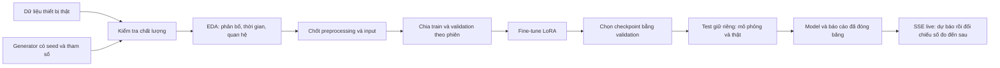

# 08 — Quy trình dữ liệu, phân tích và train AI để có cơ sở báo cáo

Ngày: 14/11/2026. **Thiết kế cần triển khai sau khi review; chưa viết generator, tải model hoặc train trong đợt lập kế hoạch này.** Đọc cùng [07 — Dashboard AI trực tiếp](07-ai-live-dashboard-v2.md).

## 1. Câu hỏi nghiên cứu và thiết kế bài toán

**Bài toán:** từ 60 phút PM2.5 và thông số phòng đã quan sát, dự báo chuỗi PM2.5 trong 30 phút tiếp theo; cập nhật khi thiết bị gửi mẫu mới, khoảng 5 giây/lần.

Đây là dự báo chuỗi thời gian đa biến, có fine-tune foundation model. Không phải chatbot, phân loại hình ảnh hoặc học lại công thức ngưỡng.

| Hạng mục | Định nghĩa |
|---|---|
| Model đã chọn | `amazon/chronos-2`, pretrained 120M, fine-tune LoRA |
| Input target | PM2.5 theo lưới 5 giây, context tối đa 720 bước |
| Input phụ | CO₂, nhiệt độ, độ ẩm, mức quạt thiết bị đã báo; chỉ phần quá khứ |
| Output | 360 giá trị median, mỗi 5 giây, tới +30 phút |
| Mốc đánh giá chính | +5/+15/+30 phút, tức các bước 60/180/360 |
| Tham chiếu thực tế | Số đo PM sensor, không khẳng định là nồng độ tuyệt đối đã được hiệu chuẩn độc lập |
| Sản phẩm | Một chart nối tiếp, một dòng note và ô độ khớp; metadata nghiên cứu nằm ở report |

Các câu hỏi cần trả lời bằng thí nghiệm:

1. Fine-tune có giảm sai số so với pretrained và giữ nguyên giá trị cuối không?
2. CO₂/T/RH/fan có bổ sung thông tin dự báo hay chỉ làm input nhiều hơn?
3. Model sai nhiều nhất khi nguồn bụi thay đổi, quạt đổi mức, dữ liệu thiếu hay môi trường khác tập train?
4. Model có theo kịp nhịp inference 5 giây trên phần cứng thực tế không?

## 2. Luồng từ dữ liệu đến kết quả



Trong thực hiện, split được đánh dấu ngay từ đầu. Chỉ dùng train để quyết định tham số generator/preprocessing; EDA toàn dữ liệu chỉ báo số lượng/chất lượng tổng quan, không dùng phân bố test để chỉnh model cho khớp test.

## 3. Nguồn, schema và provenance

### Dữ liệu thật

Xuất snapshot từ backend với device ID, sample ID, recorded/received timestamps, PM/CO₂/T/RH, flags, actuator reports và các mốc recalibration/config nếu có. Giữ nguồn `real`, timezone UTC trong file; dùng Asia/Ho_Chi_Minh khi vẽ báo cáo.

Sự kiện calibration hoặc thay đổi baseline cảm biến có thể đổi miền số đo. Chia phiên/đánh dấu ranh giới, không nối dữ liệu trước/sau thay đổi thành một đường liên tục rồi coi đó là quy luật phòng. Dữ liệu cũ không có lịch sử calibration phải ghi giới hạn đó, không suy ra sự kiện chắc chắn chỉ từ một bước nhảy PM.

### Schema generator dự kiến

| Trường | Vai trò |
|---|---|
| `source`, `episode_id`, `room_id`, `seed` | Phân biệt mô phỏng, phiên và khả năng tái tạo |
| `timestamp`, `received_at` | Lưới đo 5 giây và mô phỏng trễ nhận |
| `pm25`, `co2`, `temperature`, `humidity` | Các số đo dùng làm input/target khi hợp lệ |
| `fan_level`, `fan_mode`, `actuator_received_at` | Báo cáo quạt và thời điểm thông tin đó sẵn có |
| `dust_fault`, `pm25_saturated`, `missing_reason` | Chất lượng và phần dữ liệu cần bỏ/mask |
| `scenario`, `volume_m3`, `ventilation_rate` | Metadata chia nhóm/giải thích, không mặc định đưa hết vào model |

Biến nội bộ generator như nguồn bụi tương lai, PM tiềm ẩn không nhiễu và lịch can thiệp chưa biết nằm trong file debug riêng. Không đưa chúng vào covariates của model để vô tình cho model biết đáp án.

## 4. Mã sinh dữ liệu train

Các file dự kiến khi triển khai:

```text
ai-service/tools/generate_air_quality.py   sinh từng shard với seed cố định
ai-service/tools/analyze_air_quality.py    tạo data card và hình EDA
ai-service/tools/train_chronos.py          fine-tune và lưu adapter/manifest
ai-service/tools/evaluate_chronos.py       chấm test và xuất biểu đồ
ai-service/configs/air_quality_synthetic.yaml
```

Config chứa số phiên, nhịp 5 giây, seed, khoảng volume/ventilation/source/filter response/noise, tỷ lệ missing/fault, policy quạt và split IDs. Không hardcode dữ liệu đích thành một CSV đẹp mà không tái tạo được.

### Các nhóm kịch bản

| Nhóm | Biến thiên chính | Mục đích học/kiểm định |
|---|---|---|
| Nền ổn định | Nhiễu, trôi chậm | Không bịa xu hướng khi không có tín hiệu |
| Nguồn bụi tăng | Ramp, pulse, nhiều đợt | Học diễn biến tăng và thời gian phản ứng |
| Lọc bụi | Các mức quạt, kickstart/delay mô phỏng | Học thay đổi đường PM theo trạng thái đã quan sát |
| Thông gió/có người | CO₂, nhiệt/ẩm và nguồn biến thiên | Kiểm tra input phụ có thông tin hữu ích |
| Vận hành khác nhau | Quạt theo luật, lịch cố định, can thiệp tay | Tránh chỉ học thuộc một policy điều khiển |
| Lỗi/mất mẫu | Gap, trễ, saturation, fault | Kiểm tra readiness, robustness và chất lượng dữ liệu |

Chọn tham số từ khoảng đã công bố trong config, tham khảo miền số đo train thật nếu có; không lấy test thật để fit generator. Phương trình và đơn vị vật lý tối thiểu theo mục 5 của tài liệu 07. Các hệ số lọc là tham số mô phỏng, không ghi thành CADR đo được của thiết bị.

PM latent vượt dải thì mô phỏng saturation và loại/mask theo contract. Fault/out-of-range không được clip thành một số đo hợp lệ để che lỗi. HEPA không làm giảm CO₂ trong generator.

Quy mô khởi đầu: 2.000 phiên × 24 giờ × 17.280 bước/ngày = **34,56 triệu dòng**. Lưu shard Parquet, generator/loader lazy, thống kê kích thước và số phiên hoàn tất. Sinh ít trước để smoke test, sau đó tăng đúng config.

Không đồng nhất các con số: dòng đã sinh, cửa sổ có thể tạo, cửa sổ thực sự đưa qua optimizer và số tham số được update. Chạy 500 steps không có nghĩa đã duyệt toàn bộ 34,56 triệu dòng; training log phải ghi sampling/batch/gradient accumulation thực tế.

## 5. Kiểm tra và xử lý dữ liệu

1. **Thời gian:** parse UTC, sort, dedup theo identity/payload, nhận diện clock lỗi/future timestamps; tách thời gian đo và thời gian nhận.
2. **Dải giá trị:** cùng bảng validation của `docs/io_contract.md`; null là thiếu mẫu. Lưu số bị loại theo sensor/lý do.
3. **Sampling:** kiểm tra phân bố khoảng cách giữa packets; chuẩn hóa context trên lưới 5 giây kết thúc tại anchor, giữ ID/timestamp của số đo đóng góp.
4. **Nhân quả về thông tin:** một origin chỉ nhìn thấy sample/report đã nhận trước lúc phát hành; gói replay đến muộn không được cải thiện features quá khứ.
5. **Missing:** giữ mask, không fill label, không bù gap dài bằng nội suy qua tương lai. Quy tắc fill nếu dùng chỉ dựa quá khứ và phải giống nhau giữa train/inference.
6. **Actuator:** as-of join bằng thời gian nhận report; ghi tuổi report và khoảng chưa xác định. Command đã gửi chưa đồng nghĩa quạt đã báo thực hiện.
7. **Biến đổi số:** giữ normalization của pipeline Chronos theo context; mọi scaler bổ sung nếu thử phải fit trên train và inverse về µg/m³. Không fit scaler trên test.
8. **Lưu snapshot:** manifest, schema, số dòng, khoảng thời gian, hashes, split membership, code/dependency/model revision.

Inference sẵn sàng hay không dựa trên chất lượng context hiện tại. Việc thiếu nhiều ngày train thật không tự ngăn một pretrained/fine-tuned model nhận context hợp lệ; không bê nguyên cổng dữ liệu của Ridge sang foundation model.

## 6. EDA: phân tích có hình để đưa lên slide

| Hình/bảng bắt buộc | Câu hỏi được trả lời | Điều cần tránh |
|---|---|---|
| Timeline và heatmap coverage | Có bao nhiêu dữ liệu thật, mất ở đâu? | Gọi nhiều ngày lịch là nhiều ngày dữ liệu hợp lệ |
| Histogram/boxplot từng sensor | Miền giá trị, skew, outlier, saturation ra sao? | Xóa mọi đỉnh lớn chỉ để chart đẹp |
| Phân bố khoảng cách packet | Nhịp thực tế có gần 5 giây không? | Đồng nhất SSE nhanh với sensor đo nhanh hơn |
| ACF PM theo lag giây/phút | Quá khứ gần/xa có thông tin đến đâu? | Coi các mẫu 5 giây là độc lập |
| Pearson/Spearman + scatter theo chế độ | Sensor nào liên hệ với PM trong dữ liệu? | Coi tương quan là nguyên nhân |
| Cross-correlation/đường lag | Tín hiệu nào đi trước/sau biến động PM? | Chọn lag đẹp nhất từ test rồi tuyên bố dự báo tốt |
| PM quanh lần đổi mức quạt | Có quan sát được quá trình lọc và độ trễ không? | Suy ra CADR/tiết kiệm điện khi chưa đo |
| Real-vs-synthetic distribution | Simulator giống/khác dữ liệu sensor chỗ nào? | Giấu domain gap bằng cách gộp chung hai nguồn |

Ví dụ rất dễ bị hỏi: PM cao và quạt ON có thể tương quan dương vì **backend bật quạt khi bụi tăng**. Điều đó không chứng minh quạt sinh ra bụi. Phân tích theo thời gian trước/sau hành động, chia theo chế độ và ghi rõ cơ chế feedback.

CO₂ có thể liên quan đến hoạt động/người/thông gió, nhưng quan hệ với PM không cố định. Cần xem dữ liệu, không kể trước một câu chuyện rồi ép correlation plot xác nhận. Một sensor đứng gần như hằng số trong train có thể không đóng góp cho model.

## 7. Chia tập và tạo cửa sổ học

- Synthetic: chia nguyên episode/room/seed, 1.400 train, 300 validation, 300 test. Không để hai cửa sổ chồng lấn từ cùng phiên nằm hai tập.
- Real: train → validation → test theo thời gian; giữ test cuối riêng và tách ranh giới calibration/config/long gap khi có bằng chứng.
- Một mẫu học chuẩn: 720 bước quá khứ → 360 bước tương lai. Label là PM sensor hợp lệ, không phải latent PM không nhiễu chỉ simulator mới biết.
- Không để bất kỳ target nào vượt ranh giới tập của origin. Dữ liệu thật cần purge horizon 30 phút ở ranh giới.
- Train có thể lấy windows stride 12 bước để giảm trùng lặp; inference/live test vẫn thực hiện mỗi 5 giây. Công bố số windows thực được chọn và số optimizer steps.
- Readiness/missing policies thống nhất giữa train/inference. Đánh giá thêm phần model abstain, không chỉ sai số của các đoạn dễ còn lại.
- Test synthetic và real có bảng riêng. Chọn hyperparameters/checkpoint bằng validation; không điều chỉnh theo test đã xem rồi tiếp tục gọi nó là test giữ kín.

## 8. Train và phân tích đóng góp

Cấu hình khởi đầu: Chronos-2 + LoRA r8/alpha16, context720, output360, learning rate `1e-5`, 500 optimizer steps, validation mỗi 100 steps. Batch/cấu hình bộ nhớ theo benchmark 4 GB tại tài liệu 07. Đây là fine-tune adapter, không pretrain model từ đầu.

Log: train/validation loss, MAE theo horizon, số mẫu hợp lệ, thời gian, VRAM/RAM, số tham số toàn model và số tham số trainable thực tế. Lưu adapter, base revision, config, preprocessing và seed.

Thí nghiệm tối thiểu:

| So sánh | Mục đích |
|---|---|
| Giữ nguyên số đo cuối | Đối chứng dễ hiểu và thường mạnh khi không khí ít biến động |
| Chronos pretrained | Đo giá trị có sẵn của foundation model |
| Chronos fine-tuned | Đo phần fine-tune có đóng góp gì |
| PM-only / thêm CO₂-T-RH / thêm fan | Ablation để kiểm tra nhóm input |

Ablation dùng cùng split, origins và ngân sách windows học có thể so sánh, không gán lợi ích cho input chỉ vì một model được train lâu hơn. Chỉ dùng kết quả validation để chốt nhóm input cho model báo cáo; khi đã chốt mới chấm test cuối.

Không gắn input nhiều hơn với tốt hơn. Nếu một nhóm không giúp hoặc làm tệ hơn, ghi kết quả và chọn phương án phù hợp.

## 9. Đánh giá và đầu ra phục vụ slide

Sai số chính: MAE, RMSE tại 5/15/30 phút; thêm sai số toàn đường 360 bước và tỷ lệ trong dung sai ±5 µg/m³. Báo số điểm, coverage/abstention, nguồn và model version. Các windows chồng lấn cần được phân tích theo phiên/block thời gian, không báo p-value như hàng triệu mẫu độc lập.

Live: dự báo phải được lưu trước target. Đối chiếu từng mốc theo quy tắc timestamp/dung sai ở tài liệu 07; quá khứ không được vẽ lại bằng forecast vừa tạo sau khi đã biết kết quả.

Phân nhóm error: PM thấp/cao, nền ổn định/đang tăng, fan OFF/ON/đổi mức, dữ liệu đủ/thiếu, simulator/real. Nhìn riêng các lần spike, không chỉ trung bình trên đoạn phẳng.

Đo thời gian: sensor→backend, backend→SSE UI, model inference, sample mới→forecast mới. Benchmark 10 phút liên tục với input 5 giây, đo P50/P95, VRAM và số yêu cầu bị coalesce; nếu không theo kịp thì chưa đạt tính năng real-time đề xuất.

Gói kết quả dự kiến:

```text
reports/ai-run-<id>/
  manifest.json              source, split, seed, code/model revision và hashes
  data-card.json             raw/valid/missing rows, episodes, windows và thời lượng
  preprocessing-report.json  duplicate, clock, out-of-range, gap và exclusions
  eda/                       coverage, distributions, ACF, correlations, fan episodes
  training/                  config, loss curves, adapter, trainable-parameter count
  evaluation/                pretrained/fine-tuned/baseline, ablation, residuals
  live/                      issued forecasts, matched actuals, metrics, latency
  figures/                   SVG/PNG dùng được cho slide
  conclusions.md             kết quả, giới hạn và điều gì chưa kiểm chứng
```

## 10. Bốn slide đủ kể quy trình AI

1. **Dữ liệu và xử lý:** real/synthetic, nhịp 5 giây, coverage, loại lỗi, context720→future360.
2. **Phân tích và chọn input:** một correlation/lag plot và một phiên fan/PM; giải thích feedback và giới hạn tương quan.
3. **Model và fine-tune:** pretrained Chronos-2, LoRA, split theo phiên/thời gian, loss/validation và ablation.
4. **Kết quả và demo:** một chart nối tiếp, forecast cũ so với actual, sai số/dung sai/số mẫu, latency theo nhịp 5 giây.

Nếu fine-tune chưa thắng, trình bày kết quả đó và dùng phương án validation chọn được. Tính đúng quy trình là cơ sở giải thích; không cần bày toàn bộ bảng nghiên cứu lên dashboard.
