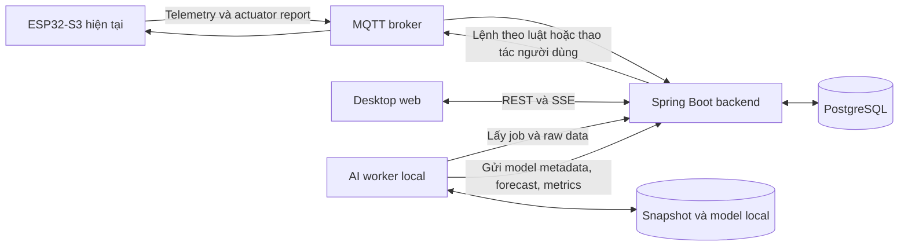

# Kế hoạch nâng cấp Air Quality Supervision System

Ngày lập: 14/11/2026. **Đọc [07 — AI trên chart trực tiếp](07-ai-live-dashboard-v2.md) trước: đây là hướng mới đang review, chưa triển khai.**

Bộ 01–06 là kế hoạch gốc, nhiều phần đã được triển khai. Tài liệu 07 thay hướng AI/màn hình chính: một chart thực đo–dự báo, SSE, ô độ khớp và foundation model fine-tune; bỏ Trung tâm AI khỏi luồng người dùng. Các mục cũ mâu thuẫn với 07 được giữ làm lịch sử quyết định. Đợt cập nhật kế hoạch này không sửa firmware, backend, frontend, database hay slide.

## 1. Kết quả cần đạt

Chuyển từ dashboard theo dõi và điều khiển theo ngưỡng sang hệ thống có dự báo học từ dữ liệu thật, cảnh báo sớm, đề xuất hành động và trang đánh giá có thể kiểm tra lại.

Khi báo cáo, phải trả lời được bằng số liệu:

1. Dự báo PM2.5 tốt hơn giữ nguyên số đo cuối bao nhiêu, ở mốc 5/15/30 phút?
2. Cảnh báo sớm được bao lâu; có bao nhiêu lần đúng, bỏ sót và báo nhầm?
3. Người dùng đã làm gì sau đề xuất, và diễn biến thực đo sau hành động ra sao?
4. Model được train từ dữ liệu nào, có bao nhiêu mẫu hợp lệ, đã kiểm định thế nào?

Hướng model mới là Chronos-2 pretrained và fine-tune LoRA, với dữ liệu tổng hợp có thể dùng để luyện. Kết quả mô phỏng và kết quả đối chiếu sensor thật phải có nguồn riêng; không trộn hai loại thành một phần trăm độ chính xác.

## 2. Các quyết định đã chốt

| Hạng mục | Quyết định |
|---|---|
| Thời gian | Phiên bản chính trong 3–7 ngày; thu dữ liệu song song từ ngày đầu |
| Dữ liệu | Sensor thật cho live/đối chiếu; thêm dữ liệu tổng hợp cho fine-tune và kịch bản demo riêng |
| Embedded | Giữ firmware và MQTT wire format hiện tại trong phiên bản chính |
| Backend | Tiếp tục Spring Boot/PostgreSQL; nâng chất lượng dữ liệu và bổ sung API cho AI |
| AI | Chronos-2 120M + LoRA local; benchmark trên RTX 3050 4 GB trước khi chốt cấu hình |
| Quyền AI | Dự báo, cảnh báo, đề xuất; không tự vượt quyền điều khiển của backend |
| Frontend | Desktop, một chart chia quá khứ/tương lai, note AI một dòng, panel độ khớp; bỏ Trung tâm AI khỏi điều hướng |
| Bảng thông số | Nâng cả cách lưu trong database và cách trình bày/lọc/so sánh trên web |
| Giao tiếp AI | Worker outbound đến backend; backend đẩy dữ liệu tới trình duyệt qua SSE |
| Bằng chứng | Baseline, test theo thời gian, forecast phát hành trước ground truth, thí nghiệm có nhật ký |
| Tên hiển thị | Dùng đầy đủ **Air Quality Supervision System** trong tài liệu, giao diện và slide |

Các identifier, package, topic và tên file cũ có chữ viết tắt được giữ để không phá tương thích.

## 3. Thứ tự đọc

| Tài liệu | Quyết định cần review |
|---|---|
| [07 — AI trên chart trực tiếp](07-ai-live-dashboard-v2.md) | **Ưu tiên mới:** SSE, chart thực đo/dự báo, độ khớp, Chronos-2/LoRA và dữ liệu tổng hợp |
| [08 — Dữ liệu, phân tích và train AI](08-ai-data-analysis-and-training.md) | Generator 5 giây, EDA, quan hệ/độ trễ, split, LoRA, ablation và bộ kết quả làm slide |
| [09 — Bước 3 đã đo](09-step3-benchmark-and-training.md) | Benchmark Chronos-2 thật, dữ liệu tổng hợp, kết quả fine-tune và điều chưa kiểm chứng |
| [10 — Bước 4 đã làm](10-step4-forecast-path-and-worker.md) | `forecast_paths`, worker Chronos + cache gia tăng, chart 360 bước và lỗi tìm được |
| [01 — Đánh giá hệ thống hiện tại](01-current-system-audit.md) | Giữ gì, sửa gì, code hiện tại thực sự làm được gì |
| [02 — Backend và dữ liệu](02-backend-and-data.md) | Schema, nguồn dữ liệu, command lifecycle, API và kiến trúc cloud/local |
| [03 — Service AI](03-ai-service.md) | Features, labels, thuật toán, tự train, inference, lựa chọn model |
| [04 — Đánh giá và thí nghiệm](04-evaluation-and-experiments.md) | Phép đo, tránh leakage, đối chứng, cách kết luận từ dữ liệu |
| [05 — Desktop web](05-desktop-web.md) | Các màn hình, wireframe, bảng thông số và tương tác |
| [06 — Triển khai và báo cáo](06-delivery-and-report.md) | Thứ tự công việc, test, chạy demo và nội dung slide |

Review 07 → 08 trước; tham khảo 01/02 cho phần code nền giữ lại. Một chart duy nhất nối thực đo với dự báo, cập nhật và tính lại khi có gói 5 giây; các lịch inference một phút và yêu cầu trang Trung tâm AI/model sklearn chính ở kế hoạch cũ đã bị thay thế.

## 4. Kiến trúc đích

Backend cloud không truy cập `localhost` trên laptop. Worker mở kết nối outbound đến backend, vì vậy không cần public port hoặc tunnel vào máy cá nhân. Giao diện vẫn đọc được kết quả đã lưu khi laptop tắt, nhưng phải báo forecast đã cũ và worker offline.

AI không nằm trên đường xử lý bắt buộc của telemetry/control. Tắt AI không được làm mất chức năng đo, điều khiển theo ngưỡng, pair thiết bị hoặc chỉnh cấu hình.

## 5. Định nghĩa hoàn thành

- [ ] Giữ các chức năng đo và điều khiển hiện tại hoạt động.
- [ ] Lưu được dữ liệu gốc, actuator history, cấu hình và sự kiện có timestamp.
- [ ] Train một mô hình trên dữ liệu node thật, lưu artifact và manifest để chạy lại.
- [ ] Dự báo định kỳ không train lại theo request của trình duyệt.
- [ ] Có bảng so persistence, Ridge và model ứng viên trên cùng khoảng đánh giá.
- [ ] Lưu forecast trước khi target xảy ra và đối chiếu với số đo đến sau.
- [ ] Có cảnh báo, phản hồi đề xuất, biểu đồ và export phục vụ slide.
- [ ] Có demo desktop hoàn chỉnh ở 1440×900 và 1280×800.
- [ ] Phân biệt kết quả đo được, mục tiêu chưa đạt và giả thuyết cần thu thêm dữ liệu.

## 6. Ranh giới phiên bản đầu

Chưa đưa vào cam kết 7 ngày: deep learning, chatbot, dự báo đa phòng từ một node, tự tối ưu điều khiển bằng reinforcement learning, tính điện năng khi không có công suất đo, hoặc suy ra tuổi thọ HEPA từ runtime như một phép đo chính xác.

Ngưỡng theo hồ sơ phòng tiếp tục là chính sách tính bằng công thức. Dự báo PM2.5 là phần học máy. Đề xuất hành động là quy tắc sử dụng forecast; tài liệu và giao diện phải nói rõ sự khác nhau.

[Hợp đồng hiện tại](../io_contract.md) vẫn là nguồn chính thức cho hệ thống đang chạy. Khi triển khai, cập nhật hợp đồng trước các thay đổi liên tầng; các contract trong bộ kế hoạch này là đề xuất cho phiên bản tiếp theo.
